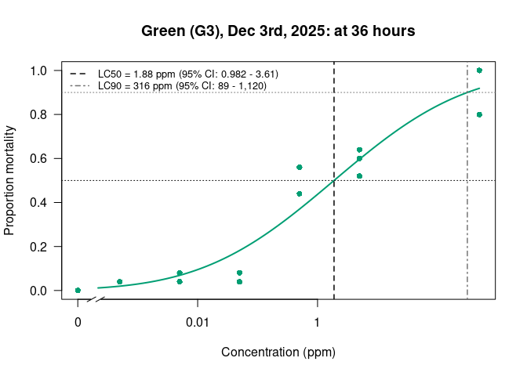
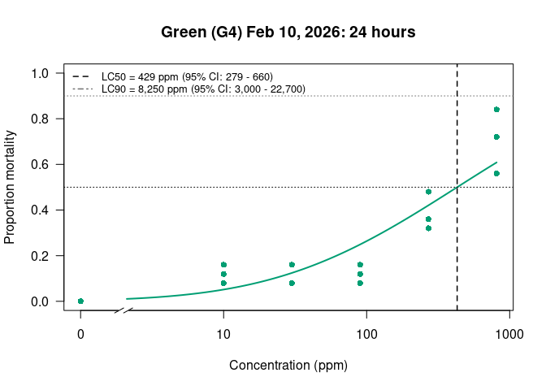
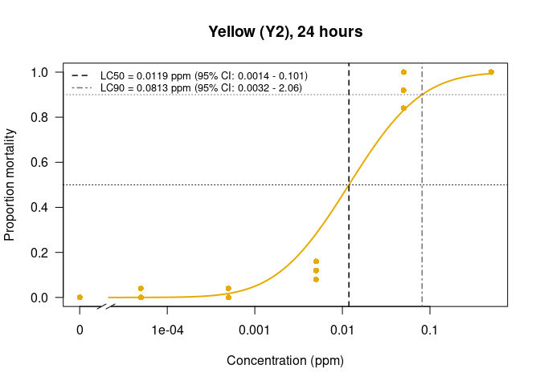
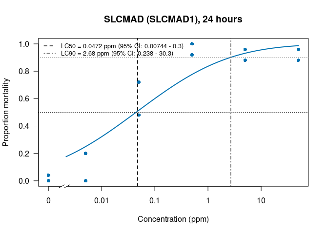
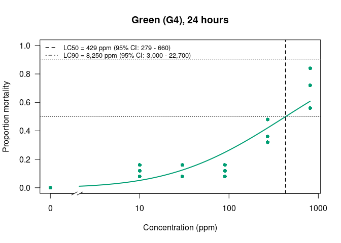
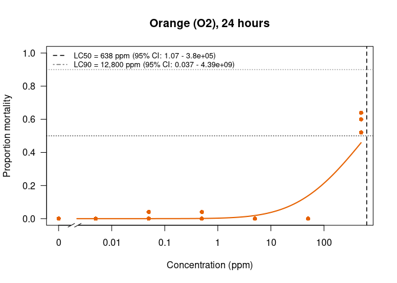
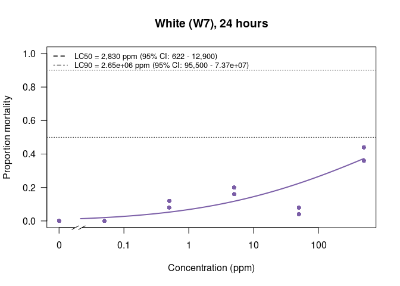
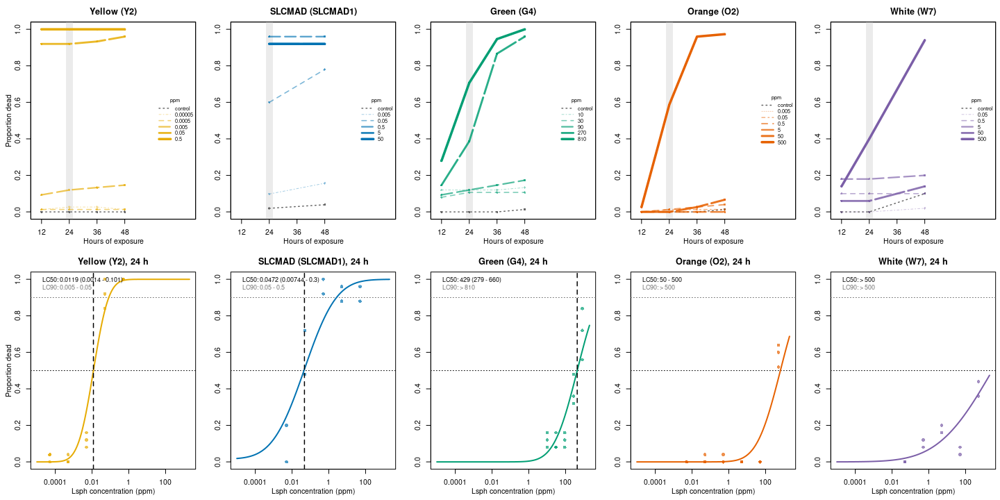

Alina’s Bioassays Probit - LC50 and LC90
================
Norah Saarman
2026-10-21

- [Overview](#overview)
- [Helper functions](#helper-functions)
  - [Entering data](#entering-data)
  - [Formatting numbers](#formatting-numbers)
  - [Mortality and brackets](#mortality-and-brackets)
  - [Fitting the probit](#fitting-the-probit)
  - [Deciding what to report](#deciding-what-to-report)
  - [One-row summary per assay](#one-row-summary-per-assay)
  - [Plotting](#plotting)
- [Data](#data)
  - [Green](#green)
  - [White](#white)
  - [Orange](#orange)
  - [Yellow](#yellow)
  - [SLCMAD](#slcmad)
  - [Early protocol (Oct - Nov 2025)](#early-protocol-oct---nov-2025)
  - [Combine into one table](#combine-into-one-table)
- [Single-assay examples](#single-assay-examples)
  - [Green (G3), Dec 3rd, 2025: at 36
    hours](#green-g3-dec-3rd-2025-at-36-hours)
  - [Green (G4) Feb 10, 2026: 24 hours](#green-g4-feb-10-2026-24-hours)
    - [Dropping low doses](#dropping-low-doses)
- [All assays](#all-assays)
- [Best assay per colony (24 hours)](#best-assay-per-colony-24-hours)
  - [Resistance ratios](#resistance-ratios)
  - [Dose-response curves](#dose-response-curves)
  - [Dose-response panel](#dose-response-panel)
- [Summary table](#summary-table)

RStudio Configuration: - **R version:** R 4.4.0 (Geospatial packages)  
- **Number of cores:** 1 (up to 32 available)  
- **Account:** saarman-np  
- **Partition:** saarman-np (now auto allows multiple simultaneous jobs)

# Overview

Lysinibacillus sphaericus (VectoLex) larval bioassays from *Insectary
Schedule and Results.xlsx*, run on five colonies: Green, White, Orange,
Yellow and SLCMAD.

**Model.** Probit on log-concentration, fitted with
`drm(dead/total ~ conc, fct = LN.2(), type = "binomial")`. When any
control larvae died, the control (natural) mortality is estimated in the
same model (`LN.4` with the upper limit fixed at 1). This gives
Abbott-corrected LC values, so we don’t have to drop low doses by hand.

**Confidence intervals.** 95% CIs are calculated on the log scale, so
they can’t go below zero. When cups vary more than a binomial model
expects (Pearson chi-square test p \< 0.05), the CIs are widened by the
heterogeneity factor.

**When a probit isn’t trustworthy.** Every assay also gets a *bracket*
read straight from the corrected mortalities. For example, no mortality
at 0.005 ppm and 92% at 0.05 ppm gives “LC90 between 0.005 and 0.05
ppm”. The fitted value is reported only when:

- at least 2 doses gave partial mortality (between 5% and 95%),
- the estimate falls inside the tested concentration range, and
- the CI spans less than 100-fold.

Otherwise the bracket is reported, with the fitted value shown as
approximate.

# Helper functions

## Entering data

Each call to `enter_assay()` is one assay at one time point. Give the
concentrations, then one vector of **survivors** per replicate cup, in
the same order as the concentrations.

``` r
bioassay_rows <- list()
 
enter_assay <- function(assay, colony, date, hours, conc, ...,
                        larvae_per_cup = 25, protocol = "current", note = "") {
  replicates <- list(...)
  for (i in seq_along(replicates)) {
    stopifnot(length(replicates[[i]]) == length(conc))
    bioassay_rows[[length(bioassay_rows) + 1]] <<- data.frame(
      assay, colony, date, hours, protocol, note, larvae_per_cup,
      rep       = i,
      cup       = seq_along(conc),
      conc      = conc,
      survivors = replicates[[i]]
    )
  }
}
```

## Formatting numbers

``` r
# Three significant figures, no scientific notation for normal-sized numbers
fmt <- function(x) {
  x <- unname(x)
  if (length(x) == 0 || is.na(x)) return(NA_character_)
  format(signif(x, 3), scientific = abs(x) >= 1e5,
         drop0trailing = TRUE, big.mark = ",")
}
```

## Mortality and brackets

``` r
# Proportion of control larvae that died
control_mortality <- function(d) {
  controls <- filter(d, conc == 0)
  sum(controls$dead) / sum(controls$total)
}
 
# Pool replicates at each concentration and apply Abbott's correction
mortality_by_conc <- function(d) {
  cm <- control_mortality(d)
  d %>%
    filter(conc > 0) %>%
    group_by(conc) %>%
    summarise(dead = sum(dead), total = sum(total), .groups = "drop") %>%
    mutate(mortality = dead / total,
           corrected = pmin(pmax((mortality - cm) / (1 - cm), 0), 1))
}
 
# Bracket for LC at level q (0.5 or 0.9), e.g. "50 - 500", "< 0.05", "> 810"
bracket_lc <- function(mort_table, q) {
  first_at_or_above <- which(mort_table$corrected >= q)[1]
  if (is.na(first_at_or_above)) {
    return(paste(">", fmt(max(mort_table$conc))))   # never reached q
  }
  if (first_at_or_above == 1) {
    return(paste("<", fmt(min(mort_table$conc))))   # reached q at lowest dose
  }
  paste(fmt(mort_table$conc[first_at_or_above - 1]), "-",
        fmt(mort_table$conc[first_at_or_above]))
}
 
# Number of doses with partial mortality (5% - 95%)
count_partial_doses <- function(mort_table) {
  sum(mort_table$corrected > 0.05 & mort_table$corrected < 0.95)
}
```

## Fitting the probit

``` r
# Safe wrapper: if anything in the fit fails (e.g. mortality jumps from 0% to
# 100% between two doses, so the slope can't be estimated), return NULL and
# the assay is reported by its bracket instead.
fit_probit <- function(d) {
  tryCatch(fit_probit_unsafe(d), error = function(e) {
    message("Probit not estimable for ", d$assay[1], " at ", d$hours[1],
            " h (", conditionMessage(e), "); using bracket.")
    NULL
  })
}
 
fit_probit_unsafe <- function(d) {
  has_control_deaths <- sum(d$dead[d$conc == 0]) > 0
 
  # 1. Fit: plain LN.2, or LN.4 with natural mortality if controls died
  model <- tryCatch({
    if (has_control_deaths) {
      drm(dead / total ~ conc, weights = total, data = d, type = "binomial",
          fct    = LN.4(fixed = c(NA, NA, 1, NA)),   # b, c (control), d = 1, e
          lowerl = c(-Inf, 0,   1e-10),
          upperl = c( Inf, 0.5, Inf))
    } else {
      drm(dead / total ~ conc, weights = total, data = d, type = "binomial",
          fct = LN.2())
    }
  }, error = function(e) NULL)
  if (is.null(model)) return(NULL)
 
  # 2. Goodness of fit across cups (Pearson chi-square)
  # (fitted() rather than predict(): predict() needs the covariance matrix,
  #  which doesn't exist when the slope can't be estimated)
  p_hat <- fitted(model)
  p_hat <- pmin(pmax(p_hat, 1e-9), 1 - 1e-9)
  chi2  <- sum((d$dead - d$total * p_hat)^2 / (d$total * p_hat * (1 - p_hat)))
  df    <- nrow(d) - length(coef(model))
  het_p <- if (df > 0) pchisq(chi2, df, lower.tail = FALSE) else NA
 
  # Heterogeneity factor widens the CI only when the fit is poor
  het_factor <- if (!is.na(het_p) && het_p < 0.05) chi2 / df else 1
  z <- if (het_factor > 1) qt(0.975, df) else qnorm(0.975)
 
  # 3. LC50 and LC90 with 95% CI on the log scale
  ed <- tryCatch(ED(model, c(50, 90), interval = "none", display = FALSE),
                 error = function(e) NULL)
  if (is.null(ed)) return(NULL)
 
  estimate <- ed[, "Estimate"]
  se_log   <- ed[, "Std. Error"] * sqrt(het_factor) / estimate
 
  list(
    model = model,
    slope = abs(coef(model)[1]),
    het_p = het_p,
    lc = data.frame(
      level    = c("LC50", "LC90"),
      estimate = estimate,
      lower    = exp(log(estimate) - z * se_log),
      upper    = exp(log(estimate) + z * se_log),
      row.names = NULL
    )
  )
}
```

## Deciding what to report

``` r
# Returns the text to report for one LC level, and why
report_lc <- function(fit, mort_table, level, conc_range) {
  q       <- if (level == "LC50") 0.5 else 0.9
  bracket <- bracket_lc(mort_table, q)
  if (is.null(fit)) {
    return(c(text = bracket, basis = "bracket (no fit)"))
  }
 
  row <- fit$lc[fit$lc$level == level, ]
  if (!is.finite(row$estimate) || !is.finite(row$lower)) {
    return(c(text = bracket, basis = "bracket (fit unstable)"))
  }
 
  enough_partials <- count_partial_doses(mort_table) >= 2
  inside_range    <- row$estimate >= conc_range[1] && row$estimate <= conc_range[2]
  ci_reasonable   <- is.finite(row$upper) && row$upper / row$lower < 100
 
  if (enough_partials && inside_range && ci_reasonable) {
    text <- paste0(fmt(row$estimate), " (", fmt(row$lower), " - ", fmt(row$upper), ")")
    return(c(text = text, basis = "probit"))
  }
 
  reasons <- c(if (!enough_partials) "<2 partial doses",
               if (!inside_range)    "probit extrapolated",
               if (inside_range && !ci_reasonable) "CI very wide")
  c(text  = paste0(bracket, "  [probit ~", fmt(row$estimate), "]"),
    basis = paste("bracket:", paste(reasons, collapse = ", ")))
}
```

## One-row summary per assay

``` r
summarise_assay <- function(d) {
  mort_table <- mortality_by_conc(d)
  conc_range <- range(mort_table$conc)
  cm         <- control_mortality(d)
  n_partial  <- count_partial_doses(mort_table)
  fit        <- if (n_partial >= 1) fit_probit(d) else NULL
 
  lc50 <- report_lc(fit, mort_table, "LC50", conc_range)
  lc90 <- report_lc(fit, mort_table, "LC90", conc_range)
  get_lc <- function(level, column) {
    if (is.null(fit)) NA else signif(fit$lc[fit$lc$level == level, column], 4)
  }
 
  tibble(
    reps          = n_distinct(d$rep),
    conc_tested   = paste(fmt(conc_range[1]), "-", fmt(conc_range[2])),
    control_mort  = round(cm, 2),
    partial_doses = n_partial,
    LC50          = lc50["text"],
    LC50_basis    = lc50["basis"],
    LC90          = lc90["text"],
    LC90_basis    = lc90["basis"],
    LC50_fit = get_lc("LC50", "estimate"),
    LC50_lo  = get_lc("LC50", "lower"),
    LC50_hi  = get_lc("LC50", "upper"),
    LC90_fit = get_lc("LC90", "estimate"),
    LC90_lo  = get_lc("LC90", "lower"),
    LC90_hi  = get_lc("LC90", "upper"),
    slope    = if (is.null(fit)) NA else round(fit$slope, 2),
    het_p    = if (is.null(fit)) NA else signif(fit$het_p, 3),
    flags = paste(c(
      if (d$protocol[1] == "early") "early protocol (not comparable)",
      if (cm > 0.2) "control mortality > 20%",
      if (d$assay[1] == "W3") "TA flagged as untrustworthy"
    ), collapse = "; ")
  )
}
```

## Plotting

``` r
# Colony colors (points and fitted curve). White is shown in purple so it is
# visible on a white background; Yellow is a darker gold for the same reason.
colony_colors <- c(Green  = "#009E73",
                   Yellow = "#E6AB02",
                   White  = "#7B5EA7",
                   Orange = "#E66100",
                   SLCMAD = "#0072B2")
 
# LC lines are neutral so they never clash with a colony color;
# LC50 vs LC90 is told apart by shade and line type.
lc_colors <- c(LC50 = "black", LC90 = "grey45")
lc_lty    <- c(LC50 = 2,       LC90 = 4)          # dashed, dot-dash
 
plot_probit <- function(fit, title, col = "grey30") {
  lc <- fit$lc
  plot(fit$model, log = "x", type = "all", broken = TRUE, ylim = c(0, 1),
       col = col, pch = 16, lwd = 2,
       xlab = "Concentration (ppm)",
       ylab = "Proportion mortality",
       main = title)
 
  # Horizontal reference lines at 50% and 90%
  abline(h = c(0.5, 0.9), col = lc_colors, lty = 3)
 
  # Vertical LC50 and LC90 lines
  abline(v = lc$estimate, col = lc_colors, lty = lc_lty, lwd = 1.5)
 
  # Estimates and 95% CIs in the legend
  legend("topleft",
         legend = sprintf("%s = %s ppm (95%% CI: %s - %s)",
                          lc$level, sapply(lc$estimate, fmt),
                          sapply(lc$lower, fmt), sapply(lc$upper, fmt)),
         col = lc_colors, lty = lc_lty, lwd = 1.5, bty = "n", cex = 0.8)
}
```

# Data

Survivors per cup, transcribed from *Insectary Schedule and
Results.xlsx*. Corrections to the spreadsheet are noted next to each
assay.

## Green

``` r
# G3: the column labelled 50 ppm was actually 5 ppm (protocol error), so 5 appears twice
enter_assay("G3", "Green", "2025-12-03", hours = 24,
  conc = c( 0, 0.0005, 0.005, 0.05, 0.5,  5,  5, 500),
  rep1 = c(25,     24,    24,   24,  12, 12, 10,  13),
  rep2 = c(25,     24,    24,   24,  14,  9,  9,   7),
  note = "'50 ppm' was 5 ppm")
enter_assay("G3", "Green", "2025-12-03", hours = 36,
  conc = c( 0, 0.0005, 0.005, 0.05, 0.5,  5,  5, 500),
  rep1 = c(26,     24,    23,   24,  11, 12, 10,   5),
  rep2 = c(25,     24,    24,   23,  14,  9,  9,   0),
  note = "'50 ppm' was 5 ppm")
enter_assay("G3", "Green", "2025-12-03", hours = 48,
  conc = c( 0, 0.0005, 0.005, 0.05, 0.5,  5,  5, 500),
  rep1 = c(26,     24,    23,   24,  11, 12,  9,   4),
  rep2 = c(24,     24,    24,   23,  14,  9,  9,   0),
  note = "'50 ppm' was 5 ppm")
 
enter_assay("G4", "Green", "2026-02-10", hours = 24,
  conc = c( 0, 10, 30, 90, 270, 810),
  rep1 = c(25, 21, 23, 23,  13,  11),
  rep2 = c(25, 22, 23, 22,  16,   4),
  rep3 = c(25, 23, 21, 21,  17,   7))
enter_assay("G4", "Green", "2026-02-10", hours = 48,
  conc = c( 0, 10, 30, 90, 270, 810),
  rep1 = c(25, 20, 23, 21,   0,   0),
  rep2 = c(25, 22, 23, 20,   2,   0),
  rep3 = c(24, 23, 21, 21,   1,   0))
 
enter_assay("G5", "Green", "2026-06-02", hours = 24,
  conc = c( 0, 0.05, 0.5,  5, 50, 500),
  rep1 = c(25,   25,  21, 19, 17,   9),
  rep2 = c(25,   25,  21, 15, 20,   9),
  rep3 = c(24,   25,  18, 19, 15,  14))
enter_assay("G5", "Green", "2026-06-02", hours = 48,
  conc = c( 0, 0.05, 0.5,  5, 50, 500),
  rep1 = c(21,   18,  20, 18, 10,   0),
  rep2 = c(25,   18,  19, 15, 20,   2),
  rep3 = c(22,   22,  14, 19, 15,   0))
 
# G7: concentrations from the count table; the sheet's proportion table is shifted one column
enter_assay("G7", "Green", "2026-09-14", hours = 24,
  conc = c( 0, 0.5,  5, 50, 500),
  rep1 = c(25,  24, 24, 25,  10),
  rep2 = c(25,  25, 25, 24,   8),
  rep3 = c(25,  25, 25, 25,   7))
enter_assay("G7", "Green", "2026-09-14", hours = 48,
  conc = c( 0, 0.5,  5, 50, 500),
  rep1 = c(25,  24, 24, 24,   0),
  rep2 = c(25,  25, 25, 24,   2),
  rep3 = c(25,  24, 24, 25,   0))
```

## White

``` r
# W3: '50 ppm' was 5 ppm; TA noted heavy pupation and "would not trust"
enter_assay("W3", "White", "2026-01-27", hours = 24,
  conc = c( 0, 0.0005, 0.005, 0.05, 0.5,  5,  5, 500),
  rep1 = c(21,     23,    23,   23,  22, 24, 22,   5),
  rep2 = c(23,     25,    22,   23,  20, 23, 22,   6),
  note = "'50 ppm' was 5 ppm; untrustworthy")
enter_assay("W3", "White", "2026-01-27", hours = 48,
  conc = c( 0, 0.0005, 0.005, 0.05, 0.5,  5,  5, 500),
  rep1 = c(18,     20,    21,   22,  21, 18, 17,   0),
  rep2 = c(22,     24,    22,   22,  15, 18, 20,   0),
  note = "'50 ppm' was 5 ppm; untrustworthy")
 
# W4: 22 larvae per cup, no mortality at all (sheet year says 2025, likely 2026)
enter_assay("W4", "White", "2026-04-30", hours = 24, larvae_per_cup = 22,
  conc = c( 0, 0.0001, 0.001, 0.01, 0.1,  1),
  rep1 = c(22,     22,    22,   22,  22, 22),
  rep2 = c(22,     22,    22,   22,  22, 22))
enter_assay("W4", "White", "2026-04-30", hours = 48, larvae_per_cup = 22,
  conc = c( 0, 0.0001, 0.001, 0.01, 0.1,  1),
  rep1 = c(22,     22,    22,   22,  22, 22),
  rep2 = c(22,     22,    22,   22,  22, 22))
 
enter_assay("W5", "White", "2026-05-12", hours = 24,
  conc = c( 0, 0.0005, 0.005, 0.05, 0.5,  5, 50, 500),
  rep1 = c(25,     25,    25,   25,  25, 25, 25,   3),
  rep2 = c(25,     25,    25,   25,  25, 25, 25,   0))
enter_assay("W5", "White", "2026-05-12", hours = 48,
  conc = c( 0, 0.0005, 0.005, 0.05, 0.5,  5, 50, 500),
  rep1 = c(24,     25,    25,   25,  24, 25, 23,   0),
  rep2 = c(25,     22,    25,   25,  25, 25, 25,   0))
 
enter_assay("W6", "White", "2026-06-02", hours = 24,
  conc = c( 0, 0.0005, 0.005, 0.05, 0.5,  5),
  rep1 = c(25,     25,    25,   25,  25, 25),
  rep2 = c(25,     25,    25,   25,  25, 25),
  rep3 = c(25,     25,    25,   25,  25, 25))
enter_assay("W6", "White", "2026-06-02", hours = 48,
  conc = c( 0, 0.0005, 0.005, 0.05, 0.5,  5),
  rep1 = c(25,     25,    25,   24,  25, 25),
  rep2 = c(25,     25,    24,   25,  25, 25),
  rep3 = c(25,     25,    25,   25,  25, 25))
 
enter_assay("W7", "White", "2026-06-08", hours = 24,
  conc = c( 0, 0.05, 0.5,  5, 50, 500),
  rep1 = c(25,   25,  23, 20, 24,  16),
  rep2 = c(25,   25,  22, 21, 23,  14))
enter_assay("W7", "White", "2026-06-08", hours = 48,
  conc = c( 0, 0.05, 0.5,  5, 50, 500),
  rep1 = c(25,   25,  23, 19, 23,   1),
  rep2 = c(20,   24,  22, 21, 20,   2))
```

## Orange

``` r
enter_assay("O2", "Orange", "2026-07-06", hours = 24,
  conc = c( 0, 0.005, 0.05, 0.5,  5, 50, 500),
  rep1 = c(25,    25,   25,  25, 25, 25,   9),
  rep2 = c(25,    25,   25,  25, 25, 25,  12),
  rep3 = c(25,    25,   24,  24, 25, 25,  10))
enter_assay("O2", "Orange", "2026-07-06", hours = 48,
  conc = c( 0, 0.005, 0.05, 0.5,  5, 50, 500),
  rep1 = c(25,    25,   25,  25, 25, 22,   1),
  rep2 = c(25,    25,   25,  25, 25, 23,   0),
  rep3 = c(24,    25,   24,  22, 25, 25,   1))
```

## Yellow

``` r
# Y1: Green concentration series used by mistake; taken down at 24 h.
# Rep 1 had a missing cell, filled from the sheet's proportion table.
enter_assay("Y1", "Yellow", "2026-09-07", hours = 24,
  conc = c( 0, 0.05, 0.5, 5, 50, 500),
  rep1 = c(25,    0,   0, 1,  0,   0),
  rep2 = c(25,    2,   0, 0,  0,   0),
  rep3 = c(25,    2,   0, 0,  0,   0),
  note = "Green conc series by mistake")
 
# Y2: September 8, 2026
enter_assay("Y2", "Yellow", "2026-09-08", hours = 24,
  conc = c( 0, 0.00005, 0.0005, 0.005, 0.05, 0.5),
  rep1 = c(26,      24,     25,    23,    0,   0),
  rep2 = c(25,      25,     24,    21,    4,   0),
  rep3 = c(25,      24,     25,    22,    2,   0))
enter_assay("Y2", "Yellow", "2026-09-08", hours = 48,
  conc = c( 0, 0.00005, 0.0005, 0.005, 0.05, 0.5),
  rep1 = c(26,      24,     25,    21,    0,   0),
  rep2 = c(25,      25,     24,    21,    2,   0),
  rep3 = c(25,      25,     25,    22,    1,   0))
```

## SLCMAD

``` r
enter_assay("SLCMAD1", "SLCMAD", "2026-05-26", hours = 24,
  conc = c( 0, 0.005, 0.05, 0.5, 5, 50),
  rep1 = c(26,    26,   13,   2, 1,  1),
  rep2 = c(24,    20,    7,   0, 3,  3))
enter_assay("SLCMAD1", "SLCMAD", "2026-05-26", hours = 48,
  conc = c( 0, 0.005, 0.05, 0.5, 5, 50),
  rep1 = c(26,    25,    8,   2, 1,  1),
  rep2 = c(23,    18,    3,   0, 3,  3))
```

## Early protocol (Oct - Nov 2025)

These used a much lower concentration series, and the results don’t line
up with any later assay. G1 and W1 killed most larvae at 0.0025 ppm,
about five orders of magnitude below later Green and White results, and
control mortality reached 36-55%. They are kept for the record but not
used for the best estimates.

``` r
enter_assay("G1", "Green", "2025-10-08", hours = 24, protocol = "early",
  conc = c( 0, 0.0025, 0.025),
  rep1 = c(24,      3,     9),
  rep2 = c(24,      3,     4),
  rep3 = c(23,      3,     5),
  note = "Conc headers disagree within sheet")
enter_assay("G1", "Green", "2025-10-08", hours = 48, protocol = "early",
  conc = c( 0, 0.0025, 0.025),
  rep1 = c( 5,      0,     0),
  rep2 = c(23,      0,     0),
  rep3 = c(20,      1,     0))
 
enter_assay("W1", "White", "2025-10-16", hours = 24, protocol = "early",
  conc = c( 0, 0.00025, 0.001, 0.0025, 0.01),
  rep1 = c(18,      14,    11,     13,    0),
  rep2 = c(22,      11,    20,     19,    0),
  rep3 = c(13,      17,    11,      7,    1),
  note = "Not fed for first 12-24 h")
enter_assay("W1", "White", "2025-10-16", hours = 48, protocol = "early",
  conc = c( 0, 0.00025, 0.001, 0.0025, 0.01),
  rep1 = c(14,       0,     0,      0,    0),
  rep2 = c(20,       0,     0,      1,    0),
  rep3 = c( 0,       1,     0,      0,    0))
 
enter_assay("G2", "Green", "2025-10-23", hours = 24, protocol = "early",
  conc = c( 0, 0.00025, 0.001, 0.0025, 0.01),
  rep1 = c(24,      22,    23,     18,   23),
  rep2 = c(25,      22,    23,     25,   16),
  rep3 = c(19,      20,    18,     21,   15))
enter_assay("G2", "Green", "2025-10-23", hours = 48, protocol = "early",
  conc = c( 0, 0.00025, 0.001, 0.0025, 0.01),
  rep1 = c(22,      18,    18,     18,   20),
  rep2 = c(22,      21,    20,     20,   16),
  rep3 = c(18,      18,    18,     19,   15))
 
enter_assay("W2", "White", "2025-11-05", hours = 24, protocol = "early",
  conc = c( 0, 0.001, 0.0025, 0.01, 0.025),
  rep1 = c(25,    22,     20,   25,    22),
  rep2 = c(19,    23,     25,   20,    15),
  rep3 = c(22,    21,     20,   19,    20),
  rep4 = c(26,    24,     20,   20,    22),
  note = "Heavy pupation")
enter_assay("W2", "White", "2025-11-05", hours = 48, protocol = "early",
  conc = c( 0, 0.001, 0.0025, 0.01, 0.025),
  rep1 = c(21,    14,     18,   18,    17),
  rep2 = c(15,    17,     17,   13,    13),
  rep3 = c(21,    17,     15,   17,    18),
  rep4 = c(20,    17,     16,   17,    16))
 
enter_assay("O1", "Orange", "2025-11-19", hours = 24, protocol = "early",
  conc = c( 0, 0.00025, 0.001, 0.0025, 0.01),
  rep1 = c(23,      22,    22,     20,   21),
  rep2 = c(19,      20,    21,     20,   20),
  rep3 = c(20,      23,    20,     21,   20),
  note = "Conc headers inconsistent within sheet")
enter_assay("O1", "Orange", "2025-11-19", hours = 48, protocol = "early",
  conc = c( 0, 0.00025, 0.001, 0.0025, 0.01),
  rep1 = c(20,      22,    20,     19,   19),
  rep2 = c(19,      19,    18,     18,   16),
  rep3 = c(20,      20,    19,     20,   18))
```

## Combine into one table

Larvae per cup is normally 25. If a cup was ever counted with more
survivors than that (e.g. 26), that cup’s total is raised to match.

``` r
bioassay <- bind_rows(bioassay_rows) %>%
  group_by(assay, rep, cup) %>%
  mutate(total = pmax(larvae_per_cup, max(survivors))) %>%
  ungroup() %>%
  mutate(dead = total - survivors)
 
write.csv(bioassay, file.path(results_dir, "lsph_bioassay_tidy.csv"), row.names = FALSE)
head(bioassay)
```

    ## # A tibble: 6 × 13
    ##   assay colony date       hours protocol note   larvae_per_cup   rep   cup  conc
    ##   <chr> <chr>  <chr>      <dbl> <chr>    <chr>           <dbl> <int> <int> <dbl>
    ## 1 G3    Green  2025-12-03    24 current  '50 p…             25     1     1  0   
    ## 2 G3    Green  2025-12-03    24 current  '50 p…             25     1     2  5e-4
    ## 3 G3    Green  2025-12-03    24 current  '50 p…             25     1     3  5e-3
    ## 4 G3    Green  2025-12-03    24 current  '50 p…             25     1     4  5e-2
    ## 5 G3    Green  2025-12-03    24 current  '50 p…             25     1     5  5e-1
    ## 6 G3    Green  2025-12-03    24 current  '50 p…             25     1     6  5e+0
    ## # ℹ 3 more variables: survivors <dbl>, total <dbl>, dead <dbl>

# Single-assay examples

## Green (G3), Dec 3rd, 2025: at 36 hours

``` r
g3_36h  <- filter(bioassay, assay == "G3", hours == 36)
fit_g3  <- fit_probit(g3_36h)
 
summary(fit_g3$model)
```

    ## 
    ## Model fitted: Log-normal with lower limit at 0 and upper limit at 1 (2 parms)
    ## 
    ## Parameter estimates:
    ## 
    ##               Estimate Std. Error t-value   p-value    
    ## b:(Intercept) 0.250248   0.024001 10.4265 < 2.2e-16 ***
    ## e:(Intercept) 1.884321   0.626163  3.0093  0.002618 ** 
    ## ---
    ## Signif. codes:  0 '***' 0.001 '**' 0.01 '*' 0.05 '.' 0.1 ' ' 1

``` r
fit_g3$lc
```

    ##   level   estimate      lower       upper
    ## 1  LC50   1.884321  0.9824244    3.614186
    ## 2  LC90 315.670869 89.0159847 1119.440493

``` r
plot_probit(fit_g3, "Green (G3), Dec 3rd, 2025: at 36 hours", col = colony_colors[["Green"]])
```

<!-- -->

## Green (G4) Feb 10, 2026: 24 hours

``` r
g4_24h <- filter(bioassay, assay == "G4", hours == 24)
fit_g4 <- fit_probit(g4_24h)
 
summary(fit_g4$model)
```

    ## 
    ## Model fitted: Log-normal with lower limit at 0 and upper limit at 1 (2 parms)
    ## 
    ## Parameter estimates:
    ## 
    ##                 Estimate Std. Error t-value   p-value    
    ## b:(Intercept)   0.433566   0.051421  8.4317 < 2.2e-16 ***
    ## e:(Intercept) 429.217711  94.106699  4.5610 5.092e-06 ***
    ## ---
    ## Signif. codes:  0 '***' 0.001 '**' 0.01 '*' 0.05 '.' 0.1 ' ' 1

``` r
fit_g4$lc
```

    ##   level  estimate     lower     upper
    ## 1  LC50  429.2177  279.2867   659.637
    ## 2  LC90 8248.6300 3002.6493 22659.955

``` r
plot_probit(fit_g4, "Green (G4) Feb 10, 2026: 24 hours", col = colony_colors[["Green"]])
```

<!-- -->

### Dropping low doses

How much do LC50 and LC90 move when the lowest doses are left out? The
controls had no deaths, so dropping them alone changes nothing.

``` r
dose_sets <- list(
  "All doses, including control" = numeric(0),
  "Excluding control (0 ppm)"    = 0,
  "Excluding 0, 10 ppm"          = c(0, 10),
  "Excluding 0, 10, 30 ppm"      = c(0, 10, 30)
)
 
g4_sensitivity <- bind_rows(lapply(names(dose_sets), function(label) {
  fit <- fit_probit(filter(g4_24h, !conc %in% dose_sets[[label]]))
  fit$lc %>% mutate(doses_used = label, .before = 1)
}))
 
kable(g4_sensitivity, digits = 1)
```

| doses_used                   | level | estimate |  lower |   upper |
|:-----------------------------|:------|---------:|-------:|--------:|
| All doses, including control | LC50  |    429.2 |  279.3 |   659.6 |
| All doses, including control | LC90  |   8248.6 | 3002.6 | 22660.0 |
| Excluding control (0 ppm)    | LC50  |    429.2 |  219.5 |   839.5 |
| Excluding control (0 ppm)    | LC90  |   8248.8 | 1703.1 | 39951.6 |
| Excluding 0, 10 ppm          | LC50  |    394.4 |  289.3 |   537.7 |
| Excluding 0, 10 ppm          | LC90  |   3374.3 | 1649.1 |  6904.3 |
| Excluding 0, 10, 30 ppm      | LC50  |    398.9 |  313.1 |   508.1 |
| Excluding 0, 10, 30 ppm      | LC90  |   2060.7 | 1165.9 |  3642.3 |

# All assays

``` r
results <- bioassay %>%
  group_by(assay, colony, date, hours, protocol) %>%
  group_modify(~ summarise_assay(.x), .keep = TRUE) %>%
  ungroup() %>%
  arrange(colony, date, hours)
```

    ## Probit not estimable for G1 at 24 h (Lapack routine dgesv: system is exactly singular: U[1,1] = 0); using bracket.

    ## Error in optim(startVec, opfct, hessian = TRUE, method = "L-BFGS-B", lower = lowerLimits,  : 
    ##   non-finite finite-difference value [1]

    ## Warning in sqrt(diag(varMat)): NaNs produced

    ## Warning in sqrt(dEDval %*% varCov %*% dEDval): NaNs produced
    ## Warning in sqrt(dEDval %*% varCov %*% dEDval): NaNs produced
    ## Warning in sqrt(dEDval %*% varCov %*% dEDval): NaNs produced
    ## Warning in sqrt(dEDval %*% varCov %*% dEDval): NaNs produced

    ## Error in optim(startVec, opfct, hessian = TRUE, method = optMethod, control = list(maxit = maxIt,  : 
    ##   non-finite finite-difference value [2]

``` r
write.csv(results, file.path(results_dir, "lsph_probit_all_assays.csv"), row.names = FALSE)
 
results %>%
  select(colony, assay, hours, control_mort, partial_doses, LC50, LC90, flags) %>%
  kable()
```

| colony | assay   | hours | control_mort | partial_doses | LC50                            | LC90                            | flags                                                     |
|:-------|:--------|------:|-------------:|--------------:|:--------------------------------|:--------------------------------|:----------------------------------------------------------|
| Green  | G1      |    24 |         0.05 |             2 | \< 0.0025                       | \> 0.025                        | early protocol (not comparable)                           |
| Green  | G1      |    48 |         0.36 |             0 | \< 0.0025                       | \< 0.0025                       | early protocol (not comparable); control mortality \> 20% |
| Green  | G2      |    24 |         0.09 |             4 | \> 0.01 \[probit ~0.054\]       | \> 0.01 \[probit ~0.556\]       | early protocol (not comparable)                           |
| Green  | G2      |    48 |         0.17 |             4 | \> 0.01 \[probit ~0.0177\]      | \> 0.01 \[probit ~0.033\]       | early protocol (not comparable)                           |
| Green  | G3      |    24 |         0.02 |             3 | 8.04 (1.34 - 48.4)              | \> 500 \[probit ~8,940\]        |                                                           |
| Green  | G3      |    36 |         0.00 |             5 | 1.88 (0.982 - 3.61)             | 316 (89 - 1,120)                |                                                           |
| Green  | G3      |    48 |         0.02 |             3 | 2 (1.04 - 3.83)                 | 179 (53.7 - 597)                |                                                           |
| Green  | G4      |    24 |         0.00 |             5 | 429 (279 - 660)                 | \> 810 \[probit ~8,250\]        |                                                           |
| Green  | G4      |    48 |         0.01 |             3 | 145 (125 - 168)                 | 231 (195 - 273)                 |                                                           |
| Green  | G5      |    24 |         0.01 |             4 | 236 (80.1 - 694)                | \> 500 \[probit ~1.84e+05\]     |                                                           |
| Green  | G5      |    48 |         0.09 |             4 | 99 (53.8 - 182)                 | 311 (146 - 660)                 |                                                           |
| Green  | G7      |    24 |         0.00 |             1 | 50 - 500 \[probit ~349\]        | \> 500 \[probit ~3,000\]        |                                                           |
| Green  | G7      |    48 |         0.00 |             0 | 50 - 500                        | 50 - 500                        |                                                           |
| Orange | O1      |    24 |         0.17 |             0 | \> 0.01                         | \> 0.01                         | early protocol (not comparable)                           |
| Orange | O1      |    48 |         0.21 |             1 | \> 0.01 \[probit ~0.0223\]      | \> 0.01 \[probit ~0.0489\]      | early protocol (not comparable); control mortality \> 20% |
| Orange | O2      |    24 |         0.00 |             1 | 50 - 500 \[probit ~638\]        | \> 500 \[probit ~12,800\]       |                                                           |
| Orange | O2      |    48 |         0.01 |             1 | 50 - 500 \[probit ~142\]        | 50 - 500 \[probit ~328\]        |                                                           |
| SLCMAD | SLCMAD1 |    24 |         0.02 |             4 | 0.0472 (0.00744 - 0.3)          | 0.05 - 0.5 \[probit ~2.68\]     |                                                           |
| SLCMAD | SLCMAD1 |    48 |         0.04 |             4 | 0.005 - 0.05 \[probit ~0.0217\] | 0.05 - 0.5 \[probit ~2.13\]     |                                                           |
| White  | W1      |    24 |         0.29 |             3 | 0.00401 (0.00248 - 0.00648)     | 0.00718 (0.00424 - 0.0121)      | early protocol (not comparable); control mortality \> 20% |
| White  | W1      |    48 |         0.55 |             0 | \< 0.00025                      | \< 0.00025                      | early protocol (not comparable); control mortality \> 20% |
| White  | W2      |    24 |         0.09 |             3 | \> 0.025 \[probit ~2.09\]       | \> 0.025 \[probit ~337\]        | early protocol (not comparable)                           |
| White  | W2      |    48 |         0.24 |             4 | \> 0.025                        | \> 0.025                        | early protocol (not comparable); control mortality \> 20% |
| White  | W3      |    24 |         0.12 |             1 | 5 - 500                         | \> 500                          | TA flagged as untrustworthy                               |
| White  | W3      |    48 |         0.20 |             2 | 5 - 500 \[probit ~14.2\]        | 5 - 500 \[probit ~43.9\]        | TA flagged as untrustworthy                               |
| White  | W4      |    24 |         0.00 |             0 | \> 1                            | \> 1                            |                                                           |
| White  | W4      |    48 |         0.00 |             0 | \> 1                            | \> 1                            |                                                           |
| White  | W5      |    24 |         0.00 |             1 | 50 - 500 \[probit ~277\]        | 50 - 500 \[probit ~451\]        |                                                           |
| White  | W5      |    48 |         0.02 |             0 | 50 - 500                        | 50 - 500                        |                                                           |
| White  | W6      |    24 |         0.00 |             0 | \> 5                            | \> 5                            |                                                           |
| White  | W6      |    48 |         0.00 |             0 | \> 5                            | \> 5                            |                                                           |
| White  | W7      |    24 |         0.00 |             4 | \> 500 \[probit ~2,830\]        | \> 500 \[probit ~2.65e+06\]     |                                                           |
| White  | W7      |    48 |         0.10 |             2 | 173 (78.2 - 385)                | 429 (234 - 786)                 |                                                           |
| Yellow | Y1      |    24 |         0.00 |             1 | \< 0.05                         | \< 0.05                         |                                                           |
| Yellow | Y2      |    24 |         0.00 |             2 | 0.0119 (0.0014 - 0.101)         | 0.005 - 0.05 \[probit ~0.0813\] |                                                           |
| Yellow | Y2      |    48 |         0.00 |             1 | 0.005 - 0.05 \[probit ~0.0106\] | 0.005 - 0.05 \[probit ~0.0527\] |                                                           |

# Best assay per colony (24 hours)

Results are shown at 24 hours only. At 24 h both susceptible colonies
(Yellow and SLCMAD) have fitted LC50s, so resistance ratios can be
calculated; at 48 h they are only bracketed. The 48 h estimates for
every assay are still in the “All assays” table above and in
`lsph_probit_all_assays.csv`.

Why each assay was picked:

- **Yellow: Y2.** It has the right dose range: about 12% mortality at
  0.005 ppm and 92% at 0.05 ppm, which gives a fitted LC50.
- **SLCMAD: SLCMAD1.** The only SLCMAD assay; 2 reps, and the response
  levels off near 92% at 5-50 ppm.
- **Green: G4.** It’s the only Green assay whose dose range brackets the
  LC50, with 3 reps, clean controls and 5 partial doses. G5 and G7 agree
  on LC50 within about 2x.
- **Orange: O2.** The only current-protocol Orange assay; mortality only
  at 50 and 500 ppm, so the LC50 is bracketed.
- **White: W7.** Partial mortality only at 500 ppm, so the LC50 is
  bracketed (\> 500 ppm). W5 agrees (no mortality up to 50 ppm, about
  100% at 500 ppm).

``` r
# Ordered from most susceptible to most resistant
best_assay <- c(Yellow = "Y2", SLCMAD = "SLCMAD1", Green = "G4",
                Orange = "O2", White = "W7")
best_hours <- 24
 
best <- results %>%
  filter(hours == best_hours,
         paste(colony, assay) %in% paste(names(best_assay), best_assay)) %>%
  arrange(match(colony, names(best_assay)))
 
write.csv(best, file.path(results_dir, "lsph_probit_best_by_colony_24h.csv"), row.names = FALSE)
 
best %>%
  select(colony, assay, LC50, LC50_basis, LC90, LC90_basis) %>%
  kable()
```

| colony | assay   | LC50                     | LC50_basis                                      | LC90                            | LC90_basis                                      |
|:-------|:--------|:-------------------------|:------------------------------------------------|:--------------------------------|:------------------------------------------------|
| Yellow | Y2      | 0.0119 (0.0014 - 0.101)  | probit                                          | 0.005 - 0.05 \[probit ~0.0813\] | bracket: CI very wide                           |
| SLCMAD | SLCMAD1 | 0.0472 (0.00744 - 0.3)   | probit                                          | 0.05 - 0.5 \[probit ~2.68\]     | bracket: CI very wide                           |
| Green  | G4      | 429 (279 - 660)          | probit                                          | \> 810 \[probit ~8,250\]        | bracket: probit extrapolated                    |
| Orange | O2      | 50 - 500 \[probit ~638\] | bracket: \<2 partial doses, probit extrapolated | \> 500 \[probit ~12,800\]       | bracket: \<2 partial doses, probit extrapolated |
| White  | W7      | \> 500 \[probit ~2,830\] | bracket: probit extrapolated                    | \> 500 \[probit ~2.65e+06\]     | bracket: probit extrapolated                    |

## Resistance ratios

LC50 of each colony divided by the LC50 of a susceptible reference
(Yellow or SLCMAD). A ratio is only computed from fitted values when
both LC50s were reported from the probit. If the colony’s LC50 is only
bracketed, the ratio is bracketed too (e.g. LC50 \> 500 ppm gives RR50
\> 500 / reference LC50).

``` r
# Strip the "[probit ~...]" note from a reported LC, leaving the value or bracket
clean_lc <- function(lc_text) trimws(sub("\\[probit.*", "", lc_text))
 
# A ratio is only as good as both LC50s. If the colony's LC50 is a bracket
# (e.g. "> 500"), the ratio is reported as a bracket too (e.g. "> 42,000").
ratio_text <- function(lc50_text, lc50_fit, basis, ref_fit, ref_basis) {
  if (ref_basis != "probit") return("reference LC50 only bracketed")
  if (basis == "probit")     return(fmt(lc50_fit / ref_fit))
 
  bracket <- gsub(",", "", clean_lc(lc50_text))          # "1,000" -> "1000"
  if (startsWith(bracket, ">")) {
    return(paste(">", fmt(as.numeric(sub(">", "", bracket)) / ref_fit)))
  }
  if (startsWith(bracket, "<")) {
    return(paste("<", fmt(as.numeric(sub("<", "", bracket)) / ref_fit)))
  }
  ends <- as.numeric(strsplit(bracket, " - ")[[1]])
  paste(fmt(ends[1] / ref_fit), "-", fmt(ends[2] / ref_fit))
}
 
resistance_ratio <- function(reference) {
  ref <- filter(best, colony == reference)
  best %>%
    rowwise() %>%
    transmute(colony, reference = reference,
              RR50 = ratio_text(LC50, LC50_fit, LC50_basis,
                                ref$LC50_fit, ref$LC50_basis)) %>%
    ungroup()
}
 
rr <- bind_rows(resistance_ratio("Yellow"), resistance_ratio("SLCMAD"))
 
write.csv(rr, file.path(results_dir, "lsph_resistance_ratios_24h.csv"), row.names = FALSE)
kable(rr)
```

| colony | reference | RR50           |
|:-------|:----------|:---------------|
| Yellow | Yellow    | 1              |
| SLCMAD | Yellow    | 3.98           |
| Green  | Yellow    | 36,200         |
| Orange | Yellow    | 4,210 - 42,100 |
| White  | Yellow    | \> 42,100      |
| Yellow | SLCMAD    | 0.251          |
| SLCMAD | SLCMAD    | 1              |
| Green  | SLCMAD    | 9,090          |
| Orange | SLCMAD    | 1,060 - 10,600 |
| White  | SLCMAD    | \> 10,600      |

## Dose-response curves

``` r
for (colony_name in names(best_assay)) {
  id  <- best_assay[[colony_name]]
  fit <- fit_probit(filter(bioassay, assay == id, hours == best_hours))
  if (is.null(fit)) next
  plot_probit(fit, paste0(colony_name, " (", id, "), ", best_hours, " hours"),
              col = colony_colors[[colony_name]])
}
```

<!-- --><!-- --><!-- --><!-- --><!-- -->

## Dose-response panel

All five colonies side by side at 24 h, on the same concentration axis
so the shift between susceptible and resistant colonies is visible.
Points are individual cups; the line is the probit fit. Dashed LC lines
are drawn only where the LC was estimated from the probit (not where it
is bracketed or extrapolated beyond the tested doses).

``` r
panel_xlim  <- c(1e-5, 2000)                 # same x-axis for every panel
panel_ticks <- 10^seq(-4, 2, by = 2)
 
draw_panel <- function(colony_name) {
  id      <- best_assay[[colony_name]]
  d       <- filter(bioassay, assay == id, hours == best_hours)
  fit     <- fit_probit(d)
  row     <- filter(best, colony == colony_name)
  treated <- filter(d, conc > 0)
  col     <- colony_colors[[colony_name]]
 
  # Observed mortality, one point per cup
  plot(treated$conc, treated$dead / treated$total,
       log = "x", xlim = panel_xlim, ylim = c(0, 1), xaxt = "n",
       pch = 16, col = adjustcolor(col, alpha.f = 0.7),
       xlab = "", ylab = "",
       main = paste0(colony_name, " (", id, ")"))
  axis(1, at = panel_ticks, labels = sapply(panel_ticks, fmt))
  abline(h = c(0.5, 0.9), lty = 3, col = lc_colors)
 
  # Probit curve, plus LC lines only where the LC came from the probit
  if (!is.null(fit)) {
    grid <- 10^seq(log10(panel_xlim[1]), log10(panel_xlim[2]), length.out = 300)
    curve_y <- tryCatch(fit$model$curve[[1]](grid), error = function(e) NULL)
    if (!is.null(curve_y)) lines(grid, curve_y, lwd = 2, col = col)
    from_probit <- c(row$LC50_basis, row$LC90_basis) == "probit"
    abline(v = fit$lc$estimate[from_probit], lty = lc_lty[from_probit],
           col = lc_colors[from_probit], lwd = 1.5)
  }
 
  # Reported values (fitted or bracketed)
  legend("topleft", bty = "n", cex = 0.85, text.col = lc_colors,
         legend = c(paste("LC50:", clean_lc(row$LC50)),
                    paste("LC90:", clean_lc(row$LC90))))
}
 
old_par <- par(mfrow = c(1, 5), mar = c(3, 3, 2.5, 0.5), oma = c(3, 3, 0, 0))
for (colony_name in names(best_assay)) draw_panel(colony_name)
mtext("Lsph concentration (ppm)",          side = 1, outer = TRUE, line = 1)
mtext("Proportion mortality (24 h)",       side = 2, outer = TRUE, line = 1)
```

<!-- -->

``` r
par(old_par)
```

# Summary table

LC50 and LC90 at 24 hours for the best assay of each colony, ordered
from most susceptible to most resistant. Values are probit estimates
with 95% CIs where the probit was reliable; otherwise they are brackets
read directly from the data (e.g. “\> 500” means less than 50% mortality
at the highest dose, 500 ppm; “0.05 - 0.5” means the LC lies between
those two tested doses).

``` r
rr_wide <- rr %>%
  tidyr::pivot_wider(names_from = reference, values_from = RR50,
                     names_prefix = "RR50 vs ")
 
summary_table <- best %>%
  left_join(rr_wide, by = "colony") %>%
  transmute(
    Colony               = colony,
    Assay                = paste0(assay, " (", date, ")"),
    `Cups per dose`      = reps,
    `LC50 (ppm, 95% CI)` = clean_lc(LC50),
    `LC90 (ppm)`         = clean_lc(LC90),
    `RR50 vs Yellow`     = `RR50 vs Yellow`,
    `RR50 vs SLCMAD`     = `RR50 vs SLCMAD`
  )
 
write.csv(summary_table, file.path(results_dir, "lsph_summary_table_24h.csv"), row.names = FALSE)
kable(summary_table, align = "llcllll")
```

| Colony | Assay                | Cups per dose | LC50 (ppm, 95% CI)      | LC90 (ppm)   | RR50 vs Yellow | RR50 vs SLCMAD |
|:-------|:---------------------|:-------------:|:------------------------|:-------------|:---------------|:---------------|
| Yellow | Y2 (2026-09-08)      |       3       | 0.0119 (0.0014 - 0.101) | 0.005 - 0.05 | 1              | 0.251          |
| SLCMAD | SLCMAD1 (2026-05-26) |       2       | 0.0472 (0.00744 - 0.3)  | 0.05 - 0.5   | 3.98           | 1              |
| Green  | G4 (2026-02-10)      |       3       | 429 (279 - 660)         | \> 810       | 36,200         | 9,090          |
| Orange | O2 (2026-07-06)      |       3       | 50 - 500                | \> 500       | 4,210 - 42,100 | 1,060 - 10,600 |
| White  | W7 (2026-06-08)      |       2       | \> 500                  | \> 500       | \> 42,100      | \> 10,600      |
