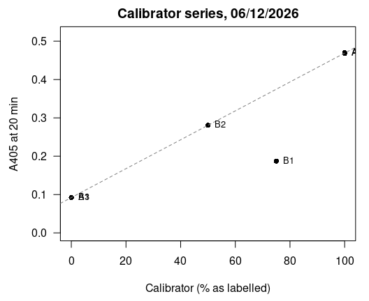
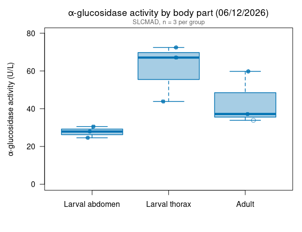
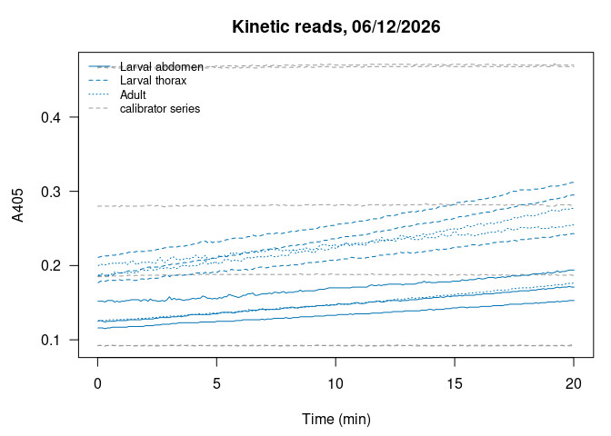

Alina’s alpha-glucosidase assays 06/12/2026: larval abdomen vs. thorax
vs. adults (SLCMAD)
================
Norah Saarman
2026-10-22

- [Overview](#overview)
- [Plate map](#plate-map)
- [Colors](#colors)
- [Data](#data)
- [QC: calibrator series](#qc-calibrator-series)
- [Activity](#activity)
  - [Summary by body part](#summary-by-body-part)
  - [Tests](#tests)
- [Boxplot](#boxplot)
- [QC: kinetic curves](#qc-kinetic-curves)
- [Notes](#notes)

RStudio Configuration: - **R version:** R 4.4.0 (Geospatial packages)  
- **Number of cores:** 1 (up to 32 available)  
- **Account:** saarman-np  
- **Partition:** saarman-np (now auto allows multiple simultaneous jobs)

# Overview

Sigma-Aldrich alpha-Glucosidase Activity Assay Kit (MAK123), read on the
Multiskan SkyHigh at 405 nm, kinetic reads every 6 s for 20 min at 25.5
°C. This was the first assay.

**Body parts.** Susceptible SLCMAD *Culex pipiens*, 3 samples each:

- **Larval abdomen**
- **Larval thorax**
- **Adult** (S7 is marked male; S8 and S9 aren’t sexed on the plate map)

The plate also has a short calibrator series (0%, 50%, 75%, 100%) to
check that A405 scales with the calibrator.

**Activity.** From the kit:

$$\text{Activity (U/L)} = \frac{A405_{final} - A405_{initial}}{A405_{calibrator} - A405_{water}} \times 250$$

- *initial* = first kinetic read (t = 0); *final* = last read (t = 20
  min)
- calibrator (100%) and water (0%) = their own reads at 20 min
- If A405_final \> 1.0, the kit says to dilute with water and repeat.
  Set `dilution` in the plate map for any re-run well and the result is
  multiplied back up.

One unit hydrolyzes 1.0 µmole substrate per minute at pH 7.0.

# Plate map

From Alina’s plate map. As in Alina’s calculation, A1 (0%) and A2 (100%)
are the water and calibrator wells.

``` r
infile    <- file.path(data_dir, "Kinetic Abs .xlsx")   # note the space before .xlsx
run_label <- "2026-06-12"

water_well <- "A1"   # 0% calibrator
cal_well   <- "A2"   # 100% calibrator

# Calibrator series, as labelled on the plate map (% calibrator)
cal_series <- data.frame(
  well    = c("A1", "B3", "B2", "B1", "A2", "A3"),
  cal_pct = c(0,    0,    50,   75,   100,  100)
)

part_order <- c("Larval abdomen", "Larval thorax", "Adult")

plate_map <- data.frame(
  well     = c("C1","C2","C3", "D1","D2","D3", "E1","E2","E3"),
  sample   = paste0("S", 1:9),
  part     = rep(part_order, each = 3),
  dilution = 1
)
```

# Colors

All samples are SLCMAD, so every box uses the SLCMAD color from the Lsph
probit figures.

``` r
slcmad_col <- "#0072B2"
```

# Data

The “Raw data 405 nm” sheet has one row per well per read (well,
wavelength, absorbance, time in seconds). The header row is found by
name, because the number of blank rows above it differs between exports.

``` r
raw <- suppressWarnings(
  read_excel(infile, sheet = "Raw data 405 nm", col_names = FALSE,
             col_types = c("text", "numeric", "numeric", "numeric")))
```

    ## New names:
    ## • `` -> `...1`
    ## • `` -> `...2`
    ## • `` -> `...3`
    ## • `` -> `...4`

``` r
names(raw)[1:4] <- c("well", "wavelength", "abs", "time_s")
header_row <- which(raw$well == "Well")[1]
raw <- as.data.frame(raw[(header_row + 1):nrow(raw), ])
raw <- raw[!is.na(raw$well) & !is.na(raw$abs), ]
raw$well <- gsub(" ", "", raw$well)            # "A 1" -> "A1"
raw <- raw[order(raw$well, raw$time_s), ]

table(raw$well)                                # reads per well (expect 201)
```

    ## 
    ##  A1  A2  A3  B1  B2  B3  C1  C2  C3  D1  D2  D3  E1  E2  E3 
    ## 201 201 201 201 201 201 201 201 201 201 201 201 201 201 201

``` r
first_abs <- tapply(raw$abs, raw$well, function(x) x[1])
last_abs  <- tapply(raw$abs, raw$well, function(x) x[length(x)])
```

# QC: calibrator series

A405 at 20 min should rise in a straight line from 0% to 100%
calibrator. The line is drawn through the 0% and 100% wells only, so
each well’s distance from it shows whether its label fits.

``` r
cal_series$A405_20min <- as.numeric(last_abs[cal_series$well])
zero    <- mean(cal_series$A405_20min[cal_series$cal_pct == 0])
full    <- mean(cal_series$A405_20min[cal_series$cal_pct == 100])
cal_series$implied_pct <- 100 * (cal_series$A405_20min - zero) / (full - zero)
kable(cal_series, digits = c(0, 0, 4, 0))
```

| well | cal_pct | A405_20min | implied_pct |
|:-----|--------:|-----------:|------------:|
| A1   |       0 |     0.0917 |           0 |
| B3   |       0 |     0.0925 |           0 |
| B2   |      50 |     0.2810 |          50 |
| B1   |      75 |     0.1870 |          25 |
| A2   |     100 |     0.4680 |         100 |
| A3   |     100 |     0.4700 |         100 |

``` r
par(mar = c(4.5, 4.5, 2, 1))
plot(cal_series$cal_pct, cal_series$A405_20min, pch = 16, las = 1,
     xlim = c(0, 100), ylim = c(0, max(cal_series$A405_20min) * 1.1),
     xlab = "Calibrator (% as labelled)", ylab = "A405 at 20 min",
     main = "Calibrator series, 06/12/2026")
abline(a = zero, b = (full - zero) / 100, col = "grey50", lty = 2)
text(cal_series$cal_pct, cal_series$A405_20min, cal_series$well, pos = 4, cex = 0.8)
```

<!-- -->

# Activity

``` r
water_20 <- last_abs[[water_well]]
cal_20   <- last_abs[[cal_well]]
denom    <- cal_20 - water_20
cat(sprintf("Calibrator (%s) at 20 min = %.4f\nWater (%s) at 20 min = %.4f\n",
            cal_well, cal_20, water_well, water_20))
```

    ## Calibrator (A2) at 20 min = 0.4680
    ## Water (A1) at 20 min = 0.0917

``` r
cat(sprintf("Using the mean of both 0%% and both 100%% wells instead: denominator %.4f vs. %.4f\n",
            full - zero, denom))
```

    ## Using the mean of both 0% and both 100% wells instead: denominator 0.3769 vs. 0.3763

``` r
agc <- plate_map
agc$A405_initial <- as.numeric(first_abs[agc$well])
agc$A405_final   <- as.numeric(last_abs[agc$well])
agc$activity_U_L <- (agc$A405_final - agc$A405_initial) / denom * 250 * agc$dilution
agc$over_1       <- agc$A405_final > 1.0
agc$part         <- factor(agc$part, levels = part_order)

if (any(agc$over_1))
  warning("A405_final > 1.0 in wells: ", paste(agc$well[agc$over_1], collapse = ", "),
          " -- kit says dilute and repeat.")

write.csv(agc, file.path(results_dir, paste0("agc_activity_", run_label, ".csv")),
          row.names = FALSE)
kable(agc, digits = 3)
```

| well | sample | part           | dilution | A405_initial | A405_final | activity_U_L | over_1 |
|:-----|:-------|:---------------|---------:|-------------:|-----------:|-------------:|:-------|
| C1   | S1     | Larval abdomen |        1 |        0.116 |      0.153 |       24.581 | FALSE  |
| C2   | S2     | Larval abdomen |        1 |        0.152 |      0.194 |       27.903 | FALSE  |
| C3   | S3     | Larval abdomen |        1 |        0.125 |      0.171 |       30.561 | FALSE  |
| D1   | S4     | Larval thorax  |        1 |        0.211 |      0.312 |       67.101 | FALSE  |
| D2   | S5     | Larval thorax  |        1 |        0.177 |      0.243 |       43.848 | FALSE  |
| D3   | S6     | Larval thorax  |        1 |        0.186 |      0.295 |       72.416 | FALSE  |
| E1   | S7     | Adult          |        1 |        0.126 |      0.177 |       33.883 | FALSE  |
| E2   | S8     | Adult          |        1 |        0.187 |      0.277 |       59.793 | FALSE  |
| E3   | S9     | Adult          |        1 |        0.200 |      0.256 |       37.204 | FALSE  |

## Summary by body part

``` r
agc_summary <- data.frame(
  part     = part_order,
  n        = as.numeric(tapply(agc$activity_U_L, agc$part, length)),
  mean_U_L = as.numeric(tapply(agc$activity_U_L, agc$part, mean)),
  sd_U_L   = as.numeric(tapply(agc$activity_U_L, agc$part, sd))
)
agc_summary$cv_pct <- 100 * agc_summary$sd_U_L / agc_summary$mean_U_L

write.csv(agc_summary, file.path(results_dir, paste0("agc_summary_", run_label, ".csv")),
          row.names = FALSE)
kable(agc_summary, digits = 1)
```

| part           |   n | mean_U_L | sd_U_L | cv_pct |
|:---------------|----:|---------:|-------:|-------:|
| Larval abdomen |   3 |     27.7 |    3.0 |   10.8 |
| Larval thorax  |   3 |     61.1 |   15.2 |   24.9 |
| Adult          |   3 |     43.6 |   14.1 |   32.3 |

## Tests

As in Alina’s analysis: one-way ANOVA, and t-tests between each pair of
body parts (Welch, unadjusted for multiple comparisons). With 3 samples
per group, treat the p-values as a rough guide.

``` r
summary(aov(activity_U_L ~ part, data = agc))
```

    ##             Df Sum Sq Mean Sq F value Pr(>F)  
    ## part         2 1678.5   839.3   5.741 0.0404 *
    ## Residuals    6  877.2   146.2                 
    ## ---
    ## Signif. codes:  0 '***' 0.001 '**' 0.01 '*' 0.05 '.' 0.1 ' ' 1

``` r
pairwise.t.test(agc$activity_U_L, agc$part, pool.sd = FALSE, p.adjust.method = "none")
```

    ## 
    ##  Pairwise comparisons using t tests with non-pooled SD 
    ## 
    ## data:  agc$activity_U_L and agc$part 
    ## 
    ##               Larval abdomen Larval thorax
    ## Larval thorax 0.058          -            
    ## Adult         0.185          0.218        
    ## 
    ## P value adjustment method: none

# Boxplot

Points are individual samples; S7 (male adult) is the open circle.

``` r
par(mar = c(4.5, 4.8, 3, 1))
boxplot(activity_U_L ~ part, data = agc,
        col    = adjustcolor(slcmad_col, alpha.f = 0.35),
        border = slcmad_col,
        lwd = 1.5, outline = FALSE, las = 1,
        ylim = c(0, max(agc$activity_U_L) * 1.1),
        xlab = "",
        ylab = expression(alpha*"-glucosidase activity (U/L)"),
        main = expression(alpha*"-glucosidase activity by body part (06/12/2026)"))
set.seed(1)
points(jitter(as.numeric(agc$part), amount = 0.12), agc$activity_U_L,
       pch = ifelse(agc$sample == "S7", 1, 16), cex = 1.2,
       col = adjustcolor(slcmad_col, alpha.f = 0.8))
mtext("SLCMAD, n = 3 per group", side = 3, line = 0.2, cex = 0.8, col = "grey40")
```

<!-- -->

# QC: kinetic curves

Each well’s A405 over the 20 min. The formula uses only the first and
last reads, so a well whose signal jumps around can shift its activity
value. Calibrator-series wells are dashed grey.

``` r
part_lty <- setNames(1:3, part_order)
par(mar = c(4.5, 4.5, 3, 1))
plot(NA, xlim = range(raw$time_s) / 60, ylim = range(raw$abs), las = 1,
     xlab = "Time (min)", ylab = "A405", main = "Kinetic reads, 06/12/2026")
for (w in unique(raw$well)) {
  d <- raw[raw$well == w, ]
  i <- match(w, agc$well)
  if (is.na(i)) {
    lines(d$time_s / 60, d$abs, col = "grey60", lty = 2)
  } else {
    lines(d$time_s / 60, d$abs, col = slcmad_col,
          lty = part_lty[[as.character(agc$part[i])]])
  }
}
legend("topleft", bty = "n", cex = 0.8,
       legend = c(part_order, "calibrator series"),
       col = c(rep(slcmad_col, 3), "grey60"), lty = c(1:3, 2))
```

<!-- -->

# Notes

*Summary for Alina and the lab, written 10/22/2026.*

- **Body parts.** Larval thorax averaged 61 U/L, adults 44 U/L and
  larval abdomen 28 U/L. With 3 samples each, only the thorax-abdomen
  difference looks consistent.
- **Not comparable with later plates.** Later plates used whole
  4th-instar larvae, so these body-part values can’t be compared
  directly with them. The larval thorax and abdomen together would be
  closer to a whole larva.
- **Calibrator series.** The 50% well (B2) reads as about 50% of the
  0-100% range, as expected. The well labelled 75% (B1) reads as about
  25%, so it was probably a 25% dilution, or mislabelled. It isn’t used
  in the activity calculation, which needs only the 0% and 100% wells,
  so the results are unaffected. The two 100% wells and the two 0% wells
  agree closely.
- **Adults.** S7 is marked male; S8 and S9 aren’t sexed. Females take
  blood meals and may differ, so recording sex would help if adults are
  tested again.
