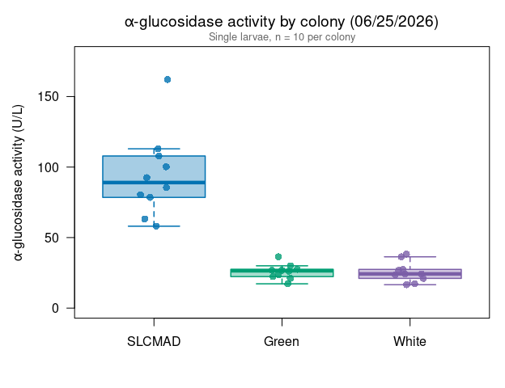
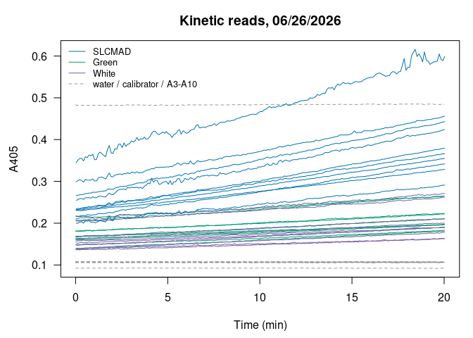

Alina’s alpha-glucosidase assays 06/25/2026: SLCMAD vs. Green and White
================
Norah Saarman
2026-10-22

- [Overview](#overview)
- [Plate map](#plate-map)
- [Colors](#colors)
- [Data](#data)
- [Activity](#activity)
  - [Summary by colony](#summary-by-colony)
  - [Tests](#tests)
- [Boxplot](#boxplot)
- [QC: kinetic curves](#qc-kinetic-curves)
- [Notes](#notes)

RStudio Configuration: - **R version:** R 4.4.0 (Geospatial packages)  
- **Number of cores:** 1 (up to 32 available)  
- **Account:** saarman-np  
- **Partition:** saarman-np (now auto allows multiple simultaneous jobs)

# Overview

Sigma-Aldrich alpha-Glucosidase Activity Assay Kit (MAK123), read on the
Multiskan SkyHigh at 405 nm, kinetic reads every 6 s for 20 min at 25.5
°C.

**Colony comparison.** 10 single larvae per colony:

- **SLCMAD**: susceptible colony (marked “\#SLCMAD susceptible colony”
  on the plate map)
- **Green**: USU resistant colony
- **White**: USU colony that Alina’s notes call the resistant
  “susceptible” USU colony

The assay is filed as 06/25; the plate-reader export is dated 06/26/2026
(run started 11:46 am).

**Activity.** From the kit:

$$\text{Activity (U/L)} = \frac{A405_{final} - A405_{initial}}{A405_{calibrator} - A405_{water}} \times 250$$

- *initial* = first kinetic read (t = 0); *final* = last read (t = 20
  min)
- calibrator and water = their own reads at 20 min
- If A405_final \> 1.0, the kit says to dilute with water and repeat.
  Set `dilution` in the plate map for any re-run well and the result is
  multiplied back up.

One unit hydrolyzes 1.0 µmole substrate per minute at pH 7.0.

# Plate map

From Alina’s plate map. A3-A10 were read but are unlabeled, so they are
not used.

``` r
infile    <- file.path(data_dir, "Kinetic Abs @ 405 2026-06-26 11-46-18.xlsx")
run_label <- "2026-06-25"

water_well <- "A1"   # H2O control
cal_well   <- "A2"   # calibrator

# Same order as the Lsph probit panel (most susceptible to most resistant)
colony_order <- c("SLCMAD", "Green", "White")

plate_map <- data.frame(
  well     = c(paste0("B", 1:10), paste0("C", 1:10), paste0("D", 1:10)),
  colony   = rep(c("Green", "White", "SLCMAD"), each = 10),
  dilution = 1
)
```

# Colors

Same palette as the Lsph probit figures.

``` r
colony_colors <- c(SLCMAD = "#0072B2",
                   Green  = "#009E73",
                   White  = "#7B5EA7")
```

# Data

The “Raw data 405 nm” sheet has one row per well per read (well,
wavelength, absorbance, time in seconds). The header row is found by
name, because the number of blank rows above it differs between exports.

``` r
raw <- suppressWarnings(
  read_excel(infile, sheet = "Raw data 405 nm", col_names = FALSE,
             col_types = c("text", "numeric", "numeric", "numeric")))
```

    ## New names:
    ## • `` -> `...1`
    ## • `` -> `...2`
    ## • `` -> `...3`
    ## • `` -> `...4`

``` r
names(raw)[1:4] <- c("well", "wavelength", "abs", "time_s")
header_row <- which(raw$well == "Well")[1]
raw <- as.data.frame(raw[(header_row + 1):nrow(raw), ])
raw <- raw[!is.na(raw$well) & !is.na(raw$abs), ]
raw$well <- gsub(" ", "", raw$well)            # "A 1" -> "A1"
raw <- raw[order(raw$well, raw$time_s), ]

table(raw$well)                                # reads per well (expect 201)
```

    ## 
    ##  A1 A10  A2  A3  A4  A5  A6  A7  A8  A9  B1 B10  B2  B3  B4  B5  B6  B7  B8  B9 
    ## 201 201 201 201 201 201 201 201 201 201 201 201 201 201 201 201 201 201 201 201 
    ##  C1 C10  C2  C3  C4  C5  C6  C7  C8  C9  D1 D10  D2  D3  D4  D5  D6  D7  D8  D9 
    ## 201 201 201 201 201 201 201 201 201 201 201 201 201 201 201 201 201 201 201 201

# Activity

``` r
first_abs <- tapply(raw$abs, raw$well, function(x) x[1])
last_abs  <- tapply(raw$abs, raw$well, function(x) x[length(x)])

water_20 <- last_abs[[water_well]]
cal_20   <- last_abs[[cal_well]]
denom    <- cal_20 - water_20
cat(sprintf("Calibrator (%s) at 20 min = %.4f\nWater (%s) at 20 min = %.4f\n",
            cal_well, cal_20, water_well, water_20))
```

    ## Calibrator (A2) at 20 min = 0.4840
    ## Water (A1) at 20 min = 0.0923

``` r
agc <- plate_map
agc$A405_initial <- as.numeric(first_abs[agc$well])
agc$A405_final   <- as.numeric(last_abs[agc$well])
agc$activity_U_L <- (agc$A405_final - agc$A405_initial) / denom * 250 * agc$dilution
agc$over_1       <- agc$A405_final > 1.0
agc$colony       <- factor(agc$colony, levels = colony_order)
agc <- agc[order(agc$colony, agc$well), ]

if (any(agc$over_1))
  warning("A405_final > 1.0 in wells: ", paste(agc$well[agc$over_1], collapse = ", "),
          " -- kit says dilute and repeat.")

write.csv(agc, file.path(results_dir, paste0("agc_activity_", run_label, ".csv")),
          row.names = FALSE)
kable(agc, digits = 3, row.names = FALSE)
```

| well | colony | dilution | A405_initial | A405_final | activity_U_L | over_1 |
|:-----|:-------|---------:|-------------:|-----------:|-------------:|:-------|
| D1   | SLCMAD |        1 |        0.234 |      0.379 |       92.545 | FALSE  |
| D10  | SLCMAD |        1 |        0.232 |      0.355 |       78.504 | FALSE  |
| D2   | SLCMAD |        1 |        0.200 |      0.291 |       58.080 | FALSE  |
| D3   | SLCMAD |        1 |        0.232 |      0.366 |       85.525 | FALSE  |
| D4   | SLCMAD |        1 |        0.230 |      0.329 |       63.186 | FALSE  |
| D5   | SLCMAD |        1 |        0.299 |      0.456 |      100.204 | FALSE  |
| D6   | SLCMAD |        1 |        0.345 |      0.599 |      162.114 | FALSE  |
| D7   | SLCMAD |        1 |        0.255 |      0.424 |      107.863 | FALSE  |
| D8   | SLCMAD |        1 |        0.266 |      0.443 |      112.969 | FALSE  |
| D9   | SLCMAD |        1 |        0.216 |      0.342 |       80.419 | FALSE  |
| B1   | Green  |        1 |        0.148 |      0.183 |       22.339 | FALSE  |
| B10  | Green  |        1 |        0.182 |      0.224 |       26.806 | FALSE  |
| B2   | Green  |        1 |        0.169 |      0.196 |       17.233 | FALSE  |
| B3   | Green  |        1 |        0.160 |      0.197 |       23.615 | FALSE  |
| B4   | Green  |        1 |        0.164 |      0.197 |       21.062 | FALSE  |
| B5   | Green  |        1 |        0.139 |      0.181 |       26.806 | FALSE  |
| B6   | Green  |        1 |        0.180 |      0.221 |       26.168 | FALSE  |
| B7   | Green  |        1 |        0.167 |      0.210 |       27.444 | FALSE  |
| B8   | Green  |        1 |        0.208 |      0.265 |       36.380 | FALSE  |
| B9   | Green  |        1 |        0.218 |      0.265 |       29.997 | FALSE  |
| C1   | White  |        1 |        0.157 |      0.190 |       21.062 | FALSE  |
| C10  | White  |        1 |        0.205 |      0.262 |       36.380 | FALSE  |
| C2   | White  |        1 |        0.136 |      0.163 |       17.233 | FALSE  |
| C3   | White  |        1 |        0.148 |      0.190 |       26.806 | FALSE  |
| C4   | White  |        1 |        0.168 |      0.211 |       27.444 | FALSE  |
| C5   | White  |        1 |        0.137 |      0.163 |       16.594 | FALSE  |
| C6   | White  |        1 |        0.153 |      0.190 |       23.615 | FALSE  |
| C7   | White  |        1 |        0.211 |      0.271 |       38.295 | FALSE  |
| C8   | White  |        1 |        0.162 |      0.200 |       24.253 | FALSE  |
| C9   | White  |        1 |        0.140 |      0.178 |       24.253 | FALSE  |

## Summary by colony

``` r
agc_summary <- data.frame(
  colony   = colony_order,
  n        = as.numeric(tapply(agc$activity_U_L, agc$colony, length)),
  mean_U_L = as.numeric(tapply(agc$activity_U_L, agc$colony, mean)),
  sd_U_L   = as.numeric(tapply(agc$activity_U_L, agc$colony, sd))
)
agc_summary$cv_pct <- 100 * agc_summary$sd_U_L / agc_summary$mean_U_L

write.csv(agc_summary, file.path(results_dir, paste0("agc_summary_", run_label, ".csv")),
          row.names = FALSE)
kable(agc_summary, digits = 1)
```

| colony |   n | mean_U_L | sd_U_L | cv_pct |
|:-------|----:|---------:|-------:|-------:|
| SLCMAD |  10 |     94.1 |   29.8 |   31.6 |
| Green  |  10 |     25.8 |    5.2 |   20.3 |
| White  |  10 |     25.6 |    7.2 |   28.0 |

## Tests

As in Alina’s analysis: one-way ANOVA across the three colonies, a
t-test of Green vs. White, and a t-test of SLCMAD against Green and
White combined (Welch t-tests, which don’t assume equal variances). With
10 larvae per colony, treat the p-values as a rough guide.

``` r
summary(aov(activity_U_L ~ colony, data = agc))
```

    ##             Df Sum Sq Mean Sq F value   Pr(>F)    
    ## colony       2  31238   15619    48.6 1.13e-09 ***
    ## Residuals   27   8677     321                     
    ## ---
    ## Signif. codes:  0 '***' 0.001 '**' 0.01 '*' 0.05 '.' 0.1 ' ' 1

``` r
t.test(agc$activity_U_L[agc$colony == "Green"],
       agc$activity_U_L[agc$colony == "White"])
```

    ## 
    ##  Welch Two Sample t-test
    ## 
    ## data:  agc$activity_U_L[agc$colony == "Green"] and agc$activity_U_L[agc$colony == "White"]
    ## t = 0.068243, df = 16.489, p-value = 0.9464
    ## alternative hypothesis: true difference in means is not equal to 0
    ## 95 percent confidence interval:
    ##  -5.742193  6.125139
    ## sample estimates:
    ## mean of x mean of y 
    ##  25.78504  25.59357

``` r
t.test(agc$activity_U_L[agc$colony == "SLCMAD"],
       agc$activity_U_L[agc$colony != "SLCMAD"])
```

    ## 
    ##  Welch Two Sample t-test
    ## 
    ## data:  agc$activity_U_L[agc$colony == "SLCMAD"] and agc$activity_U_L[agc$colony != "SLCMAD"]
    ## t = 7.1995, df = 9.3812, p-value = 4.1e-05
    ## alternative hypothesis: true difference in means is not equal to 0
    ## 95 percent confidence interval:
    ##  47.07588 89.82736
    ## sample estimates:
    ## mean of x mean of y 
    ##  94.14092  25.68930

# Boxplot

Ordered as in the Lsph probit panel. Points are individual larvae.

``` r
cols <- colony_colors[colony_order]

par(mar = c(4.5, 4.8, 3, 1))
boxplot(activity_U_L ~ colony, data = agc,
        col    = adjustcolor(cols, alpha.f = 0.35),
        border = cols,
        lwd = 1.5, outline = FALSE, las = 1,
        ylim = c(0, max(agc$activity_U_L) * 1.1),
        xlab = "",
        ylab = expression(alpha*"-glucosidase activity (U/L)"),
        main = expression(alpha*"-glucosidase activity by colony (06/25/2026)"))
set.seed(1)
points(jitter(as.numeric(agc$colony), amount = 0.12), agc$activity_U_L,
       pch = 16, cex = 1.2,
       col = adjustcolor(colony_colors[as.character(agc$colony)], alpha.f = 0.8))
mtext("Single larvae, n = 10 per colony", side = 3, line = 0.2, cex = 0.8, col = "grey40")
```

<!-- -->

# QC: kinetic curves

Each well’s A405 over the 20 min. The formula uses only the first and
last reads, so a well whose signal jumps around can shift its activity
value. Water, calibrator and A3-A10 are dashed grey.

``` r
par(mar = c(4.5, 4.5, 3, 1))
plot(NA, xlim = range(raw$time_s) / 60, ylim = range(raw$abs), las = 1,
     xlab = "Time (min)", ylab = "A405", main = "Kinetic reads, 06/26/2026")
for (w in unique(raw$well)) {
  d <- raw[raw$well == w, ]
  i <- match(w, agc$well)
  col <- if (is.na(i)) "grey60" else colony_colors[[as.character(agc$colony[i])]]
  lines(d$time_s / 60, d$abs, col = col, lty = if (is.na(i)) 2 else 1)
}
legend("topleft", bty = "n", cex = 0.8,
       legend = c(colony_order, "water / calibrator / A3-A10"),
       col = c(colony_colors[colony_order], "grey60"), lty = c(rep(1, 3), 2))
```

<!-- -->

# Notes

*Summary for Alina and the lab, written 10/22/2026.*

- **SLCMAD vs. Green and White.** SLCMAD averaged 94 U/L, more than
  three times Green (26 U/L) and White (26 U/L), which were nearly
  identical. With 10 larvae per colony, this is the largest sample of
  any plate, and it matches 07/23.
- **White.** Alina’s notes call White the “susceptible” USU colony, but
  in the Lsph probits White was the most resistant colony tested (LC50
  \> 500 ppm at 24 h). Its low activity here, matching Green, fits the
  probits.
- **SLCMAD on later plates.** SLCMAD has read high on every plate. On
  08/14 and 08/17 the susceptible Yellow / wild larvae read about as low
  as Green, so the gap here may reflect SLCMAD itself rather than
  susceptibility in general.
- **Date.** Filed as 06/25, but the export is dated 06/26. Worth noting
  which date the larvae were collected vs. assayed.
- **Storage.** The plate map doesn’t say whether these larvae were live
  or stored. Based on 07/31, storage in PBS or EtOH would lower
  activity.
- The “\#” before SLCMAD on the plate map isn’t explained.
