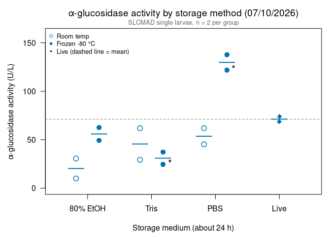
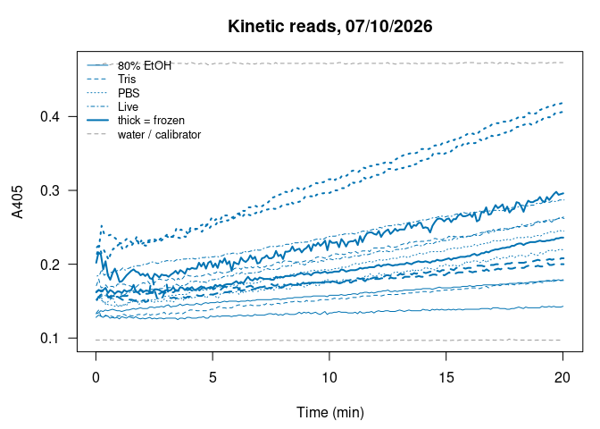

Alina’s alpha-glucosidase assays 07/10/2026: 24-hour storage methods
(SLCMAD)
================
Norah Saarman
2026-10-22

- [Overview](#overview)
- [Plate map](#plate-map)
- [Colors](#colors)
- [Data](#data)
- [Activity](#activity)
  - [Summary by storage method](#summary-by-storage-method)
  - [Comparison with live (Dunnett)](#comparison-with-live-dunnett)
- [Plot](#plot)
- [QC: kinetic curves](#qc-kinetic-curves)
- [Notes](#notes)

RStudio Configuration: - **R version:** R 4.4.0 (Geospatial packages)  
- **Number of cores:** 1 (up to 32 available)  
- **Account:** saarman-np  
- **Partition:** saarman-np (now auto allows multiple simultaneous jobs)

# Overview

Sigma-Aldrich alpha-Glucosidase Activity Assay Kit (MAK123), read on the
Multiskan SkyHigh at 405 nm, kinetic reads every 6 s for 20 min at 25.5
°C.

**Storage test (24 h).** Susceptible SLCMAD *Culex pipiens* larvae, 2
single larvae per method, stored for about 24 hours before the assay in
one of three media, either at room temperature or frozen at -80 °C:

- **80% EtOH**
- **Tris**
- **PBS**
- **Live**: not stored

Two wells are marked “\* Samples could have been switched” on the plate
map: E1 (Tris, frozen) and G1 (PBS, frozen). They are kept as labelled;
see the notes.

**Activity.** From the kit:

$$\text{Activity (U/L)} = \frac{A405_{final} - A405_{initial}}{A405_{calibrator} - A405_{water}} \times 250$$

- *initial* = first kinetic read (t = 0); *final* = last read (t = 20
  min)
- calibrator and water = their own reads at 20 min
- If A405_final \> 1.0, the kit says to dilute with water and repeat.
  Set `dilution` in the plate map for any re-run well and the result is
  multiplied back up.

One unit hydrolyzes 1.0 µmole substrate per minute at pH 7.0.

# Plate map

From Alina’s plate map.

``` r
infile    <- file.path(data_dir, "Kinetic Abs @ 405 2026-07-10 09-15-51.xlsx")
run_label <- "2026-07-10"

water_well <- "A1"   # H2O control
cal_well   <- "A2"   # calibrator

medium_order <- c("80% EtOH", "Tris", "PBS", "Live")
temp_order   <- c("Room temp", "Frozen -80 °C")

plate_map <- data.frame(
  well   = c("B1","B2", "C1","C2", "D1","D2", "E1","E2", "F1","F2", "G1","G2", "H1","H2"),
  medium = c(rep("80% EtOH", 4), rep("Tris", 4), rep("PBS", 4), rep("Live", 2)),
  temp   = c(rep(rep(temp_order, each = 2), 3), NA, NA),
  maybe_switched = FALSE,
  dilution = 1
)
plate_map$maybe_switched[plate_map$well %in% c("E1", "G1")] <- TRUE
plate_map$group <- ifelse(is.na(plate_map$temp), "Live",
                          paste(plate_map$medium, plate_map$temp, sep = ", "))
```

# Colors

All larvae are SLCMAD, so every point uses the SLCMAD color from the
Lsph probit figures: open circles for room temperature, filled for
frozen, diamond for live.

``` r
slcmad_col <- "#0072B2"
```

# Data

The “Raw data 405 nm” sheet has one row per well per read (well,
wavelength, absorbance, time in seconds). The header row is found by
name, because the number of blank rows above it differs between exports.

``` r
raw <- suppressWarnings(
  read_excel(infile, sheet = "Raw data 405 nm", col_names = FALSE,
             col_types = c("text", "numeric", "numeric", "numeric")))
```

    ## New names:
    ## • `` -> `...1`
    ## • `` -> `...2`
    ## • `` -> `...3`
    ## • `` -> `...4`

``` r
names(raw)[1:4] <- c("well", "wavelength", "abs", "time_s")
header_row <- which(raw$well == "Well")[1]
raw <- as.data.frame(raw[(header_row + 1):nrow(raw), ])
raw <- raw[!is.na(raw$well) & !is.na(raw$abs), ]
raw$well <- gsub(" ", "", raw$well)            # "A 1" -> "A1"
raw <- raw[order(raw$well, raw$time_s), ]

table(raw$well)                                # reads per well (expect 201)
```

    ## 
    ##  A1  A2  B1  B2  C1  C2  D1  D2  E1  E2  F1  F2  G1  G2  H1  H2 
    ## 201 201 201 201 201 201 201 201 201 201 201 201 201 201 201 201

# Activity

``` r
first_abs <- tapply(raw$abs, raw$well, function(x) x[1])
last_abs  <- tapply(raw$abs, raw$well, function(x) x[length(x)])

water_20 <- last_abs[[water_well]]
cal_20   <- last_abs[[cal_well]]
denom    <- cal_20 - water_20
cat(sprintf("Calibrator (%s) at 20 min = %.4f\nWater (%s) at 20 min = %.4f\n",
            cal_well, cal_20, water_well, water_20))
```

    ## Calibrator (A2) at 20 min = 0.4730
    ## Water (A1) at 20 min = 0.0973

``` r
agc <- plate_map
agc$A405_initial <- as.numeric(first_abs[agc$well])
agc$A405_final   <- as.numeric(last_abs[agc$well])
agc$activity_U_L <- (agc$A405_final - agc$A405_initial) / denom * 250 * agc$dilution
agc$over_1       <- agc$A405_final > 1.0

group_order <- c(as.vector(t(outer(medium_order[1:3], temp_order, paste, sep = ", "))), "Live")
agc$group   <- factor(agc$group, levels = group_order)

if (any(agc$over_1))
  warning("A405_final > 1.0 in wells: ", paste(agc$well[agc$over_1], collapse = ", "),
          " -- kit says dilute and repeat.")

write.csv(agc, file.path(results_dir, paste0("agc_activity_", run_label, ".csv")),
          row.names = FALSE)
kable(agc, digits = 3)
```

| well | medium   | temp          | maybe_switched | dilution | group                   | A405_initial | A405_final | activity_U_L | over_1 |
|:-----|:---------|:--------------|:---------------|---------:|:------------------------|-------------:|-----------:|-------------:|:-------|
| B1   | 80% EtOH | Room temp     | FALSE          |        1 | 80% EtOH, Room temp     |        0.133 |      0.179 |       30.610 | FALSE  |
| B2   | 80% EtOH | Room temp     | FALSE          |        1 | 80% EtOH, Room temp     |        0.128 |      0.143 |        9.981 | FALSE  |
| C1   | 80% EtOH | Frozen -80 °C | FALSE          |        1 | 80% EtOH, Frozen -80 °C |        0.202 |      0.296 |       62.550 | FALSE  |
| C2   | 80% EtOH | Frozen -80 °C | FALSE          |        1 | 80% EtOH, Frozen -80 °C |        0.162 |      0.236 |       49.241 | FALSE  |
| D1   | Tris     | Room temp     | FALSE          |        1 | Tris, Room temp         |        0.134 |      0.178 |       29.279 | FALSE  |
| D2   | Tris     | Room temp     | FALSE          |        1 | Tris, Room temp         |        0.171 |      0.264 |       61.884 | FALSE  |
| E1   | Tris     | Frozen -80 °C | TRUE           |        1 | Tris, Frozen -80 °C     |        0.163 |      0.200 |       24.621 | FALSE  |
| E2   | Tris     | Frozen -80 °C | FALSE          |        1 | Tris, Frozen -80 °C     |        0.152 |      0.208 |       37.264 | FALSE  |
| F1   | PBS      | Room temp     | FALSE          |        1 | PBS, Room temp          |        0.152 |      0.245 |       61.884 | FALSE  |
| F2   | PBS      | Room temp     | FALSE          |        1 | PBS, Room temp          |        0.151 |      0.219 |       45.249 | FALSE  |
| G1   | PBS      | Frozen -80 °C | TRUE           |        1 | PBS, Frozen -80 °C      |        0.223 |      0.406 |      121.773 | FALSE  |
| G2   | PBS      | Frozen -80 °C | FALSE          |        1 | PBS, Frozen -80 °C      |        0.214 |      0.421 |      137.743 | FALSE  |
| H1   | Live     | NA            | FALSE          |        1 | Live                    |        0.184 |      0.287 |       68.539 | FALSE  |
| H2   | Live     | NA            | FALSE          |        1 | Live                    |        0.151 |      0.262 |       73.862 | FALSE  |

## Summary by storage method

``` r
agc_summary <- data.frame(
  group    = group_order,
  n        = as.numeric(tapply(agc$activity_U_L, agc$group, length)),
  mean_U_L = as.numeric(tapply(agc$activity_U_L, agc$group, mean)),
  min_U_L  = as.numeric(tapply(agc$activity_U_L, agc$group, min)),
  max_U_L  = as.numeric(tapply(agc$activity_U_L, agc$group, max))
)
agc_summary$pct_of_live <- 100 * agc_summary$mean_U_L /
                           agc_summary$mean_U_L[agc_summary$group == "Live"]

write.csv(agc_summary, file.path(results_dir, paste0("agc_summary_", run_label, ".csv")),
          row.names = FALSE)
kable(agc_summary, digits = 1)
```

| group                   |   n | mean_U_L | min_U_L | max_U_L | pct_of_live |
|:------------------------|----:|---------:|--------:|--------:|------------:|
| 80% EtOH, Room temp     |   2 |     20.3 |    10.0 |    30.6 |        28.5 |
| 80% EtOH, Frozen -80 °C |   2 |     55.9 |    49.2 |    62.5 |        78.5 |
| Tris, Room temp         |   2 |     45.6 |    29.3 |    61.9 |        64.0 |
| Tris, Frozen -80 °C     |   2 |     30.9 |    24.6 |    37.3 |        43.5 |
| PBS, Room temp          |   2 |     53.6 |    45.2 |    61.9 |        75.2 |
| PBS, Frozen -80 °C      |   2 |    129.8 |   121.8 |   137.7 |       182.2 |
| Live                    |   2 |     71.2 |    68.5 |    73.9 |       100.0 |

## Comparison with live (Dunnett)

As in Alina’s analysis: one-way ANOVA, then Dunnett’s test comparing
each storage method with live. Needs the `multcomp` package. With only 2
larvae per group, these tests have very little power; treat them as
descriptive.

``` r
agc$group_vs_live <- relevel(agc$group, ref = "Live")
anova_model <- aov(activity_U_L ~ group_vs_live, data = agc)
summary(anova_model)
```

    ##               Df Sum Sq Mean Sq F value  Pr(>F)   
    ## group_vs_live  6  15311  2551.8   14.97 0.00112 **
    ## Residuals      7   1193   170.4                   
    ## ---
    ## Signif. codes:  0 '***' 0.001 '**' 0.01 '*' 0.05 '.' 0.1 ' ' 1

``` r
if (requireNamespace("multcomp", quietly = TRUE)) {
  dunnett <- multcomp::glht(anova_model,
                            linfct = multcomp::mcp(group_vs_live = "Dunnett"))
  summary(dunnett)
} else {
  message("multcomp not installed; install.packages('multcomp') for Dunnett's test.")
}
```

    ## 
    ##   Simultaneous Tests for General Linear Hypotheses
    ## 
    ## Multiple Comparisons of Means: Dunnett Contrasts
    ## 
    ## 
    ## Fit: aov(formula = activity_U_L ~ group_vs_live, data = agc)
    ## 
    ## Linear Hypotheses:
    ##                                     Estimate Std. Error t value Pr(>|t|)  
    ## 80% EtOH, Room temp - Live == 0       -50.90      13.05  -3.900   0.0242 *
    ## 80% EtOH, Frozen -80 °C - Live == 0   -15.30      13.05  -1.172   0.7151  
    ## Tris, Room temp - Live == 0           -25.62      13.05  -1.963   0.3025  
    ## Tris, Frozen -80 °C - Live == 0       -40.26      13.05  -3.084   0.0693 .
    ## PBS, Room temp - Live == 0            -17.63      13.05  -1.351   0.6074  
    ## PBS, Frozen -80 °C - Live == 0         58.56      13.05   4.486   0.0118 *
    ## ---
    ## Signif. codes:  0 '***' 0.001 '**' 0.01 '*' 0.05 '.' 0.1 ' ' 1
    ## (Adjusted p values reported -- single-step method)

# Plot

With 2 larvae per group, each larva is shown with a bar at the group
mean instead of a box. Room temperature (open) and frozen (filled) sit
side by side for each medium; the dashed line is the live mean. \* marks
the two wells that may have been switched.

``` r
x_medium <- setNames(seq_along(medium_order), medium_order)
offset   <- c("Room temp" = -0.18, "Frozen -80 °C" = 0.18)
agc$x <- x_medium[agc$medium] + ifelse(is.na(agc$temp), 0, offset[agc$temp])
agc$x[is.na(agc$x)] <- x_medium[["Live"]]

means <- aggregate(cbind(activity_U_L, x) ~ group, data = agc, FUN = mean)
live_mean <- means$activity_U_L[means$group == "Live"]

par(mar = c(4.5, 4.8, 3, 1))
plot(NA, xlim = c(0.5, length(medium_order) + 0.5),
     ylim = c(0, max(agc$activity_U_L) * 1.15),
     xaxt = "n", las = 1, xlab = "Storage medium (about 24 h)",
     ylab = expression(alpha*"-glucosidase activity (U/L)"),
     main = expression(alpha*"-glucosidase activity by storage method (07/10/2026)"))
axis(1, at = x_medium, labels = medium_order)
abline(h = live_mean, lty = 2, col = "grey50")
segments(means$x - 0.12, means$activity_U_L, means$x + 0.12, means$activity_U_L,
         col = slcmad_col, lwd = 2)
pch <- ifelse(agc$medium == "Live", 18, ifelse(agc$temp == "Room temp", 1, 16))
points(agc$x, agc$activity_U_L, pch = pch, cex = 1.4, col = slcmad_col, lwd = 1.5)
text(agc$x[agc$maybe_switched], agc$activity_U_L[agc$maybe_switched],
     "*", pos = 4, cex = 1.3)
legend("topleft", bty = "n", cex = 0.8, pch = c(1, 16, 18), col = slcmad_col,
       legend = c("Room temp", "Frozen -80 °C", "Live (dashed line = mean)"))
mtext("SLCMAD single larvae, n = 2 per group", side = 3, line = 0.2,
      cex = 0.8, col = "grey40")
```

<!-- -->

# QC: kinetic curves

Each well’s A405 over the 20 min. The formula uses only the first and
last reads, so a well whose signal jumps around can shift its activity
value. Water and calibrator are dashed grey.

``` r
medium_lty <- setNames(1:4, medium_order)
par(mar = c(4.5, 4.5, 3, 1))
plot(NA, xlim = range(raw$time_s) / 60, ylim = range(raw$abs), las = 1,
     xlab = "Time (min)", ylab = "A405", main = "Kinetic reads, 07/10/2026")
for (w in unique(raw$well)) {
  d <- raw[raw$well == w, ]
  i <- match(w, agc$well)
  if (is.na(i)) {
    lines(d$time_s / 60, d$abs, col = "grey60", lty = 2)
  } else {
    lines(d$time_s / 60, d$abs, col = slcmad_col,
          lty = medium_lty[[agc$medium[i]]],
          lwd = if (identical(agc$temp[i], "Frozen -80 °C")) 2 else 1)
  }
}
legend("topleft", bty = "n", cex = 0.8,
       legend = c(medium_order, "thick = frozen", "water / calibrator"),
       col = c(rep(slcmad_col, 5), "grey60"), lty = c(1:4, 1, 2),
       lwd = c(1, 1, 1, 1, 2, 1))
```

<!-- -->

# Notes

*Summary for Alina and the lab, written 10/22/2026.*

- **Results (2 larvae each, about 24 h storage).** Live averaged 71 U/L.
  Frozen PBS read highest (130 U/L, 182% of live); frozen 80% EtOH and
  room-temp PBS were somewhat below live (79% and 75%); Tris at either
  temperature and room-temp EtOH were lowest. With n = 2, none of this
  is conclusive.
- **Frozen PBS above live.** One possible explanation is that freezing
  and thawing breaks up tissue and releases more enzyme into the
  homogenate. That’s a guess; it would need more larvae to test.
- **E1 and G1 (“could have been switched”).** As labelled, both
  frozen-PBS larvae read high (122 and 138 U/L) and both frozen-Tris
  larvae read low (25 and 37 U/L). Swapping E1 and G1 would give each
  group one high and one low value, so the data fit the labels as
  recorded better than the swap.
- **Compared with 07/31.** After about a week, 100% EtOH at -80 °C kept
  only about a tenth of live activity and PBS at room temp about a
  third, while glycerol/PBS kept all of it. Here, after 24 h, the losses
  were smaller, and the EtOH was 80%, not 100%. Storage time and EtOH
  strength both seem to matter; glycerol/PBS (tested on 07/31) is the
  method with the best support so far.
