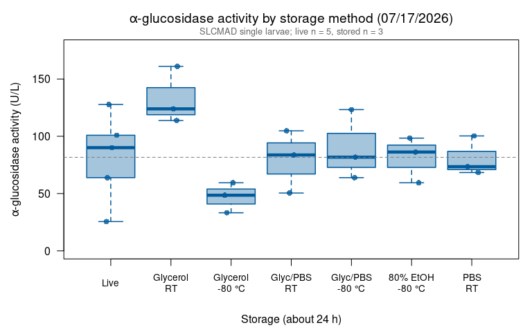
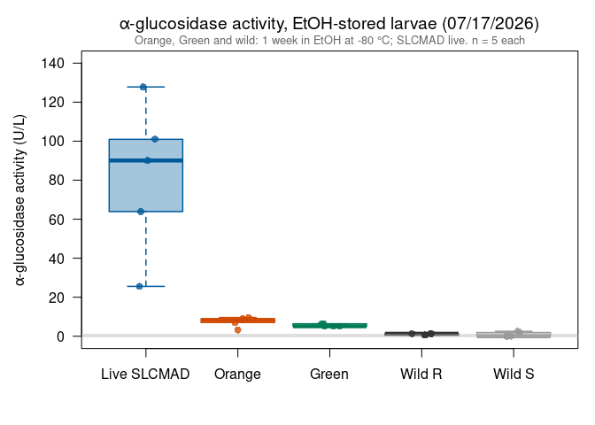
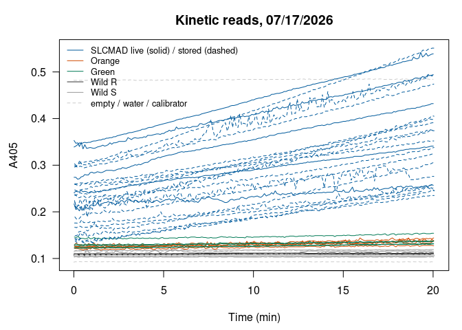

Alina’s alpha-glucosidase assays 07/17/2026: storage methods and
EtOH-stored colony and wild larvae
================
Norah Saarman
2026-10-23

- [Overview](#overview)
- [Plate map](#plate-map)
- [Colors](#colors)
- [Data](#data)
- [Activity](#activity)
  - [Background from empty wells](#background-from-empty-wells)
- [Part 1: storage methods (about 24
  h)](#part-1-storage-methods-about-24-h)
  - [Summary](#summary)
  - [Comparison with live (Dunnett)](#comparison-with-live-dunnett)
  - [Boxplot](#boxplot)
- [Part 2: EtOH-stored colony and wild larvae (about 1
  week)](#part-2-etoh-stored-colony-and-wild-larvae-about-1-week)
  - [Summary](#summary-1)
  - [Boxplot](#boxplot-1)
- [QC: kinetic curves](#qc-kinetic-curves)
- [Notes](#notes)

RStudio Configuration: - **R version:** R 4.4.0 (Geospatial packages)  
- **Number of cores:** 1 (up to 32 available)  
- **Account:** saarman-np  
- **Partition:** saarman-np (now auto allows multiple simultaneous jobs)

# Overview

Sigma-Aldrich alpha-Glucosidase Activity Assay Kit (MAK123), read on the
Multiskan SkyHigh at 405 nm, kinetic reads every 6 s for 20 min at 25.5
°C.

This plate holds two experiments:

1.  **Storage methods (about 24 h).** Susceptible SLCMAD larvae, 3 per
    method: glycerol and 50% glycerol + 50% PBS, each at room
    temperature or frozen at -80 °C; 80% EtOH frozen at -80 °C; PBS at
    room temperature. Compared with 5 live SLCMAD larvae.
2.  **EtOH-stored colony and wild larvae (about 1 week at -80 °C).** 5
    each:
    - **Orange**: USU resistant colony from the CDC
    - **Green**: USU resistant colony (fire station 13)
    - **Wild R**: wild larvae that survived 5 ppm Lsph for 24 h
    - **Wild S**: wild larvae that were dead at 12 h of exposure to 5
      ppm Lsph

    From Alina’s notes, the wild larvae had not reached 4th instar, and
    it isn’t known how long the Wild S larvae were dead before storage.

**Activity.** From the kit:

$$\text{Activity (U/L)} = \frac{A405_{final} - A405_{initial}}{A405_{calibrator} - A405_{water}} \times 250$$

- *initial* = first kinetic read (t = 0); *final* = last read (t = 20
  min)
- calibrator and water = their own reads at 20 min
- If A405_final \> 1.0, the kit says to dilute with water and repeat.
  Set `dilution` in the plate map for any re-run well and the result is
  multiplied back up.

One unit hydrolyzes 1.0 µmole substrate per minute at pH 7.0.

# Plate map

From Alina’s plate map. The plate reader read columns 1-10 of every row;
wells without a sample are used below to estimate background.

``` r
infile    <- file.path(data_dir, "Kinetic Abs @ 405 2026-07-17 11-43-15.xlsx")
run_label <- "2026-07-17"

water_well <- "A1"   # H2O control
cal_well   <- "A2"   # calibrator

storage_order <- c("Live", "Glycerol, RT", "Glycerol, -80 °C",
                   "Glycerol/PBS, RT", "Glycerol/PBS, -80 °C",
                   "80% EtOH, -80 °C", "PBS, RT")
etoh_order    <- c("Live SLCMAD", "Orange", "Green", "Wild R", "Wild S")

plate_map <- rbind(
  data.frame(experiment = "both", well = paste0("B", 1:5),
             group = "Live", colony = "SLCMAD"),
  data.frame(experiment = "etoh", well = paste0("C", 1:10),
             group = rep(c("Wild R", "Wild S"), each = 5),
             colony = rep(c("Wild R", "Wild S"), each = 5)),
  data.frame(experiment = "etoh", well = paste0("D", 1:10),
             group = rep(c("Orange", "Green"), each = 5),
             colony = rep(c("Orange", "Green"), each = 5)),
  data.frame(experiment = "storage",
             well  = c(paste0("E", 1:6), paste0("F", 1:6), paste0("G", 1:3), paste0("H", 1:3)),
             group = c(rep(c("Glycerol, RT", "Glycerol, -80 °C",
                             "Glycerol/PBS, RT", "Glycerol/PBS, -80 °C"), each = 3),
                       rep("80% EtOH, -80 °C", 3), rep("PBS, RT", 3)),
             colony = "SLCMAD")
)
plate_map$dilution <- 1
```

# Colors

Same palette as the Lsph probit figures. Wild larvae aren’t one of the
colonies, so they are drawn in greys (dark for Wild R, light for Wild
S).

``` r
colony_colors <- c(Yellow   = "#B8860B",   # mustard gold (was #E6AB02)
                   SLCMAD   = "#005A9C",   # deeper blue  (was #0072B2)
                   Green    = "#007A55",   # deeper green (was #009E73)
                   Orange   = "#D04A00",   # burnt orange (was #E66100)
                   White    = "#5E3C99",   # deeper purple (was #7B5EA7)
                   "Wild R" = "grey20",
                   "Wild S" = "grey60")
```

# Data

The “Raw data 405 nm” sheet has one row per well per read (well,
wavelength, absorbance, time in seconds). The header row is found by
name, because the number of blank rows above it differs between exports.

``` r
raw <- suppressWarnings(
  read_excel(infile, sheet = "Raw data 405 nm", col_names = FALSE,
             col_types = c("text", "numeric", "numeric", "numeric")))
```

    ## New names:
    ## • `` -> `...1`
    ## • `` -> `...2`
    ## • `` -> `...3`
    ## • `` -> `...4`

``` r
names(raw)[1:4] <- c("well", "wavelength", "abs", "time_s")
header_row <- which(raw$well == "Well")[1]
raw <- as.data.frame(raw[(header_row + 1):nrow(raw), ])
raw <- raw[!is.na(raw$well) & !is.na(raw$abs), ]
raw$well <- gsub(" ", "", raw$well)            # "A 1" -> "A1"
raw <- raw[order(raw$well, raw$time_s), ]

table(raw$well)                                # reads per well (expect 201)
```

    ## 
    ##  A1 A10  A2  A3  A4  A5  A6  A7  A8  A9  B1 B10  B2  B3  B4  B5  B6  B7  B8  B9 
    ## 201 201 201 201 201 201 201 201 201 201 201 201 201 201 201 201 201 201 201 201 
    ##  C1 C10  C2  C3  C4  C5  C6  C7  C8  C9  D1 D10  D2  D3  D4  D5  D6  D7  D8  D9 
    ## 201 201 201 201 201 201 201 201 201 201 201 201 201 201 201 201 201 201 201 201 
    ##  E1 E10  E2  E3  E4  E5  E6  E7  E8  E9  F1 F10  F2  F3  F4  F5  F6  F7  F8  F9 
    ## 201 201 201 201 201 201 201 201 201 201 201 201 201 201 201 201 201 201 201 201 
    ##  G1 G10  G2  G3  G4  G5  G6  G7  G8  G9  H1 H10  H2  H3  H4  H5  H6  H7  H8  H9 
    ## 201 201 201 201 201 201 201 201 201 201 201 201 201 201 201 201 201 201 201 201

# Activity

``` r
first_abs <- tapply(raw$abs, raw$well, function(x) x[1])
last_abs  <- tapply(raw$abs, raw$well, function(x) x[length(x)])

water_20 <- last_abs[[water_well]]
cal_20   <- last_abs[[cal_well]]
denom    <- cal_20 - water_20
cat(sprintf("Calibrator (%s) at 20 min = %.4f\nWater (%s) at 20 min = %.4f\n",
            cal_well, cal_20, water_well, water_20))
```

    ## Calibrator (A2) at 20 min = 0.4840
    ## Water (A1) at 20 min = 0.0927

``` r
to_activity <- function(wells) {
  (last_abs[wells] - first_abs[wells]) / denom * 250
}

agc <- plate_map
agc$A405_initial <- as.numeric(first_abs[agc$well])
agc$A405_final   <- as.numeric(last_abs[agc$well])
agc$activity_U_L <- as.numeric(to_activity(agc$well)) * agc$dilution
agc$over_1       <- agc$A405_final > 1.0

if (any(agc$over_1))
  warning("A405_final > 1.0 in wells: ", paste(agc$well[agc$over_1], collapse = ", "),
          " -- kit says dilute and repeat.")

write.csv(agc, file.path(results_dir, paste0("agc_activity_", run_label, ".csv")),
          row.names = FALSE)
kable(agc, digits = 3)
```

| experiment | well | group                | colony | dilution | A405_initial | A405_final | activity_U_L | over_1 |
|:-----------|:-----|:---------------------|:-------|---------:|-------------:|-----------:|-------------:|:-------|
| both       | B1   | Live                 | SLCMAD |        1 |        0.241 |      0.341 |       63.890 | FALSE  |
| both       | B2   | Live                 | SLCMAD |        1 |        0.339 |      0.539 |      127.779 | FALSE  |
| both       | B3   | Live                 | SLCMAD |        1 |        0.353 |      0.494 |       90.084 | FALSE  |
| both       | B4   | Live                 | SLCMAD |        1 |        0.274 |      0.432 |      100.946 | FALSE  |
| both       | B5   | Live                 | SLCMAD |        1 |        0.217 |      0.257 |       25.556 | FALSE  |
| etoh       | C1   | Wild R               | Wild R |        1 |        0.109 |      0.111 |        1.278 | FALSE  |
| etoh       | C2   | Wild R               | Wild R |        1 |        0.108 |      0.110 |        1.278 | FALSE  |
| etoh       | C3   | Wild R               | Wild R |        1 |        0.107 |      0.108 |        0.639 | FALSE  |
| etoh       | C4   | Wild R               | Wild R |        1 |        0.107 |      0.108 |        0.639 | FALSE  |
| etoh       | C5   | Wild R               | Wild R |        1 |        0.110 |      0.112 |        1.278 | FALSE  |
| etoh       | C6   | Wild S               | Wild S |        1 |        0.104 |      0.104 |        0.000 | FALSE  |
| etoh       | C7   | Wild S               | Wild S |        1 |        0.106 |      0.106 |        0.000 | FALSE  |
| etoh       | C8   | Wild S               | Wild S |        1 |        0.111 |      0.115 |        2.556 | FALSE  |
| etoh       | C9   | Wild S               | Wild S |        1 |        0.103 |      0.103 |        0.000 | FALSE  |
| etoh       | C10  | Wild S               | Wild S |        1 |        0.116 |      0.119 |        1.917 | FALSE  |
| etoh       | D1   | Orange               | Orange |        1 |        0.122 |      0.127 |        3.194 | FALSE  |
| etoh       | D2   | Orange               | Orange |        1 |        0.123 |      0.137 |        8.945 | FALSE  |
| etoh       | D3   | Orange               | Orange |        1 |        0.129 |      0.144 |        9.583 | FALSE  |
| etoh       | D4   | Orange               | Orange |        1 |        0.127 |      0.138 |        7.028 | FALSE  |
| etoh       | D5   | Orange               | Orange |        1 |        0.125 |      0.138 |        8.306 | FALSE  |
| etoh       | D6   | Green                | Green  |        1 |        0.123 |      0.131 |        5.111 | FALSE  |
| etoh       | D7   | Green                | Green  |        1 |        0.127 |      0.137 |        6.389 | FALSE  |
| etoh       | D8   | Green                | Green  |        1 |        0.130 |      0.138 |        5.111 | FALSE  |
| etoh       | D9   | Green                | Green  |        1 |        0.122 |      0.132 |        6.389 | FALSE  |
| etoh       | D10  | Green                | Green  |        1 |        0.146 |      0.154 |        5.111 | FALSE  |
| storage    | E1   | Glycerol, RT         | SLCMAD |        1 |        0.296 |      0.474 |      113.723 | FALSE  |
| storage    | E2   | Glycerol, RT         | SLCMAD |        1 |        0.299 |      0.551 |      161.002 | FALSE  |
| storage    | E3   | Glycerol, RT         | SLCMAD |        1 |        0.303 |      0.497 |      123.946 | FALSE  |
| storage    | E4   | Glycerol, -80 °C     | SLCMAD |        1 |        0.259 |      0.352 |       59.417 | FALSE  |
| storage    | E5   | Glycerol, -80 °C     | SLCMAD |        1 |        0.176 |      0.252 |       48.556 | FALSE  |
| storage    | E6   | Glycerol, -80 °C     | SLCMAD |        1 |        0.224 |      0.276 |       33.223 | FALSE  |
| storage    | F1   | Glycerol/PBS, RT     | SLCMAD |        1 |        0.235 |      0.399 |      104.779 | FALSE  |
| storage    | F2   | Glycerol/PBS, RT     | SLCMAD |        1 |        0.260 |      0.391 |       83.695 | FALSE  |
| storage    | F3   | Glycerol/PBS, RT     | SLCMAD |        1 |        0.167 |      0.246 |       50.473 | FALSE  |
| storage    | F4   | Glycerol/PBS, -80 °C | SLCMAD |        1 |        0.247 |      0.375 |       81.779 | FALSE  |
| storage    | F5   | Glycerol/PBS, -80 °C | SLCMAD |        1 |        0.212 |      0.405 |      123.307 | FALSE  |
| storage    | F6   | Glycerol/PBS, -80 °C | SLCMAD |        1 |        0.238 |      0.338 |       63.890 | FALSE  |
| storage    | G1   | 80% EtOH, -80 °C     | SLCMAD |        1 |        0.142 |      0.235 |       59.417 | FALSE  |
| storage    | G2   | 80% EtOH, -80 °C     | SLCMAD |        1 |        0.220 |      0.374 |       98.390 | FALSE  |
| storage    | G3   | 80% EtOH, -80 °C     | SLCMAD |        1 |        0.189 |      0.324 |       86.251 | FALSE  |
| storage    | H1   | PBS, RT              | SLCMAD |        1 |        0.138 |      0.245 |       68.362 | FALSE  |
| storage    | H2   | PBS, RT              | SLCMAD |        1 |        0.143 |      0.258 |       73.473 | FALSE  |
| storage    | H3   | PBS, RT              | SLCMAD |        1 |        0.149 |      0.306 |      100.307 | FALSE  |

## Background from empty wells

Wells with no sample show how much “activity” the reader reports from
noise alone. Samples within this range have no activity the assay can
detect.

``` r
empty_wells <- setdiff(names(last_abs), c(agc$well, water_well, cal_well))
background  <- as.numeric(to_activity(empty_wells))
bg_max      <- max(abs(background))
cat(sprintf("%d empty wells: apparent activity from %.2f to %.2f U/L\n",
            length(empty_wells), min(background), max(background)))
```

    ## 35 empty wells: apparent activity from -0.64 to 1.28 U/L

# Part 1: storage methods (about 24 h)

## Summary

``` r
st <- agc[agc$experiment %in% c("both", "storage"), ]
st$group <- factor(st$group, levels = storage_order)

storage_summary <- data.frame(
  group    = storage_order,
  n        = as.numeric(tapply(st$activity_U_L, st$group, length)),
  mean_U_L = as.numeric(tapply(st$activity_U_L, st$group, mean)),
  sd_U_L   = as.numeric(tapply(st$activity_U_L, st$group, sd))
)
storage_summary$pct_of_live <- 100 * storage_summary$mean_U_L / storage_summary$mean_U_L[1]

write.csv(storage_summary,
          file.path(results_dir, paste0("agc_storage_summary_", run_label, ".csv")),
          row.names = FALSE)
kable(storage_summary, digits = 1)
```

| group                |   n | mean_U_L | sd_U_L | pct_of_live |
|:---------------------|----:|---------:|-------:|------------:|
| Live                 |   5 |     81.7 |   38.8 |       100.0 |
| Glycerol, RT         |   3 |    132.9 |   24.9 |       162.8 |
| Glycerol, -80 °C     |   3 |     47.1 |   13.2 |        57.6 |
| Glycerol/PBS, RT     |   3 |     79.6 |   27.4 |        97.5 |
| Glycerol/PBS, -80 °C |   3 |     89.7 |   30.5 |       109.8 |
| 80% EtOH, -80 °C     |   3 |     81.4 |   19.9 |        99.6 |
| PBS, RT              |   3 |     80.7 |   17.2 |        98.9 |

## Comparison with live (Dunnett)

As in Alina’s analysis: one-way ANOVA, then Dunnett’s test comparing
each storage method with live. Needs the `multcomp` package. With 3
larvae per method, treat the p-values as a rough guide.

``` r
anova_model <- aov(activity_U_L ~ group, data = st)
summary(anova_model)
```

    ##             Df Sum Sq Mean Sq F value Pr(>F)  
    ## group        6  11493  1915.4    2.48 0.0687 .
    ## Residuals   16  12359   772.4                 
    ## ---
    ## Signif. codes:  0 '***' 0.001 '**' 0.01 '*' 0.05 '.' 0.1 ' ' 1

``` r
if (requireNamespace("multcomp", quietly = TRUE)) {
  dunnett <- multcomp::glht(anova_model, linfct = multcomp::mcp(group = "Dunnett"))
  summary(dunnett)
} else {
  message("multcomp not installed; install.packages('multcomp') for Dunnett's test.")
}
```

    ## 
    ##   Simultaneous Tests for General Linear Hypotheses
    ## 
    ## Multiple Comparisons of Means: Dunnett Contrasts
    ## 
    ## 
    ## Fit: aov(formula = activity_U_L ~ group, data = st)
    ## 
    ## Linear Hypotheses:
    ##                                  Estimate Std. Error t value Pr(>|t|)
    ## Glycerol, RT - Live == 0          51.2395    20.2971   2.524    0.105
    ## Glycerol, -80 °C - Live == 0     -34.5856    20.2971  -1.704    0.409
    ## Glycerol/PBS, RT - Live == 0      -2.0019    20.2971  -0.099    1.000
    ## Glycerol/PBS, -80 °C - Live == 0   8.0075    20.2971   0.395    0.998
    ## 80% EtOH, -80 °C - Live == 0      -0.2982    20.2971  -0.015    1.000
    ## PBS, RT - Live == 0               -0.9370    20.2971  -0.046    1.000
    ## (Adjusted p values reported -- single-step method)

## Boxplot

All SLCMAD. Points are individual larvae; the dashed line is the live
mean.

``` r
slcmad_col <- colony_colors[["SLCMAD"]]
# Two-line axis labels so R doesn't drop any for overlapping
storage_labels <- c("Live", "Glycerol\nRT", "Glycerol\n-80 °C", "Glyc/PBS\nRT",
                    "Glyc/PBS\n-80 °C", "80% EtOH\n-80 °C", "PBS\nRT")

par(mar = c(5.5, 4.8, 3, 1))
boxplot(activity_U_L ~ group, data = st,
        col    = adjustcolor(slcmad_col, alpha.f = 0.35),
        border = slcmad_col,
        lwd = 1.5, outline = FALSE, las = 1, xaxt = "n",
        ylim = c(0, max(st$activity_U_L) * 1.1),
        xlab = "",
        ylab = expression(alpha*"-glucosidase activity (U/L)"),
        main = expression(alpha*"-glucosidase activity by storage method (07/17/2026)"))
axis(1, at = seq_along(storage_order), labels = storage_labels, padj = 0.5, cex.axis = 0.85)
title(xlab = "Storage (about 24 h)", line = 4)
abline(h = storage_summary$mean_U_L[1], lty = 2, col = "grey50")
set.seed(1)
points(jitter(as.numeric(st$group), amount = 0.12), st$activity_U_L,
       pch = 16, cex = 1.1, col = adjustcolor(slcmad_col, alpha.f = 0.8))
mtext("SLCMAD single larvae; live n = 5, stored n = 3",
      side = 3, line = 0.2, cex = 0.8, col = "grey40")
```

<!-- -->

# Part 2: EtOH-stored colony and wild larvae (about 1 week)

## Summary

Live SLCMAD from the same plate is included as a reference.

``` r
et <- agc[agc$experiment %in% c("both", "etoh"), ]
et$group <- ifelse(et$group == "Live", "Live SLCMAD", et$group)
et$group <- factor(et$group, levels = etoh_order)

etoh_summary <- data.frame(
  group    = etoh_order,
  n        = as.numeric(tapply(et$activity_U_L, et$group, length)),
  mean_U_L = as.numeric(tapply(et$activity_U_L, et$group, mean)),
  max_U_L  = as.numeric(tapply(et$activity_U_L, et$group, max))
)
etoh_summary$above_background <- etoh_summary$max_U_L > bg_max

write.csv(etoh_summary,
          file.path(results_dir, paste0("agc_etoh_colony_wild_summary_", run_label, ".csv")),
          row.names = FALSE)
kable(etoh_summary, digits = 1)
```

| group       |   n | mean_U_L | max_U_L | above_background |
|:------------|----:|---------:|--------:|:-----------------|
| Live SLCMAD |   5 |     81.7 |   127.8 | TRUE             |
| Orange      |   5 |      7.4 |     9.6 | TRUE             |
| Green       |   5 |      5.6 |     6.4 | TRUE             |
| Wild R      |   5 |      1.0 |     1.3 | FALSE            |
| Wild S      |   5 |      0.9 |     2.6 | TRUE             |

## Boxplot

The grey band is the range of apparent activity in the empty wells
(background). Points are individual larvae.

``` r
box_cols <- colony_colors[c("SLCMAD", "Orange", "Green", "Wild R", "Wild S")]

par(mar = c(4.5, 4.8, 3, 1))
boxplot(activity_U_L ~ group, data = et,
        col    = adjustcolor(box_cols, alpha.f = 0.35),
        border = box_cols,
        lwd = 1.5, outline = FALSE, las = 1,
        ylim = c(min(0, background), max(et$activity_U_L) * 1.1),
        xlab = "",
        ylab = expression(alpha*"-glucosidase activity (U/L)"),
        main = expression(alpha*"-glucosidase activity, EtOH-stored larvae (07/17/2026)"))
rect(0, min(background), length(etoh_order) + 1, max(background),
     col = adjustcolor("grey70", alpha.f = 0.4), border = NA)
set.seed(1)
points(jitter(as.numeric(et$group), amount = 0.12), et$activity_U_L,
       pch = 16, cex = 1.1,
       col = adjustcolor(colony_colors[et$colony], alpha.f = 0.8))
mtext("Orange, Green and wild: 1 week in EtOH at -80 °C; SLCMAD live. n = 5 each",
      side = 3, line = 0.2, cex = 0.8, col = "grey40")
```

<!-- -->

# QC: kinetic curves

Each well’s A405 over the 20 min. The formula uses only the first and
last reads, so a well whose signal jumps around can shift its activity
value. Empty wells, water and calibrator are dashed grey.

``` r
par(mar = c(4.5, 4.5, 3, 1))
plot(NA, xlim = range(raw$time_s) / 60, ylim = range(raw$abs), las = 1,
     xlab = "Time (min)", ylab = "A405", main = "Kinetic reads, 07/17/2026")
for (w in unique(raw$well)) {
  d <- raw[raw$well == w, ]
  i <- match(w, agc$well)
  if (is.na(i)) {
    lines(d$time_s / 60, d$abs, col = "grey80", lty = 2)
  } else {
    lines(d$time_s / 60, d$abs, col = colony_colors[[agc$colony[i]]],
          lty = if (agc$experiment[i] == "storage") 2 else 1)
  }
}
legend("topleft", bty = "n", cex = 0.8,
       legend = c("SLCMAD live (solid) / stored (dashed)", "Orange", "Green",
                  "Wild R", "Wild S", "empty / water / calibrator"),
       col = c(colony_colors[c("SLCMAD", "Orange", "Green", "Wild R", "Wild S")], "grey80"),
       lty = c(1, 1, 1, 1, 1, 2))
```

<!-- -->

# Notes

*Summary for Alina and the lab, written 10/22/2026.*

**Storage (about 24 h, SLCMAD).**

- Live averaged 82 U/L. Glycerol at room temperature read highest (163%
  of live). Glycerol/PBS kept about as much activity as live at both
  temperatures (98% at room temp, 110% frozen), as did 80% EtOH frozen
  (100%) and PBS at room temp (99%) over this short storage. Freezing in
  pure glycerol lost the most (58%).
- Over about a week (07/31), glycerol/PBS at room temperature still kept
  all of the live activity, while PBS and EtOH lost most of it. Together
  these plates support **50% glycerol / 50% PBS at room temperature** as
  the storage method.

**EtOH-stored colony and wild larvae (about 1 week at -80 °C).**

- Wild R (1 U/L) and Wild S (0.9 U/L) read at or near the background of
  the empty wells (up to about 1.3 U/L; the highest single wild larva
  read 2.6 U/L): **essentially no detectable activity**. Orange (7.4)
  and Green (5.6 U/L) were only just above background, against 81.7 U/L
  for live SLCMAD.
- These values say more about storage than about the colonies. On 07/31,
  a week in EtOH at -80 °C cut SLCMAD activity to about a tenth of live,
  and the wild larvae were also not 4th instar, and Wild S may have been
  dead for some time before storage. **The wild and colony comparisons
  on this plate should not be used** for resistance vs. activity; 06/25
  and 07/23 (Green, Orange, White vs. SLCMAD) are the usable colony
  comparisons.
