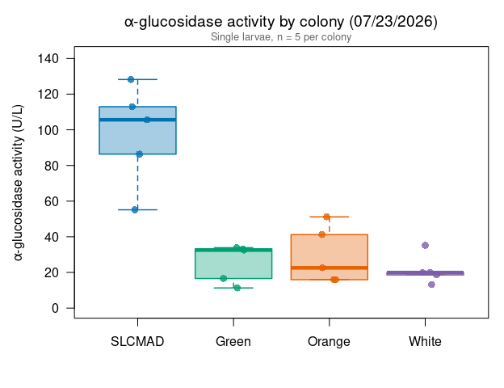
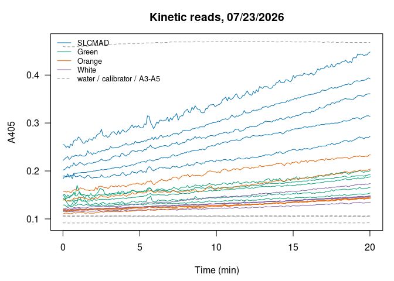

Alina’s alpha-glucosidase assays 07/23/2026: SLCMAD vs. USU colonies
================
Norah Saarman
2026-10-22

- [Overview](#overview)
- [Plate map](#plate-map)
- [Colors](#colors)
- [Data](#data)
- [Activity](#activity)
  - [Summary by colony](#summary-by-colony)
  - [Tests](#tests)
- [Boxplot](#boxplot)
- [QC: kinetic curves](#qc-kinetic-curves)
- [Notes](#notes)

RStudio Configuration: - **R version:** R 4.4.0 (Geospatial packages)  
- **Number of cores:** 1 (up to 32 available)  
- **Account:** saarman-np  
- **Partition:** saarman-np (now auto allows multiple simultaneous jobs)

# Overview

Sigma-Aldrich alpha-Glucosidase Activity Assay Kit (MAK123), read on the
Multiskan SkyHigh at 405 nm, kinetic reads every 6 s for 20 min at 25.5
°C.

**Colony comparison.** 5 single larvae per colony:

- **SLCMAD**: susceptible colony
- **Green**: USU resistant colony (fire station 13)
- **Orange**: USU resistant colony from the CDC
- **White**: USU colony that Alina’s notes call the “susceptible” USU
  colony

**Activity.** From the kit:

$$\text{Activity (U/L)} = \frac{A405_{final} - A405_{initial}}{A405_{calibrator} - A405_{water}} \times 250$$

- *initial* = first kinetic read (t = 0); *final* = last read (t = 20
  min)
- calibrator and water = their own reads at 20 min
- If A405_final \> 1.0, the kit says to dilute with water and repeat.
  Set `dilution` in the plate map for any re-run well and the result is
  multiplied back up.

One unit hydrolyzes 1.0 µmole substrate per minute at pH 7.0.

# Plate map

From Alina’s plate map. A3-A5 were read but are unlabeled, so they are
not used.

``` r
infile    <- file.path(data_dir, "Kinetic Abs @ 405 2026-07-23 13-01-35.xlsx")
run_label <- "2026-07-23"

water_well <- "A1"   # H2O control
cal_well   <- "A2"   # calibrator

# Same order as the Lsph probit panel (most susceptible to most resistant)
colony_order <- c("SLCMAD", "Green", "Orange", "White")

plate_map <- data.frame(
  well     = c(paste0("B", 1:5), paste0("C", 1:5), paste0("D", 1:5), paste0("E", 1:5)),
  colony   = rep(c("SLCMAD", "Green", "White", "Orange"), each = 5),
  dilution = 1
)
```

# Colors

Same palette as the Lsph probit figures.

``` r
colony_colors <- c(SLCMAD = "#0072B2",
                   Green  = "#009E73",
                   Orange = "#E66100",
                   White  = "#7B5EA7")
```

# Data

The “Raw data 405 nm” sheet has one row per well per read (well,
wavelength, absorbance, time in seconds). The header row is found by
name, because the number of blank rows above it differs between exports.

``` r
raw <- suppressWarnings(
  read_excel(infile, sheet = "Raw data 405 nm", col_names = FALSE,
             col_types = c("text", "numeric", "numeric", "numeric")))
```

    ## New names:
    ## • `` -> `...1`
    ## • `` -> `...2`
    ## • `` -> `...3`
    ## • `` -> `...4`

``` r
names(raw)[1:4] <- c("well", "wavelength", "abs", "time_s")
header_row <- which(raw$well == "Well")[1]
raw <- as.data.frame(raw[(header_row + 1):nrow(raw), ])
raw <- raw[!is.na(raw$well) & !is.na(raw$abs), ]
raw$well <- gsub(" ", "", raw$well)            # "A 1" -> "A1"
raw <- raw[order(raw$well, raw$time_s), ]

table(raw$well)                                # reads per well (expect 201)
```

    ## 
    ##  A1  A2  A3  A4  A5  B1  B2  B3  B4  B5  C1  C2  C3  C4  C5  D1  D2  D3  D4  D5 
    ## 201 201 201 201 201 201 201 201 201 201 201 201 201 201 201 201 201 201 201 201 
    ##  E1  E2  E3  E4  E5 
    ## 201 201 201 201 201

# Activity

``` r
first_abs <- tapply(raw$abs, raw$well, function(x) x[1])
last_abs  <- tapply(raw$abs, raw$well, function(x) x[length(x)])

water_20 <- last_abs[[water_well]]
cal_20   <- last_abs[[cal_well]]
denom    <- cal_20 - water_20
cat(sprintf("Calibrator (%s) at 20 min = %.4f\nWater (%s) at 20 min = %.4f\n",
            cal_well, cal_20, water_well, water_20))
```

    ## Calibrator (A2) at 20 min = 0.4680
    ## Water (A1) at 20 min = 0.0917

``` r
agc <- plate_map
agc$A405_initial <- as.numeric(first_abs[agc$well])
agc$A405_final   <- as.numeric(last_abs[agc$well])
agc$activity_U_L <- (agc$A405_final - agc$A405_initial) / denom * 250 * agc$dilution
agc$over_1       <- agc$A405_final > 1.0
agc$colony       <- factor(agc$colony, levels = colony_order)
agc <- agc[order(agc$colony, agc$well), ]

if (any(agc$over_1))
  warning("A405_final > 1.0 in wells: ", paste(agc$well[agc$over_1], collapse = ", "),
          " -- kit says dilute and repeat.")

write.csv(agc, file.path(results_dir, paste0("agc_activity_", run_label, ".csv")),
          row.names = FALSE)
kable(agc, digits = 3, row.names = FALSE)
```

| well | colony | dilution | A405_initial | A405_final | activity_U_L | over_1 |
|:-----|:-------|---------:|-------------:|-----------:|-------------:|:-------|
| B1   | SLCMAD |        1 |        0.222 |      0.392 |      112.942 | FALSE  |
| B2   | SLCMAD |        1 |        0.189 |      0.272 |       55.142 | FALSE  |
| B3   | SLCMAD |        1 |        0.184 |      0.314 |       86.367 | FALSE  |
| B4   | SLCMAD |        1 |        0.202 |      0.361 |      105.634 | FALSE  |
| B5   | SLCMAD |        1 |        0.255 |      0.448 |      128.222 | FALSE  |
| C1   | Green  |        1 |        0.142 |      0.192 |       33.218 | FALSE  |
| C2   | Green  |        1 |        0.139 |      0.188 |       32.554 | FALSE  |
| C3   | Green  |        1 |        0.149 |      0.166 |       11.294 | FALSE  |
| C4   | Green  |        1 |        0.150 |      0.201 |       33.883 | FALSE  |
| C5   | Green  |        1 |        0.129 |      0.154 |       16.609 | FALSE  |
| E1   | Orange |        1 |        0.111 |      0.145 |       22.588 | FALSE  |
| E2   | Orange |        1 |        0.142 |      0.204 |       41.191 | FALSE  |
| E3   | Orange |        1 |        0.119 |      0.143 |       15.945 | FALSE  |
| E4   | Orange |        1 |        0.157 |      0.234 |       51.156 | FALSE  |
| E5   | Orange |        1 |        0.120 |      0.144 |       15.945 | FALSE  |
| D1   | White  |        1 |        0.121 |      0.174 |       35.211 | FALSE  |
| D2   | White  |        1 |        0.118 |      0.148 |       19.931 | FALSE  |
| D3   | White  |        1 |        0.119 |      0.147 |       18.602 | FALSE  |
| D4   | White  |        1 |        0.118 |      0.148 |       19.931 | FALSE  |
| D5   | White  |        1 |        0.115 |      0.135 |       13.287 | FALSE  |

## Summary by colony

``` r
agc_summary <- data.frame(
  colony   = colony_order,
  n        = as.numeric(tapply(agc$activity_U_L, agc$colony, length)),
  mean_U_L = as.numeric(tapply(agc$activity_U_L, agc$colony, mean)),
  sd_U_L   = as.numeric(tapply(agc$activity_U_L, agc$colony, sd))
)
agc_summary$cv_pct <- 100 * agc_summary$sd_U_L / agc_summary$mean_U_L

write.csv(agc_summary, file.path(results_dir, paste0("agc_summary_", run_label, ".csv")),
          row.names = FALSE)
kable(agc_summary, digits = 1)
```

| colony |   n | mean_U_L | sd_U_L | cv_pct |
|:-------|----:|---------:|-------:|-------:|
| SLCMAD |   5 |     97.7 |   28.1 |   28.8 |
| Green  |   5 |     25.5 |   10.7 |   42.1 |
| Orange |   5 |     29.4 |   16.0 |   54.4 |
| White  |   5 |     21.4 |    8.2 |   38.3 |

## Tests

As in Alina’s analysis: one-way ANOVA across the four colonies, and a
t-test of SLCMAD against the three USU colonies combined (Welch, which
doesn’t assume equal variances). With 5 larvae per colony, treat the
p-values as a rough guide.

``` r
summary(aov(activity_U_L ~ colony, data = agc))
```

    ##             Df Sum Sq Mean Sq F value  Pr(>F)    
    ## colony       3  19728    6576    21.4 7.6e-06 ***
    ## Residuals   16   4916     307                    
    ## ---
    ## Signif. codes:  0 '***' 0.001 '**' 0.01 '*' 0.05 '.' 0.1 ' ' 1

``` r
t.test(agc$activity_U_L[agc$colony == "SLCMAD"],
       agc$activity_U_L[agc$colony != "SLCMAD"])
```

    ## 
    ##  Welch Two Sample t-test
    ## 
    ## data:  agc$activity_U_L[agc$colony == "SLCMAD"] and agc$activity_U_L[agc$colony != "SLCMAD"]
    ## t = 5.5831, df = 4.4683, p-value = 0.003613
    ## alternative hypothesis: true difference in means is not equal to 0
    ## 95 percent confidence interval:
    ##   37.75179 106.72513
    ## sample estimates:
    ## mean of x mean of y 
    ##  97.66144  25.42298

# Boxplot

Ordered as in the Lsph probit panel. Points are individual larvae.

``` r
cols <- colony_colors[colony_order]

par(mar = c(4.5, 4.8, 3, 1))
boxplot(activity_U_L ~ colony, data = agc,
        col    = adjustcolor(cols, alpha.f = 0.35),
        border = cols,
        lwd = 1.5, outline = FALSE, las = 1,
        ylim = c(0, max(agc$activity_U_L) * 1.1),
        xlab = "",
        ylab = expression(alpha*"-glucosidase activity (U/L)"),
        main = expression(alpha*"-glucosidase activity by colony (07/23/2026)"))
set.seed(1)
points(jitter(as.numeric(agc$colony), amount = 0.12), agc$activity_U_L,
       pch = 16, cex = 1.2,
       col = adjustcolor(colony_colors[as.character(agc$colony)], alpha.f = 0.8))
mtext("Single larvae, n = 5 per colony", side = 3, line = 0.2, cex = 0.8, col = "grey40")
```

<!-- -->

# QC: kinetic curves

Each well’s A405 over the 20 min. The formula uses only the first and
last reads, so a well whose signal jumps around can shift its activity
value. Water, calibrator and A3-A5 are dashed grey.

``` r
par(mar = c(4.5, 4.5, 3, 1))
plot(NA, xlim = range(raw$time_s) / 60, ylim = range(raw$abs), las = 1,
     xlab = "Time (min)", ylab = "A405", main = "Kinetic reads, 07/23/2026")
for (w in unique(raw$well)) {
  d <- raw[raw$well == w, ]
  i <- match(w, agc$well)
  col <- if (is.na(i)) "grey60" else colony_colors[[as.character(agc$colony[i])]]
  lines(d$time_s / 60, d$abs, col = col, lty = if (is.na(i)) 2 else 1)
}
legend("topleft", bty = "n", cex = 0.8,
       legend = c(colony_order, "water / calibrator / A3-A5"),
       col = c(colony_colors[colony_order], "grey60"), lty = c(rep(1, 4), 2))
```

<!-- -->

# Notes

*Summary for Alina and the lab, written 10/22/2026.*

- **SLCMAD vs. the USU colonies.** SLCMAD averaged 98 U/L, about 3-5
  times the three USU colonies (Green 26, Orange 29, White 21 U/L),
  which were similar to one another. This is the clearest
  susceptible-vs.-resistant difference of any plate so far.
- **White.** Alina’s notes call White the “susceptible” USU colony, but
  in the Lsph probits White was the most resistant colony tested (LC50
  \> 500 ppm at 24 h). Its low activity here fits the probits. Worth
  checking which label is current.
- **SLCMAD on later plates.** SLCMAD has read high on every plate since
  (08/14, 08/17, 10/01). On 08/14 and 08/17 the susceptible Yellow /
  wild larvae read about as low as Green, so the gap seen here may
  reflect SLCMAD itself rather than susceptibility in general.
- **Storage.** The plate map doesn’t say whether these larvae were live
  or stored. Based on 07/31, storage in PBS or EtOH would lower
  activity, so it’s worth recording.
- Small n: 5 single larvae per colony, one plate.
