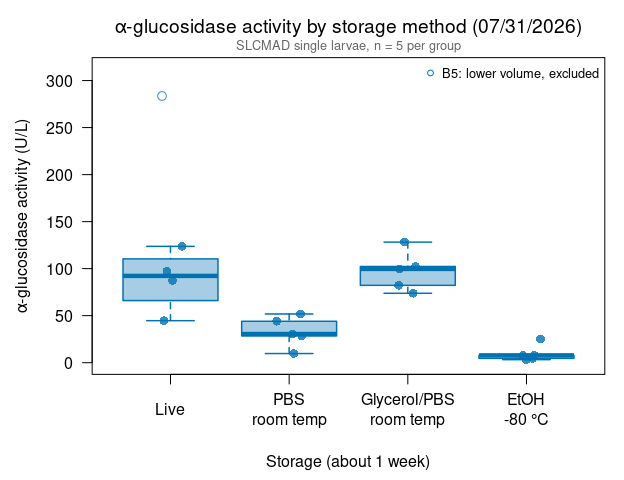
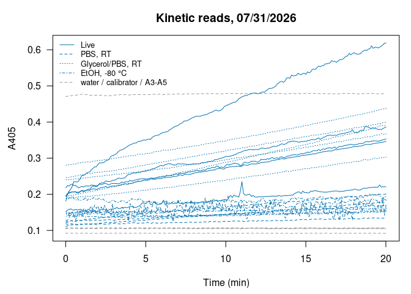

Alina’s alpha-glucosidase assays 07/31/2026: storage methods (SLCMAD)
================
Norah Saarman
2026-10-22

- [Overview](#overview)
- [Plate map](#plate-map)
- [Colors](#colors)
- [Data](#data)
- [Activity](#activity)
  - [Summary by storage method](#summary-by-storage-method)
  - [Comparison with live (Dunnett)](#comparison-with-live-dunnett)
- [Boxplot](#boxplot)
- [QC: kinetic curves](#qc-kinetic-curves)
- [Notes](#notes)

RStudio Configuration: - **R version:** R 4.4.0 (Geospatial packages)  
- **Number of cores:** 1 (up to 32 available)  
- **Account:** saarman-np  
- **Partition:** saarman-np (now auto allows multiple simultaneous jobs)

# Overview

Sigma-Aldrich alpha-Glucosidase Activity Assay Kit (MAK123), read on the
Multiskan SkyHigh at 405 nm, kinetic reads every 6 s for 20 min at 25.5
°C.

**Storage test.** Susceptible SLCMAD *Culex pipiens* larvae, 5 single
larvae per storage method, stored for about a week before the assay:

- **Live**: not stored
- **PBS, room temp**
- **50% glycerol + 50% PBS, room temp**
- **100% EtOH, frozen at -80 °C**

B5 (live) is marked on the plate map: “The volume was lower, which
indicates that the sample was more concentrated.” It is shown on the
plots but excluded from the summary and test below, as in Alina’s second
analysis.

**Activity.** From the kit:

$$\text{Activity (U/L)} = \frac{A405_{final} - A405_{initial}}{A405_{calibrator} - A405_{water}} \times 250$$

- *initial* = first kinetic read (t = 0); *final* = last read (t = 20
  min)
- calibrator and water = their own reads at 20 min
- If A405_final \> 1.0, the kit says to dilute with water and repeat.
  Set `dilution` in the plate map for any re-run well and the result is
  multiplied back up.

One unit hydrolyzes 1.0 µmole substrate per minute at pH 7.0.

# Plate map

From Alina’s plate map. A3-A5 were read but are unlabeled, so they are
not used.

``` r
infile    <- file.path(data_dir, "Kinetic Abs @ 405 2026-07-31 10-29-00.xlsx")
run_label <- "2026-07-31"

water_well <- "A1"   # H2O control
cal_well   <- "A2"   # calibrator

storage_order <- c("Live", "PBS, RT", "Glycerol/PBS, RT", "EtOH, -80 °C")

plate_map <- data.frame(
  well     = c(paste0("B", 1:5), paste0("C", 1:5), paste0("D", 1:5), paste0("E", 1:5)),
  storage  = rep(storage_order, each = 5),
  dilution = 1,
  exclude  = FALSE
)
plate_map$exclude[plate_map$well == "B5"] <- TRUE   # lower volume, more concentrated
```

# Colors

All larvae are SLCMAD, so every box uses the SLCMAD color from the Lsph
probit figures. The excluded well (B5) is an open circle.

``` r
slcmad_col <- "#0072B2"
```

# Data

The “Raw data 405 nm” sheet has one row per well per read (well,
wavelength, absorbance, time in seconds). The header row is found by
name, because the number of blank rows above it differs between exports.

``` r
raw <- suppressWarnings(
  read_excel(infile, sheet = "Raw data 405 nm", col_names = FALSE,
             col_types = c("text", "numeric", "numeric", "numeric")))
```

    ## New names:
    ## • `` -> `...1`
    ## • `` -> `...2`
    ## • `` -> `...3`
    ## • `` -> `...4`

``` r
names(raw)[1:4] <- c("well", "wavelength", "abs", "time_s")
header_row <- which(raw$well == "Well")[1]
raw <- as.data.frame(raw[(header_row + 1):nrow(raw), ])
raw <- raw[!is.na(raw$well) & !is.na(raw$abs), ]
raw$well <- gsub(" ", "", raw$well)            # "A 1" -> "A1"
raw <- raw[order(raw$well, raw$time_s), ]

table(raw$well)                                # reads per well (expect 201)
```

    ## 
    ##  A1  A2  A3  A4  A5  B1  B2  B3  B4  B5  C1  C2  C3  C4  C5  D1  D2  D3  D4  D5 
    ## 201 201 201 201 201 201 201 201 201 201 201 201 201 201 201 201 201 201 201 201 
    ##  E1  E2  E3  E4  E5 
    ## 201 201 201 201 201

# Activity

``` r
first_abs <- tapply(raw$abs, raw$well, function(x) x[1])
last_abs  <- tapply(raw$abs, raw$well, function(x) x[length(x)])

water_20 <- last_abs[[water_well]]
cal_20   <- last_abs[[cal_well]]
denom    <- cal_20 - water_20
cat(sprintf("Calibrator (%s) at 20 min = %.4f\nWater (%s) at 20 min = %.4f\n",
            cal_well, cal_20, water_well, water_20))
```

    ## Calibrator (A2) at 20 min = 0.4780
    ## Water (A1) at 20 min = 0.0919

``` r
agc <- plate_map
agc$A405_initial <- as.numeric(first_abs[agc$well])
agc$A405_final   <- as.numeric(last_abs[agc$well])
agc$activity_U_L <- (agc$A405_final - agc$A405_initial) / denom * 250 * agc$dilution
agc$over_1       <- agc$A405_final > 1.0
agc$storage      <- factor(agc$storage, levels = storage_order)

if (any(agc$over_1))
  warning("A405_final > 1.0 in wells: ", paste(agc$well[agc$over_1], collapse = ", "),
          " -- kit says dilute and repeat.")

write.csv(agc, file.path(results_dir, paste0("agc_activity_", run_label, ".csv")),
          row.names = FALSE)
kable(agc, digits = 3)
```

| well | storage          | dilution | exclude | A405_initial | A405_final | activity_U_L | over_1 |
|:-----|:-----------------|---------:|:--------|-------------:|-----------:|-------------:|:-------|
| B1   | Live             |        1 | FALSE   |        0.152 |      0.221 |       44.678 | FALSE  |
| B2   | Live             |        1 | FALSE   |        0.196 |      0.346 |       97.125 | FALSE  |
| B3   | Live             |        1 | FALSE   |        0.218 |      0.353 |       87.413 | FALSE  |
| B4   | Live             |        1 | FALSE   |        0.195 |      0.386 |      123.673 | FALSE  |
| B5   | Live             |        1 | TRUE    |        0.181 |      0.619 |      283.605 | FALSE  |
| C1   | PBS, RT          |        1 | FALSE   |        0.121 |      0.201 |       51.800 | FALSE  |
| C2   | PBS, RT          |        1 | FALSE   |        0.125 |      0.169 |       28.490 | FALSE  |
| C3   | PBS, RT          |        1 | FALSE   |        0.118 |      0.133 |        9.713 | FALSE  |
| C4   | PBS, RT          |        1 | FALSE   |        0.128 |      0.175 |       30.433 | FALSE  |
| C5   | PBS, RT          |        1 | FALSE   |        0.111 |      0.179 |       44.030 | FALSE  |
| D1   | Glycerol/PBS, RT |        1 | FALSE   |        0.246 |      0.400 |       99.715 | FALSE  |
| D2   | Glycerol/PBS, RT |        1 | FALSE   |        0.240 |      0.367 |       82.233 | FALSE  |
| D3   | Glycerol/PBS, RT |        1 | FALSE   |        0.189 |      0.303 |       73.815 | FALSE  |
| D4   | Glycerol/PBS, RT |        1 | FALSE   |        0.194 |      0.392 |      128.205 | FALSE  |
| D5   | Glycerol/PBS, RT |        1 | FALSE   |        0.280 |      0.438 |      102.305 | FALSE  |
| E1   | EtOH, -80 °C     |        1 | FALSE   |        0.188 |      0.193 |        3.238 | FALSE  |
| E2   | EtOH, -80 °C     |        1 | FALSE   |        0.147 |      0.154 |        4.533 | FALSE  |
| E3   | EtOH, -80 °C     |        1 | FALSE   |        0.145 |      0.184 |       25.253 | FALSE  |
| E4   | EtOH, -80 °C     |        1 | FALSE   |        0.150 |      0.162 |        7.770 | FALSE  |
| E5   | EtOH, -80 °C     |        1 | FALSE   |        0.139 |      0.151 |        7.770 | FALSE  |

``` r
agc_use <- agc[!agc$exclude, ]
```

## Summary by storage method

Excluding B5. Live with B5 included is shown in the last row for
comparison.

``` r
agc_summary <- data.frame(
  storage  = storage_order,
  n        = as.numeric(tapply(agc_use$activity_U_L, agc_use$storage, length)),
  mean_U_L = as.numeric(tapply(agc_use$activity_U_L, agc_use$storage, mean)),
  sd_U_L   = as.numeric(tapply(agc_use$activity_U_L, agc_use$storage, sd))
)
live_all <- agc$activity_U_L[agc$storage == "Live"]
agc_summary <- rbind(agc_summary,
  data.frame(storage = "Live (incl. B5)", n = length(live_all),
             mean_U_L = mean(live_all), sd_U_L = sd(live_all)))
agc_summary$cv_pct  <- 100 * agc_summary$sd_U_L / agc_summary$mean_U_L
agc_summary$pct_of_live <- 100 * agc_summary$mean_U_L / agc_summary$mean_U_L[1]

write.csv(agc_summary, file.path(results_dir, paste0("agc_summary_", run_label, ".csv")),
          row.names = FALSE)
kable(agc_summary, digits = 1)
```

| storage          |   n | mean_U_L | sd_U_L | cv_pct | pct_of_live |
|:-----------------|----:|---------:|-------:|-------:|------------:|
| Live             |   4 |     88.2 |   32.8 |   37.2 |       100.0 |
| PBS, RT          |   5 |     32.9 |   16.2 |   49.1 |        37.3 |
| Glycerol/PBS, RT |   5 |     97.3 |   21.0 |   21.6 |       110.2 |
| EtOH, -80 °C     |   5 |      9.7 |    8.9 |   91.8 |        11.0 |
| Live (incl. B5)  |   5 |    127.3 |   91.9 |   72.2 |       144.3 |

## Comparison with live (Dunnett)

As in Alina’s analysis: one-way ANOVA, then Dunnett’s test comparing
each storage method with live, excluding B5. Needs the `multcomp`
package. With 4-5 larvae per group and very different spreads (EtOH is
nearly zero), treat the p-values as a rough guide.

``` r
anova_model <- aov(activity_U_L ~ storage, data = agc_use)
summary(anova_model)
```

    ##             Df Sum Sq Mean Sq F value   Pr(>F)    
    ## storage      3  26038    8679   20.47 1.47e-05 ***
    ## Residuals   15   6359     424                     
    ## ---
    ## Signif. codes:  0 '***' 0.001 '**' 0.01 '*' 0.05 '.' 0.1 ' ' 1

``` r
if (requireNamespace("multcomp", quietly = TRUE)) {
  dunnett <- multcomp::glht(anova_model,
                            linfct = multcomp::mcp(storage = "Dunnett"))
  summary(dunnett)
} else {
  message("multcomp not installed; install.packages('multcomp') for Dunnett's test.")
}
```

    ## 
    ##   Simultaneous Tests for General Linear Hypotheses
    ## 
    ## Multiple Comparisons of Means: Dunnett Contrasts
    ## 
    ## 
    ## Fit: aov(formula = activity_U_L ~ storage, data = agc_use)
    ## 
    ## Linear Hypotheses:
    ##                              Estimate Std. Error t value Pr(>|t|)    
    ## PBS, RT - Live == 0           -55.329     13.812  -4.006   0.0032 ** 
    ## Glycerol/PBS, RT - Live == 0    9.033     13.812   0.654   0.8420    
    ## EtOH, -80 °C - Live == 0      -78.509     13.812  -5.684   <0.001 ***
    ## ---
    ## Signif. codes:  0 '***' 0.001 '**' 0.01 '*' 0.05 '.' 0.1 ' ' 1
    ## (Adjusted p values reported -- single-step method)

# Boxplot

Points are individual larvae; the open circle is B5 (excluded from the
box).

``` r
# Two-line axis labels so R doesn't drop any for overlapping
axis_labels <- c("Live", "PBS\nroom temp", "Glycerol/PBS\nroom temp", "EtOH\n-80 °C")

par(mar = c(5.5, 4.8, 3, 1))
boxplot(activity_U_L ~ storage, data = agc_use,
        col    = adjustcolor(slcmad_col, alpha.f = 0.35),
        border = slcmad_col,
        lwd = 1.5, outline = FALSE, las = 1, xaxt = "n",
        ylim = c(0, max(agc$activity_U_L) * 1.1),
        xlab = "",
        ylab = expression(alpha*"-glucosidase activity (U/L)"),
        main = expression(alpha*"-glucosidase activity by storage method (07/31/2026)"))
set.seed(1)
points(jitter(as.numeric(agc$storage), amount = 0.12), agc$activity_U_L,
       pch = ifelse(agc$exclude, 1, 16), cex = 1.2,
       col = adjustcolor(slcmad_col, alpha.f = 0.8))
axis(1, at = seq_along(storage_order), labels = axis_labels, padj = 0.5)
title(xlab = "Storage (about 1 week)", line = 4)
legend("topright", bty = "n", cex = 0.8, pch = 1, col = slcmad_col,
       legend = "B5: lower volume, excluded")
mtext("SLCMAD single larvae, n = 5 per group", side = 3, line = 0.2,
      cex = 0.8, col = "grey40")
```

<!-- -->

# QC: kinetic curves

Each well’s A405 over the 20 min. The formula uses only the first and
last reads, so a well whose signal jumps around can shift its activity
value. Water, calibrator and A3-A5 are dashed grey.

``` r
storage_lty <- setNames(1:4, storage_order)
par(mar = c(4.5, 4.5, 3, 1))
plot(NA, xlim = range(raw$time_s) / 60, ylim = range(raw$abs), las = 1,
     xlab = "Time (min)", ylab = "A405", main = "Kinetic reads, 07/31/2026")
for (w in unique(raw$well)) {
  d <- raw[raw$well == w, ]
  i <- match(w, agc$well)
  if (is.na(i)) {
    lines(d$time_s / 60, d$abs, col = "grey60", lty = 2)
  } else {
    lines(d$time_s / 60, d$abs, col = slcmad_col,
          lty = storage_lty[[as.character(agc$storage[i])]])
  }
}
legend("topleft", bty = "n", cex = 0.8,
       legend = c(storage_order, "water / calibrator / A3-A5"),
       col = c(rep(slcmad_col, 4), "grey60"), lty = c(1:4, 2))
```

<!-- -->

# Notes

*Summary for Alina and the lab, written 10/22/2026.*

- **Glycerol/PBS at room temperature preserved activity.** Mean activity
  was 97 U/L, about 110% of live (88 U/L, excluding B5).
- **PBS alone lost most of it** (33 U/L, about 37% of live), and **EtOH
  at -80 °C lost nearly all of it** (10 U/L, about 11% of live). EtOH
  storage is not usable for this assay.
- **B5.** The fifth live larva had a lower homogenate volume and read
  284 U/L. With it, the live mean rises to 127 U/L. It is excluded from
  the summary and test, but kept in the results CSV.
- **What this means for later plates.**
  - The SLCMAD larvae on 08/17 were stored in glycerol/PBS for about 3
    days. Based on this plate, that storage shouldn’t explain their high
    activity.
  - The wild resistant larvae on 10/01 were stored; the storage method
    should be recorded. If it was EtOH or PBS, their activity would be
    expected to read *low*, which makes their high reading on 10/01
    harder to explain.
  - The 07/17 plate used EtOH-stored Orange and Green larvae; based on
    this plate, those values are likely underestimates.
- Small n: 5 larvae per group (4 for live after excluding B5), all from
  one colony on one plate.
