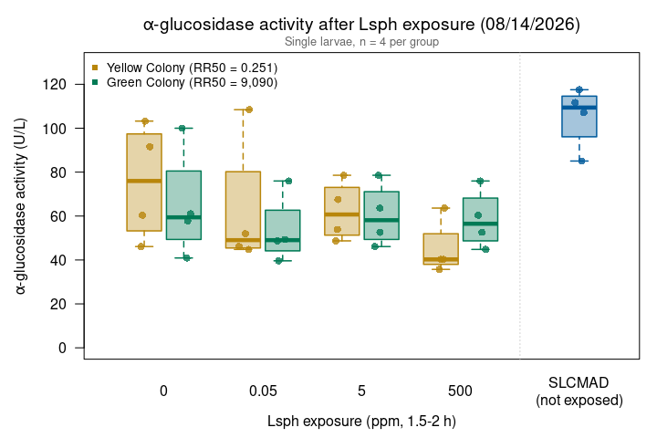

Alina’s alpha-glucosidase assays 08/14/2026
================
Norah Saarman
2026-10-23

- [Overview](#overview)
- [Plate map](#plate-map)
- [Colors](#colors)
- [Data](#data)
- [Activity](#activity)
  - [Summary by group](#summary-by-group)
- [Boxplot](#boxplot)
- [QC: reader stability](#qc-reader-stability)
- [Notes](#notes)

RStudio Configuration: - **R version:** R 4.4.0 (Geospatial packages)  
- **Number of cores:** 1 (up to 32 available)  
- **Account:** saarman-np  
- **Partition:** saarman-np (now auto allows multiple simultaneous jobs)

# Overview

Sigma-Aldrich alpha-Glucosidase Activity Assay Kit (MAK123), read at 405
nm on the older plate reader at USU. That reader couldn’t run a kinetic
protocol, so the plate was read twice by hand: once at the start (run 1)
and once at 20 min (run 2). Each run is a separate .xls file.

**Lsph exposure test.** Larvae were exposed to Lsph (VectoLex) at 0
(control), 0.05, 5 or 500 ppm for 1.5-2 hours before the assay, 4 single
larvae per group:

- **Yellow**: susceptible wild larvae (from the SSLVMAD egg rafts given
  to Thad), labelled “Susceptible (yellow)” on the plate map
- **Green**: resistant colony
- **SLCMAD**: susceptible colony, live, not exposed (extra control)

**Activity.** From the kit:

$$\text{Activity (U/L)} = \frac{A405_{final} - A405_{initial}}{A405_{calibrator} - A405_{water}} \times 250$$

- *initial* = run 1; *final* = run 2 (20 min)
- calibrator and water = their run 2 reads
- If A405_final \> 1.0, the kit says to dilute with water and repeat.
  Set `dilution` in the plate map for any re-run well and the result is
  multiplied back up.

One unit hydrolyzes 1.0 µmole substrate per minute at pH 7.0.

# Plate map

From Alina’s plate map. All other wells were empty.

``` r
file_initial <- file.path(data_dir, "8-14-26 assay run 1.xls")   # t = 0
file_final   <- file.path(data_dir, "8-14-26 assay run 2.xls")   # t = 20 min
run_label    <- "2026-08-14"
 
water_well <- "A1"   # H2O control
cal_well   <- "A2"   # calibrator
 
dose_order   <- c("0", "0.05", "5", "500")          # ppm Lsph
colony_order <- c("Yellow", "Green")
 
plate_map <- data.frame(
  well   = c(paste0("B", 1:8), paste0("C", 1:8), paste0("D", 1:8), paste0("E", 1:8),
             paste0("F", 1:4)),
  colony = c(rep("Yellow", 16), rep("Green", 16), rep("SLCMAD", 4)),
  dose   = c(rep(rep(dose_order, each = 4), 2), rep(NA, 4)),
  dilution = 1
)
plate_map$group <- ifelse(is.na(plate_map$dose), "SLCMAD (not exposed)",
                          paste(plate_map$colony, plate_map$dose, "ppm"))
```

# Colors

Presentation palette, matching the master summary and the Lsph probit
figures (higher contrast; Yellow is a mustard gold).

``` r
colony_colors <- c(Yellow = "#B8860B",
                   SLCMAD = "#005A9C",
                   Green  = "#007A55")
```

# Data

Each .xls holds one 8 x 12 plate of A405 values. The plate block is
found by its row label “A”, so a different number of header rows doesn’t
matter.

``` r
read_plate <- function(file) {
  x <- suppressMessages(read_excel(file, sheet = 1, col_names = FALSE,
                                   col_types = "text"))
  first <- which(x[[1]] == "A")[1]
  block <- as.data.frame(x[first:(first + 7), 1:13])
  absorbance <- sapply(block[, 2:13], as.numeric)       # 8 rows x 12 columns
  data.frame(well = paste0(rep(block[[1]], 12), rep(1:12, each = 8)),
             abs  = as.vector(absorbance))
}
 
initial <- read_plate(file_initial)
final   <- read_plate(file_final)
stopifnot(identical(initial$well, final$well))
 
plates <- data.frame(well = initial$well,
                     A405_initial = initial$abs, A405_final = final$abs)
```

# Activity

``` r
water_20 <- plates$A405_final[plates$well == water_well]
cal_20   <- plates$A405_final[plates$well == cal_well]
denom    <- cal_20 - water_20
cat(sprintf("Calibrator (%s) at 20 min = %.4f\nWater (%s) at 20 min = %.4f\n",
            cal_well, cal_20, water_well, water_20))
```

    ## Calibrator (A2) at 20 min = 0.4780
    ## Water (A1) at 20 min = 0.0930

``` r
agc <- merge(plate_map, plates, by = "well", sort = FALSE)
agc$activity_U_L <- (agc$A405_final - agc$A405_initial) / denom * 250 * agc$dilution
agc$over_1       <- agc$A405_final > 1.0
 
group_order <- c(paste("Yellow", dose_order, "ppm"), paste("Green", dose_order, "ppm"),
                 "SLCMAD (not exposed)")
agc$group <- factor(agc$group, levels = group_order)
agc <- agc[order(agc$group, agc$well), ]
 
if (any(agc$over_1))
  warning("A405_final > 1.0 in wells: ", paste(agc$well[agc$over_1], collapse = ", "),
          " -- kit says dilute and repeat.")
 
write.csv(agc, file.path(results_dir, paste0("agc_activity_", run_label, ".csv")),
          row.names = FALSE)
kable(agc, digits = 3, row.names = FALSE)
```

| well | colony | dose | dilution | group                | A405_initial | A405_final | activity_U_L | over_1 |
|:-----|:-------|:-----|---------:|:---------------------|-------------:|-----------:|-------------:|:-------|
| B1   | Yellow | 0    |        1 | Yellow 0 ppm         |        0.189 |      0.260 |       46.104 | FALSE  |
| B2   | Yellow | 0    |        1 | Yellow 0 ppm         |        0.215 |      0.308 |       60.390 | FALSE  |
| B3   | Yellow | 0    |        1 | Yellow 0 ppm         |        0.283 |      0.442 |      103.247 | FALSE  |
| B4   | Yellow | 0    |        1 | Yellow 0 ppm         |        0.269 |      0.410 |       91.558 | FALSE  |
| B5   | Yellow | 0.05 |        1 | Yellow 0.05 ppm      |        0.191 |      0.262 |       46.104 | FALSE  |
| B6   | Yellow | 0.05 |        1 | Yellow 0.05 ppm      |        0.197 |      0.266 |       44.805 | FALSE  |
| B7   | Yellow | 0.05 |        1 | Yellow 0.05 ppm      |        0.299 |      0.466 |      108.442 | FALSE  |
| B8   | Yellow | 0.05 |        1 | Yellow 0.05 ppm      |        0.183 |      0.263 |       51.948 | FALSE  |
| C1   | Yellow | 5    |        1 | Yellow 5 ppm         |        0.230 |      0.351 |       78.571 | FALSE  |
| C2   | Yellow | 5    |        1 | Yellow 5 ppm         |        0.200 |      0.275 |       48.701 | FALSE  |
| C3   | Yellow | 5    |        1 | Yellow 5 ppm         |        0.202 |      0.306 |       67.532 | FALSE  |
| C4   | Yellow | 5    |        1 | Yellow 5 ppm         |        0.179 |      0.262 |       53.896 | FALSE  |
| C5   | Yellow | 500  |        1 | Yellow 500 ppm       |        0.164 |      0.226 |       40.260 | FALSE  |
| C6   | Yellow | 500  |        1 | Yellow 500 ppm       |        0.177 |      0.232 |       35.714 | FALSE  |
| C7   | Yellow | 500  |        1 | Yellow 500 ppm       |        0.219 |      0.317 |       63.636 | FALSE  |
| C8   | Yellow | 500  |        1 | Yellow 500 ppm       |        0.168 |      0.230 |       40.260 | FALSE  |
| D1   | Green  | 0    |        1 | Green 0 ppm          |        0.182 |      0.245 |       40.909 | FALSE  |
| D2   | Green  | 0    |        1 | Green 0 ppm          |        0.199 |      0.293 |       61.039 | FALSE  |
| D3   | Green  | 0    |        1 | Green 0 ppm          |        0.245 |      0.399 |      100.000 | FALSE  |
| D4   | Green  | 0    |        1 | Green 0 ppm          |        0.206 |      0.295 |       57.792 | FALSE  |
| D5   | Green  | 0.05 |        1 | Green 0.05 ppm       |        0.235 |      0.352 |       75.974 | FALSE  |
| D6   | Green  | 0.05 |        1 | Green 0.05 ppm       |        0.219 |      0.280 |       39.610 | FALSE  |
| D7   | Green  | 0.05 |        1 | Green 0.05 ppm       |        0.245 |      0.321 |       49.351 | FALSE  |
| D8   | Green  | 0.05 |        1 | Green 0.05 ppm       |        0.223 |      0.298 |       48.701 | FALSE  |
| E1   | Green  | 5    |        1 | Green 5 ppm          |        0.211 |      0.332 |       78.571 | FALSE  |
| E2   | Green  | 5    |        1 | Green 5 ppm          |        0.186 |      0.267 |       52.597 | FALSE  |
| E3   | Green  | 5    |        1 | Green 5 ppm          |        0.183 |      0.254 |       46.104 | FALSE  |
| E4   | Green  | 5    |        1 | Green 5 ppm          |        0.187 |      0.285 |       63.636 | FALSE  |
| E5   | Green  | 500  |        1 | Green 500 ppm        |        0.161 |      0.230 |       44.805 | FALSE  |
| E6   | Green  | 500  |        1 | Green 500 ppm        |        0.191 |      0.284 |       60.390 | FALSE  |
| E7   | Green  | 500  |        1 | Green 500 ppm        |        0.230 |      0.347 |       75.974 | FALSE  |
| E8   | Green  | 500  |        1 | Green 500 ppm        |        0.180 |      0.261 |       52.597 | FALSE  |
| F1   | SLCMAD | NA   |        1 | SLCMAD (not exposed) |        0.208 |      0.389 |      117.532 | FALSE  |
| F2   | SLCMAD | NA   |        1 | SLCMAD (not exposed) |        0.244 |      0.416 |      111.688 | FALSE  |
| F3   | SLCMAD | NA   |        1 | SLCMAD (not exposed) |        0.235 |      0.400 |      107.143 | FALSE  |
| F4   | SLCMAD | NA   |        1 | SLCMAD (not exposed) |        0.189 |      0.320 |       85.065 | FALSE  |

## Summary by group

``` r
agc_summary <- data.frame(
  group    = group_order,
  n        = as.numeric(tapply(agc$activity_U_L, agc$group, length)),
  mean_U_L = as.numeric(tapply(agc$activity_U_L, agc$group, mean)),
  sd_U_L   = as.numeric(tapply(agc$activity_U_L, agc$group, sd))
)
agc_summary$cv_pct <- 100 * agc_summary$sd_U_L / agc_summary$mean_U_L
 
write.csv(agc_summary, file.path(results_dir, paste0("agc_summary_", run_label, ".csv")),
          row.names = FALSE)
kable(agc_summary, digits = 1)
```

| group                |   n | mean_U_L | sd_U_L | cv_pct |
|:---------------------|----:|---------:|-------:|-------:|
| Yellow 0 ppm         |   4 |     75.3 |   26.6 |   35.3 |
| Yellow 0.05 ppm      |   4 |     62.8 |   30.6 |   48.7 |
| Yellow 5 ppm         |   4 |     62.2 |   13.5 |   21.7 |
| Yellow 500 ppm       |   4 |     45.0 |   12.6 |   28.1 |
| Green 0 ppm          |   4 |     64.9 |   25.0 |   38.5 |
| Green 0.05 ppm       |   4 |     53.4 |   15.7 |   29.4 |
| Green 5 ppm          |   4 |     60.2 |   14.2 |   23.6 |
| Green 500 ppm        |   4 |     58.4 |   13.3 |   22.8 |
| SLCMAD (not exposed) |   4 |    105.4 |   14.2 |   13.5 |

# Boxplot

Activity by Lsph dose, Yellow and Green side by side at each dose, with
unexposed SLCMAD at the right. Points are individual larvae.

``` r
n_dose <- length(dose_order)
at <- c(seq_len(n_dose) - 0.2, seq_len(n_dose) + 0.2, n_dose + 1.2)
box_colony <- c(rep("Yellow", n_dose), rep("Green", n_dose), "SLCMAD")
cols <- colony_colors[box_colony]
 
par(mar = c(4.5, 4.8, 3, 1))
boxplot(activity_U_L ~ group, data = agc, at = at, boxwex = 0.35,
        col    = adjustcolor(cols, alpha.f = 0.35),
        border = cols,
        lwd = 1.5, outline = FALSE, las = 1, xaxt = "n",
        xlim = c(0.4, n_dose + 1.6),
        ylim = c(0, max(agc$activity_U_L) * 1.1),
        xlab = "Lsph exposure (ppm, 1.5-2 h)",
        ylab = expression(alpha*"-glucosidase activity (U/L)"),
        main = expression(alpha*"-glucosidase activity after Lsph exposure (08/14/2026)"))
axis(1, at = c(seq_len(n_dose), n_dose + 1.2),
     labels = c(paste(dose_order), "SLCMAD\n(not exposed)"),
     tick = FALSE, padj = 0.5)
abline(v = n_dose + 0.6, col = "grey80", lty = 3)
set.seed(1)
points(jitter(at[as.numeric(agc$group)], amount = 0.07), agc$activity_U_L,
       pch = 16, cex = 1.1,
       col = adjustcolor(colony_colors[agc$colony], alpha.f = 0.8))
legend("topleft", bty = "n", cex = 0.85, pch = 15,
       col = colony_colors[c("Yellow", "Green")],
       legend = c("Yellow Colony (RR50 = 0.251)", "Green Colony (RR50 = 9,090)"))
mtext("Single larvae, n = 4 per group", side = 3, line = 0.2, cex = 0.8, col = "grey40")
```

<!-- -->

# QC: reader stability

There are no kinetic reads, so instead: the empty wells and the water
and calibrator wells should read the same in both runs if the reader was
stable between them.

``` r
empty <- plates[!plates$well %in% c(plate_map$well, water_well, cal_well), ]
qc <- data.frame(
  wells   = c("Empty wells (mean)", "Water (A1)", "Calibrator (A2)"),
  run_1   = c(mean(empty$A405_initial), plates$A405_initial[plates$well == water_well],
              plates$A405_initial[plates$well == cal_well]),
  run_2   = c(mean(empty$A405_final),   water_20, cal_20)
)
qc$change <- qc$run_2 - qc$run_1
kable(qc, digits = 4)
```

| wells              |  run_1 |  run_2 | change |
|:-------------------|-------:|-------:|-------:|
| Empty wells (mean) | 0.0998 | 0.0997 |  0.000 |
| Water (A1)         | 0.0910 | 0.0930 |  0.002 |
| Calibrator (A2)    | 0.4790 | 0.4780 | -0.001 |

``` r
cat(sprintf("Largest change in any empty well between runs: %.3f\n",
            max(abs(empty$A405_final - empty$A405_initial))))
```

    ## Largest change in any empty well between runs: 0.001

# Notes

*Summary for Alina and the lab, written 10/22/2026.*

- **Exposure effect.** Mean activity in the unexposed controls was
  Yellow 75 and Green 65 U/L. Exposed groups were somewhat lower (Yellow
  63, 62, 45; Green 53, 60, 58 U/L at 0.05, 5 and 500 ppm), but there is
  no clear dose-response, and the spread within groups is about as large
  as the differences between them. This matches Alina’s reading of the
  plate.
- **Yellow vs. Green.** Yellow and Green controls are similar here.
  Unexposed SLCMAD (105 U/L) is again higher than both, as on every
  other plate.
- **Short exposure.** 1.5-2 h of exposure is much shorter than the 24-48
  h bioassays, so any effect on alpha-glucosidase may not have had time
  to show.
- **Two manual reads.** As on 08/17, activity comes from two hand-timed
  reads on the older USU reader, so the 20-min interval and temperature
  were not logged, and there is no way to check whether each well’s
  signal rose steadily. Values may not be directly comparable with the
  09/11 and 10/01 plates read on the Multiskan SkyHigh.
- Small n: 4 single larvae per group, so differences should be treated
  as preliminary.
