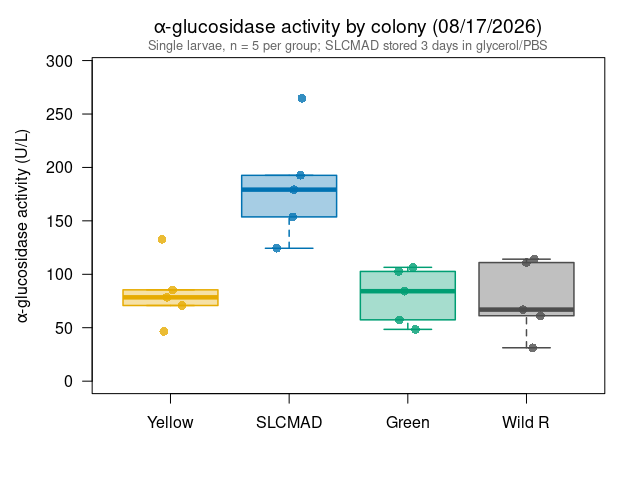

Alina’s alpha-glucosidase assays 08/17/2026: wild and colony larvae (USU
reader)
================
Norah Saarman
2026-10-22

- [Overview](#overview)
- [Plate map](#plate-map)
- [Colors](#colors)
- [Data](#data)
- [Activity](#activity)
  - [Summary by group](#summary-by-group)
- [Boxplot](#boxplot)
- [QC: reader stability](#qc-reader-stability)
- [Notes](#notes)

RStudio Configuration: - **R version:** R 4.4.0 (Geospatial packages)  
- **Number of cores:** 1 (up to 32 available)  
- **Account:** saarman-np  
- **Partition:** saarman-np (now auto allows multiple simultaneous jobs)

# Overview

Sigma-Aldrich alpha-Glucosidase Activity Assay Kit (MAK123), read at 405
nm on the older plate reader at USU. That reader couldn’t run a kinetic
protocol, so the plate was read twice by hand: once at the start (run 1)
and once at 20 min (run 2). Each run is a separate .xls file.

Five single larvae per group:

- **Wild R**: wild larvae from the resistant field samples (SLC), live
- **Yellow**: susceptible wild/colony larvae (yellow), live
- **Green**: resistant colony, live
- **SLCMAD**: susceptible colony, stored in 50% glycerol / 50% PBS at
  room temperature for about 3 days (from 08/14) before the assay

**Activity.** From the kit:

$$\text{Activity (U/L)} = \frac{A405_{final} - A405_{initial}}{A405_{calibrator} - A405_{water}} \times 250$$

- *initial* = run 1; *final* = run 2 (20 min)
- calibrator and water = their run 2 reads
- If A405_final \> 1.0, the kit says to dilute with water and repeat.
  Set `dilution` in the plate map for any re-run well and the result is
  multiplied back up.

One unit hydrolyzes 1.0 µmole substrate per minute at pH 7.0.

# Plate map

From Alina’s plate map. All other wells were empty.

``` r
file_initial <- file.path(data_dir, "8-17-26 assay run 1.xls")   # t = 0
file_final   <- file.path(data_dir, "8-17-26 assay run 2.xls")   # t = 20 min
run_label    <- "2026-08-17"

water_well <- "A1"   # H2O control
cal_well   <- "A2"   # calibrator

# Ordered from most susceptible to most resistant, wild resistant last
colony_order <- c("Yellow", "SLCMAD", "Green", "Wild R")

plate_map <- data.frame(
  well     = c(paste0("B", 1:5), paste0("C", 1:5), paste0("D", 1:5), paste0("E", 1:5)),
  colony   = rep(c("Wild R", "Yellow", "Green", "SLCMAD"), each = 5),
  dilution = 1
)
```

# Colors

Same palette as the Lsph probit figures and the 10/01 plate. The wild
resistant samples aren’t one of the colonies, so they are drawn in
neutral dark grey.

``` r
colony_colors <- c(Yellow   = "#E6AB02",
                   SLCMAD   = "#0072B2",
                   Green    = "#009E73",
                   "Wild R" = "grey30")
```

# Data

Each .xls holds one 8 x 12 plate of A405 values. The plate block is
found by its row label “A”, so a different number of header rows doesn’t
matter.

``` r
read_plate <- function(file) {
  x <- suppressMessages(read_excel(file, sheet = 1, col_names = FALSE,
                                   col_types = "text"))
  first <- which(x[[1]] == "A")[1]
  block <- as.data.frame(x[first:(first + 7), 1:13])
  absorbance <- sapply(block[, 2:13], as.numeric)       # 8 rows x 12 columns
  data.frame(well = paste0(rep(block[[1]], 12), rep(1:12, each = 8)),
             abs  = as.vector(absorbance))
}

initial <- read_plate(file_initial)
final   <- read_plate(file_final)
stopifnot(identical(initial$well, final$well))

plates <- data.frame(well = initial$well,
                     A405_initial = initial$abs, A405_final = final$abs)
```

# Activity

``` r
water_20 <- plates$A405_final[plates$well == water_well]
cal_20   <- plates$A405_final[plates$well == cal_well]
denom    <- cal_20 - water_20
cat(sprintf("Calibrator (%s) at 20 min = %.4f\nWater (%s) at 20 min = %.4f\n",
            cal_well, cal_20, water_well, water_20))
```

    ## Calibrator (A2) at 20 min = 0.4800
    ## Water (A1) at 20 min = 0.0880

``` r
agc <- merge(plate_map, plates, by = "well", sort = FALSE)
agc$activity_U_L <- (agc$A405_final - agc$A405_initial) / denom * 250 * agc$dilution
agc$over_1       <- agc$A405_final > 1.0
agc$colony       <- factor(agc$colony, levels = colony_order)
agc <- agc[order(agc$colony, agc$well), ]

if (any(agc$over_1))
  warning("A405_final > 1.0 in wells: ", paste(agc$well[agc$over_1], collapse = ", "),
          " -- kit says dilute and repeat.")

write.csv(agc, file.path(results_dir, paste0("agc_activity_", run_label, ".csv")),
          row.names = FALSE)
kable(agc, digits = 3, row.names = FALSE)
```

| well | colony | dilution | A405_initial | A405_final | activity_U_L | over_1 |
|:-----|:-------|---------:|-------------:|-----------:|-------------:|:-------|
| C1   | Yellow |        1 |        0.166 |      0.239 |       46.556 | FALSE  |
| C2   | Yellow |        1 |        0.175 |      0.298 |       78.444 | FALSE  |
| C3   | Yellow |        1 |        0.197 |      0.331 |       85.459 | FALSE  |
| C4   | Yellow |        1 |        0.170 |      0.281 |       70.791 | FALSE  |
| C5   | Yellow |        1 |        0.246 |      0.454 |      132.653 | FALSE  |
| E1   | SLCMAD |        1 |        0.266 |      0.568 |      192.602 | FALSE  |
| E2   | SLCMAD |        1 |        0.348 |      0.763 |      264.668 | FALSE  |
| E3   | SLCMAD |        1 |        0.268 |      0.549 |      179.209 | FALSE  |
| E4   | SLCMAD |        1 |        0.254 |      0.495 |      153.699 | FALSE  |
| E5   | SLCMAD |        1 |        0.236 |      0.431 |      124.362 | FALSE  |
| D1   | Green  |        1 |        0.179 |      0.269 |       57.398 | FALSE  |
| D2   | Green  |        1 |        0.233 |      0.394 |      102.679 | FALSE  |
| D3   | Green  |        1 |        0.218 |      0.385 |      106.505 | FALSE  |
| D4   | Green  |        1 |        0.194 |      0.326 |       84.184 | FALSE  |
| D5   | Green  |        1 |        0.170 |      0.246 |       48.469 | FALSE  |
| B1   | Wild R |        1 |        0.271 |      0.445 |      110.969 | FALSE  |
| B2   | Wild R |        1 |        0.197 |      0.246 |       31.250 | FALSE  |
| B3   | Wild R |        1 |        0.185 |      0.281 |       61.224 | FALSE  |
| B4   | Wild R |        1 |        0.276 |      0.381 |       66.964 | FALSE  |
| B5   | Wild R |        1 |        0.249 |      0.428 |      114.158 | FALSE  |

## Summary by group

``` r
agc_summary <- data.frame(
  colony   = colony_order,
  n        = as.numeric(tapply(agc$activity_U_L, agc$colony, length)),
  mean_U_L = as.numeric(tapply(agc$activity_U_L, agc$colony, mean)),
  sd_U_L   = as.numeric(tapply(agc$activity_U_L, agc$colony, sd))
)
agc_summary$cv_pct <- 100 * agc_summary$sd_U_L / agc_summary$mean_U_L

write.csv(agc_summary, file.path(results_dir, paste0("agc_summary_", run_label, ".csv")),
          row.names = FALSE)
kable(agc_summary, digits = 1)
```

| colony |   n | mean_U_L | sd_U_L | cv_pct |
|:-------|----:|---------:|-------:|-------:|
| Yellow |   5 |     82.8 |   31.5 |   38.1 |
| SLCMAD |   5 |    182.9 |   52.6 |   28.8 |
| Green  |   5 |     79.8 |   26.2 |   32.8 |
| Wild R |   5 |     76.9 |   35.3 |   45.9 |

# Boxplot

Ordered from most susceptible to most resistant (as in the probit
panel), with the wild resistant samples last. Points are individual
larvae.

``` r
cols <- colony_colors[colony_order]

par(mar = c(4.5, 4.8, 3, 1))
boxplot(activity_U_L ~ colony, data = agc,
        col    = adjustcolor(cols, alpha.f = 0.35),
        border = cols,
        lwd = 1.5, outline = FALSE, las = 1,
        ylim = c(0, max(agc$activity_U_L) * 1.1),
        xlab = "",
        ylab = expression(alpha*"-glucosidase activity (U/L)"),
        main = expression(alpha*"-glucosidase activity by colony (08/17/2026)"))
set.seed(1)
points(jitter(as.numeric(agc$colony), amount = 0.12), agc$activity_U_L,
       pch = 16, cex = 1.2,
       col = adjustcolor(colony_colors[as.character(agc$colony)], alpha.f = 0.8))
mtext("Single larvae, n = 5 per group; SLCMAD stored 3 days in glycerol/PBS",
      side = 3, line = 0.2, cex = 0.8, col = "grey40")
```

<!-- -->

# QC: reader stability

There are no kinetic reads, so instead: the empty wells and the water
and calibrator wells should read the same in both runs if the reader was
stable between them.

``` r
empty <- plates[!plates$well %in% c(plate_map$well, water_well, cal_well), ]
qc <- data.frame(
  wells   = c("Empty wells (mean)", "Water (A1)", "Calibrator (A2)"),
  run_1   = c(mean(empty$A405_initial), plates$A405_initial[plates$well == water_well],
              plates$A405_initial[plates$well == cal_well]),
  run_2   = c(mean(empty$A405_final),   water_20, cal_20)
)
qc$change <- qc$run_2 - qc$run_1
kable(qc, digits = 4)
```

| wells              |  run_1 |  run_2 | change |
|:-------------------|-------:|-------:|-------:|
| Empty wells (mean) | 0.0968 | 0.0967 | -1e-04 |
| Water (A1)         | 0.0880 | 0.0880 |  0e+00 |
| Calibrator (A2)    | 0.4800 | 0.4800 |  0e+00 |

``` r
cat(sprintf("Largest change in any empty well between runs: %.3f\n",
            max(abs(empty$A405_final - empty$A405_initial))))
```

    ## Largest change in any empty well between runs: 0.001

# Notes

*Summary for Alina and the lab, written 10/22/2026.*

- **Two manual reads.** Activity comes from just two reads (start and 20
  min) taken by hand on the older USU reader, so the 20-min interval and
  the temperature were not logged. Alina has noted that this reader has
  trouble regulating temperature. Values from this plate may not be
  directly comparable with the 09/11 and 10/01 plates, which were read
  on the Multiskan SkyHigh with logged 20-min kinetic runs.
- **No check on linearity.** With only two reads per well, there is no
  way to see whether a well’s signal rose steadily or jumped, as the
  kinetic QC plots can on later plates.
- **SLCMAD was stored, the others were live.** SLCMAD larvae spent about
  3 days in 50% glycerol / 50% PBS at room temperature; the other three
  groups were assayed live. Storage is confounded with colony here.
- **Pattern.** SLCMAD again reads clearly higher than the other groups,
  which are similar to one another (see the summary table). On 10/01 the
  stored wild resistant larvae read as high as SLCMAD, while the live
  wild resistant larvae here do not; whether those are the same
  collection, and whether storage raises activity, is worth checking.
- Small n: 5 single larvae per group, so group differences should be
  treated as preliminary.
