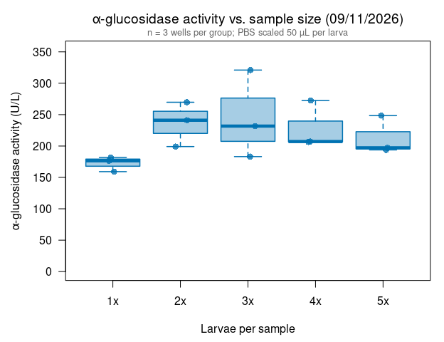
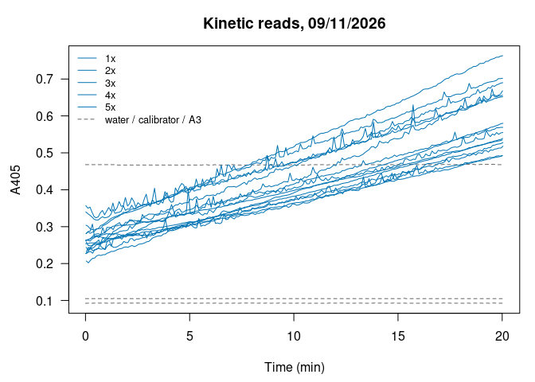

Alina’s alpha-glucosidase assays 09/11/2026: pooling test (1x-5x larvae)
================
Norah Saarman
2026-10-22

- [Overview](#overview)
- [Plate map](#plate-map)
- [Colors](#colors)
- [Data](#data)
- [Activity](#activity)
  - [Summary by group](#summary-by-group)
- [Boxplot](#boxplot)
- [QC: kinetic curves](#qc-kinetic-curves)

RStudio Configuration: - **R version:** R 4.4.0 (Geospatial packages)  
- **Number of cores:** 1 (up to 32 available)  
- **Account:** saarman-np  
- **Partition:** saarman-np (now auto allows multiple simultaneous jobs)

# Overview

Sigma-Aldrich alpha-Glucosidase Activity Assay Kit (MAK123), read on the
Multiskan SkyHigh at 405 nm, kinetic reads every 6 s for 20 min at 25.5
°C.

This plate tests **pooling**: 1, 2, 3, 4 or 5 larvae per sample, 3 wells
each. PBS was scaled with pool size (50 µL per larva), so the homogenate
concentration is about the same in every group and U/L can be compared
directly across 1x-5x.

**Activity.** From the kit:

$$\text{Activity (U/L)} = \frac{A405_{final} - A405_{initial}}{A405_{calibrator} - A405_{water}} \times 250$$

- *initial* = first kinetic read (t = 0); *final* = last read (t = 20
  min)
- calibrator and water = their own reads at 20 min
- If A405_final \> 1.0, the kit says to dilute with water and repeat.
  Set `dilution` in the plate map for any re-run well and the result is
  multiplied back up.

One unit hydrolyzes 1.0 µmole substrate per minute at pH 7.0.

# Plate map

From Alina’s plate map. A3 was read but is unlabeled, so it is not used.

``` r
infile    <- file.path(data_dir, "Kinetic Abs @ 405 2026-09-11 11-03-49.xlsx")
run_label <- "09_11"

water_well <- "A1"   # 220 µL water
cal_well   <- "A2"   # 200 µL calibrator + 20 µL water

group_order <- c("1x", "2x", "3x", "4x", "5x")

plate_map <- data.frame(
  well     = c("B1","B2","B3", "C1","C2","C3", "D1","D2","D3",
               "E1","E2","E3", "F1","F2","F3"),
  group    = rep(group_order, each = 3),
  dilution = 1
)
```

# Colors

Same palette as the Lsph probit figures (most susceptible to most
resistant). This plate has no colony comparison, so the five colors are
simply reused in order for 1x-5x.

``` r
pal <- c("#E6AB02", "#0072B2", "#009E73", "#E66100", "#7B5EA7")
names(pal) <- group_order
#To draw every box in one colony's color instead, e.g. SLCMAD:
pal[] <- "#0072B2"
```

# Data

The “Raw data 405 nm” sheet has one row per well per read (well,
wavelength, absorbance, time in seconds).

``` r
raw <- read_excel(infile, sheet = "Raw data 405 nm", skip = 2)
names(raw)[1:4] <- c("well", "wavelength", "abs", "time_s")
raw <- as.data.frame(raw[!is.na(raw$abs), ])
raw$well   <- gsub(" ", "", raw$well)          # "A 1" -> "A1"
raw$time_s <- as.numeric(raw$time_s)
raw <- raw[order(raw$well, raw$time_s), ]

table(raw$well)                                # reads per well (expect 201)
```

    ## 
    ##  A1  A2  A3  B1  B2  B3  C1  C2  C3  D1  D2  D3  E1  E2  E3  F1  F2  F3 
    ## 201 201 201 201 201 201 201 201 201 201 201 201 201 201 201 201 201 201

# Activity

``` r
first_abs <- tapply(raw$abs, raw$well, function(x) x[1])
last_abs  <- tapply(raw$abs, raw$well, function(x) x[length(x)])

water_20 <- last_abs[[water_well]]
cal_20   <- last_abs[[cal_well]]
denom    <- cal_20 - water_20
cat(sprintf("Calibrator (%s) at 20 min = %.4f\nWater (%s) at 20 min = %.4f\n",
            cal_well, cal_20, water_well, water_20))
```

    ## Calibrator (A2) at 20 min = 0.4680
    ## Water (A1) at 20 min = 0.0926

``` r
agc <- plate_map
agc$A405_initial <- as.numeric(first_abs[agc$well])
agc$A405_final   <- as.numeric(last_abs[agc$well])
agc$activity_U_L <- (agc$A405_final - agc$A405_initial) / denom * 250 * agc$dilution
agc$over_1       <- agc$A405_final > 1.0
agc$group        <- factor(agc$group, levels = group_order)

if (any(agc$over_1))
  warning("A405_final > 1.0 in wells: ", paste(agc$well[agc$over_1], collapse = ", "),
          " -- kit says dilute and repeat.")

write.csv(agc, file.path(results_dir, paste0("agc_activity_", run_label, ".csv")),
          row.names = FALSE)
kable(agc, digits = 3)
```

| well | group | dilution | A405_initial | A405_final | activity_U_L | over_1 |
|:-----|:------|---------:|-------------:|-----------:|-------------:|:-------|
| B1   | 1x    |        1 |        0.227 |      0.492 |      176.478 | FALSE  |
| B2   | 1x    |        1 |        0.262 |      0.535 |      181.806 | FALSE  |
| B3   | 1x    |        1 |        0.254 |      0.493 |      159.164 | FALSE  |
| C1   | 2x    |        1 |        0.340 |      0.702 |      241.076 | FALSE  |
| C2   | 2x    |        1 |        0.357 |      0.656 |      199.121 | FALSE  |
| C3   | 2x    |        1 |        0.263 |      0.668 |      269.712 | FALSE  |
| D1   | 3x    |        1 |        0.304 |      0.652 |      231.753 | FALSE  |
| D2   | 3x    |        1 |        0.281 |      0.763 |      320.991 | FALSE  |
| D3   | 3x    |        1 |        0.264 |      0.539 |      183.138 | FALSE  |
| E1   | 4x    |        1 |        0.259 |      0.569 |      206.446 | FALSE  |
| E2   | 4x    |        1 |        0.281 |      0.690 |      272.376 | FALSE  |
| E3   | 4x    |        1 |        0.244 |      0.555 |      207.112 | FALSE  |
| F1   | 5x    |        1 |        0.227 |      0.518 |      193.793 | FALSE  |
| F2   | 5x    |        1 |        0.207 |      0.580 |      248.402 | FALSE  |
| F3   | 5x    |        1 |        0.232 |      0.528 |      197.123 | FALSE  |

## Summary by group

``` r
agc_summary <- data.frame(
  group    = group_order,
  n        = as.numeric(tapply(agc$activity_U_L, agc$group, length)),
  mean_U_L = as.numeric(tapply(agc$activity_U_L, agc$group, mean)),
  sd_U_L   = as.numeric(tapply(agc$activity_U_L, agc$group, sd))
)
agc_summary$cv_pct <- 100 * agc_summary$sd_U_L / agc_summary$mean_U_L

write.csv(agc_summary, file.path(results_dir, paste0("agc_summary_", run_label, ".csv")),
          row.names = FALSE)
kable(agc_summary, digits = 1)
```

| group |   n | mean_U_L | sd_U_L | cv_pct |
|:------|----:|---------:|-------:|-------:|
| 1x    |   3 |    172.5 |   11.8 |    6.9 |
| 2x    |   3 |    236.6 |   35.5 |   15.0 |
| 3x    |   3 |    245.3 |   69.9 |   28.5 |
| 4x    |   3 |    228.6 |   37.9 |   16.6 |
| 5x    |   3 |    213.1 |   30.6 |   14.4 |

# Boxplot

Boxes show the three wells per group; points are the individual wells.

``` r
par(mar = c(4.5, 4.8, 3, 1))
boxplot(activity_U_L ~ group, data = agc,
        col    = adjustcolor(pal[group_order], alpha.f = 0.35),
        border = pal[group_order],
        lwd = 1.5, outline = FALSE, las = 1,
        ylim = c(0, max(agc$activity_U_L) * 1.1),
        xlab = "Larvae per sample",
        ylab = expression(alpha*"-glucosidase activity (U/L)"),
        main = expression(alpha*"-glucosidase activity vs. sample size (09/11/2026)"))
set.seed(1)
points(jitter(as.numeric(agc$group), amount = 0.12), agc$activity_U_L,
       pch = 16, cex = 1.2,
       col = adjustcolor(pal[as.character(agc$group)], alpha.f = 0.8))
mtext("n = 3 wells per group; PBS scaled 50 µL per larva",
      side = 3, line = 0.2, cex = 0.8, col = "grey40")
```

<!-- -->

# QC: kinetic curves

Each well’s A405 over the 20 min. The formula uses only the first and
last reads, so a well whose signal jumps around can shift its activity
value. Water, calibrator and A3 are dashed grey.

``` r
par(mar = c(4.5, 4.5, 3, 1))
plot(NA, xlim = range(raw$time_s) / 60, ylim = range(raw$abs), las = 1,
     xlab = "Time (min)", ylab = "A405", main = "Kinetic reads, 09/11/2026")
for (w in unique(raw$well)) {
  d   <- raw[raw$well == w, ]
  grp <- agc$group[match(w, agc$well)]
  col <- if (is.na(grp)) "grey40" else pal[as.character(grp)]
  lty <- if (is.na(grp)) 2 else 1
  lines(d$time_s / 60, d$abs, col = col, lty = lty)
}
legend("topleft", bty = "n", cex = 0.8,
       legend = c(group_order, "water / calibrator / A3"),
       col = c(pal[group_order], "grey40"), lty = c(rep(1, 5), 2))
```

<!-- -->
