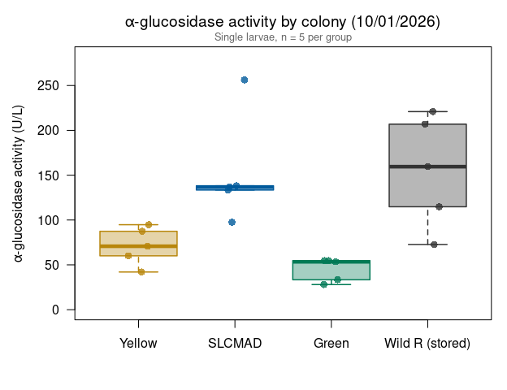
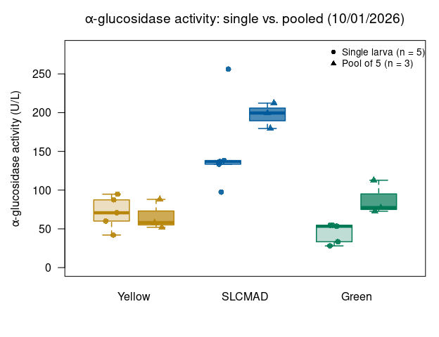
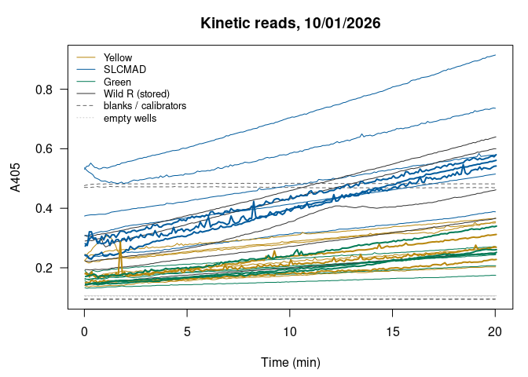

Alina’s alpha-glucosidase assays 10/1/2026: pooling test (1x-5x larvae)
================
Norah Saarman
2026-10-23

- [Overview](#overview)
- [Plate map](#plate-map)
- [Colors](#colors)
- [Data](#data)
- [Activity](#activity)
  - [Summary by group](#summary-by-group)
- [Single larvae by colony](#single-larvae-by-colony)
- [Single larvae vs. 5-larva pools](#single-larvae-vs-5-larva-pools)
- [QC: kinetic curves](#qc-kinetic-curves)
- [QC: reaction rates and starting
  absorbance](#qc-reaction-rates-and-starting-absorbance)
- [Notes](#notes)

RStudio Configuration: - **R version:** R 4.4.0 (Geospatial packages)  
- **Number of cores:** 1 (up to 32 available)  
- **Account:** saarman-np  
- **Partition:** saarman-np (now auto allows multiple simultaneous jobs)

# Overview

Sigma-Aldrich alpha-Glucosidase Activity Assay Kit (MAK123), read on the
Multiskan SkyHigh at 405 nm, kinetic reads every 6 s for 20 min.

This plate compares colonies, 5 single larvae each:

- **Yellow** and **SLCMAD** (susceptible), **Green** (resistant colony)
- **Wild resistant, stored**: wild larvae from the resistant field
  samples, stored before the assay

It also has 3 wells each of **5-larva pools** (x5) of SLCMAD, Yellow and
Green. PBS is assumed scaled with pool size (50 µL per larva), as on
09/11, so U/L is comparable between single larvae and pools.

**Activity.** From the kit:

$$\text{Activity (U/L)} = \frac{A405_{final} - A405_{initial}}{A405_{calibrator} - A405_{water}} \times 250$$

- *initial* = first kinetic read (t = 0); *final* = last read (t = 20
  min)
- calibrator and blank = their own reads at 20 min
- If A405_final \> 1.0, the kit says to dilute with water and repeat.
  Set `dilution` in the plate map for any re-run well and the result is
  multiplied back up.

This plate has two calibrator pairs: calibrator + water (A2 vs. A1, as
in the kit) and calibrator + PBS (A4 vs. A3, matching the sample
buffer). Alina’s numbers use the **water** pair; the PBS pair is
reported alongside as a check.

One unit hydrolyzes 1.0 µmole substrate per minute at pH 7.0.

# Plate map

From Alina’s plate map. A5 and F4-H5 were read but are empty. D3 is
marked “Green \*” on the plate map; it is kept in the analysis (set
`exclude` below to drop it).

``` r
infile    <- file.path(data_dir, "Kinetic Abs @ 405 2026-10-01 14-18-32.xlsx")
run_label <- "2026-10-01"
 
water_well   <- "A1"   # H2O control
cal_h2o_well <- "A2"   # calibrator + H2O
pbs_well     <- "A3"   # PBS control
cal_pbs_well <- "A4"   # calibrator + PBS
 
# Which calibrator pair to use for the activity: "water" (kit, Alina) or "pbs"
use_blank <- "water"
 
colony_order <- c("Yellow", "SLCMAD", "Green", "Wild R (stored)")
 
plate_map <- data.frame(
  well   = c(paste0("B", 1:5), paste0("C", 1:5), paste0("D", 1:5), paste0("E", 1:5),
             paste0("F", 1:3), paste0("G", 1:3), paste0("H", 1:3)),
  colony = c(rep("SLCMAD", 5), rep("Yellow", 5), rep("Green", 5),
             rep("Wild R (stored)", 5),
             rep("SLCMAD", 3), rep("Yellow", 3), rep("Green", 3)),
  larvae   = c(rep(1, 20), rep(5, 9)),
  dilution = 1,
  exclude  = FALSE
)
# plate_map$exclude[plate_map$well == "D3"] <- TRUE   # to drop "Green *"
 
plate_map$group <- ifelse(plate_map$larvae == 1, plate_map$colony,
                          paste(plate_map$colony, "x5"))
```

# Colors

Presentation palette, matching the master summary and the Lsph probit
figures (higher contrast; Yellow is a mustard gold). The wild resistant
samples aren’t one of the colonies, so they are drawn in near-black
grey.

``` r
colony_colors <- c(Yellow            = "#B8860B",
                   SLCMAD            = "#005A9C",
                   Green             = "#007A55",
                   "Wild R (stored)" = "grey20")
```

# Data

The “Raw data 405 nm” sheet has one row per well per read (well,
wavelength, absorbance, time in seconds). The header row is found by
name, because the number of blank rows above it differs between exports.

``` r
raw <- suppressWarnings(
  read_excel(infile, sheet = "Raw data 405 nm", col_names = FALSE,
             col_types = c("text", "numeric", "numeric", "numeric")))
```

    ## New names:
    ## • `` -> `...1`
    ## • `` -> `...2`
    ## • `` -> `...3`
    ## • `` -> `...4`

``` r
names(raw)[1:4] <- c("well", "wavelength", "abs", "time_s")
header_row <- which(raw$well == "Well")[1]
raw <- as.data.frame(raw[(header_row + 1):nrow(raw), ])
raw <- raw[!is.na(raw$well) & !is.na(raw$abs), ]
raw$well <- gsub(" ", "", raw$well)            # "A 1" -> "A1"
raw <- raw[order(raw$well, raw$time_s), ]
 
table(raw$well)                                # reads per well (expect 201)
```

    ## 
    ##  A1  A2  A3  A4  A5  B1  B2  B3  B4  B5  C1  C2  C3  C4  C5  D1  D2  D3  D4  D5 
    ## 201 201 201 201 201 201 201 201 201 201 201 201 201 201 201 201 201 201 201 201 
    ##  E1  E2  E3  E4  E5  F1  F2  F3  F4  F5  G1  G2  G3  G4  G5  H1  H2  H3  H4  H5 
    ## 201 201 201 201 201 201 201 201 201 201 201 201 201 201 201 201 201 201 201 201

# Activity

``` r
first_abs <- tapply(raw$abs, raw$well, function(x) x[1])
last_abs  <- tapply(raw$abs, raw$well, function(x) x[length(x)])
 
denom_water <- last_abs[[cal_h2o_well]] - last_abs[[water_well]]
denom_pbs   <- last_abs[[cal_pbs_well]] - last_abs[[pbs_well]]
cat(sprintf(paste0("At 20 min: water %.4f, calibrator+H2O %.4f -> denominator %.4f\n",
                   "           PBS   %.4f, calibrator+PBS %.4f -> denominator %.4f\n"),
            last_abs[[water_well]], last_abs[[cal_h2o_well]], denom_water,
            last_abs[[pbs_well]],   last_abs[[cal_pbs_well]], denom_pbs))
```

    ## At 20 min: water 0.0944, calibrator+H2O 0.4690 -> denominator 0.3746
    ##            PBS   0.0949, calibrator+PBS 0.4820 -> denominator 0.3871

``` r
agc <- plate_map
agc$A405_initial <- as.numeric(first_abs[agc$well])
agc$A405_final   <- as.numeric(last_abs[agc$well])
delta <- agc$A405_final - agc$A405_initial
agc$activity_water_U_L <- delta / denom_water * 250 * agc$dilution
agc$activity_pbs_U_L   <- delta / denom_pbs   * 250 * agc$dilution
agc$activity_U_L <- if (use_blank == "water") agc$activity_water_U_L else agc$activity_pbs_U_L
agc$over_1 <- agc$A405_final > 1.0
 
if (any(agc$over_1))
  warning("A405_final > 1.0 in wells: ", paste(agc$well[agc$over_1], collapse = ", "),
          " -- kit says dilute and repeat.")
 
write.csv(agc, file.path(results_dir, paste0("agc_activity_", run_label, ".csv")),
          row.names = FALSE)
kable(agc[, c("well", "group", "A405_initial", "A405_final",
              "activity_water_U_L", "activity_pbs_U_L", "over_1", "exclude")],
      digits = 3)
```

| well | group           | A405_initial | A405_final | activity_water_U_L | activity_pbs_U_L | over_1 | exclude |
|:-----|:----------------|-------------:|-----------:|-------------------:|-----------------:|:-------|:--------|
| B1   | SLCMAD          |        0.374 |      0.579 |            136.813 |          132.395 | FALSE  | FALSE   |
| B2   | SLCMAD          |        0.242 |      0.388 |             97.437 |           94.291 | FALSE  | FALSE   |
| B3   | SLCMAD          |        0.308 |      0.515 |            138.147 |          133.686 | FALSE  | FALSE   |
| B4   | SLCMAD          |        0.531 |      0.915 |            256.273 |          247.998 | FALSE  | FALSE   |
| B5   | SLCMAD          |        0.536 |      0.736 |            133.476 |          129.166 | FALSE  | FALSE   |
| C1   | Yellow          |        0.245 |      0.351 |             70.742 |           68.458 | FALSE  | FALSE   |
| C2   | Yellow          |        0.225 |      0.367 |             94.768 |           91.708 | FALSE  | FALSE   |
| C3   | Yellow          |        0.224 |      0.355 |             87.427 |           84.603 | FALSE  | FALSE   |
| C4   | Yellow          |        0.140 |      0.203 |             42.045 |           40.687 | FALSE  | FALSE   |
| C5   | Yellow          |        0.179 |      0.269 |             60.064 |           58.125 | FALSE  | FALSE   |
| D1   | Green           |        0.164 |      0.246 |             54.725 |           52.958 | FALSE  | FALSE   |
| D2   | Green           |        0.133 |      0.175 |             28.030 |           27.125 | FALSE  | FALSE   |
| D3   | Green           |        0.191 |      0.271 |             53.390 |           51.666 | FALSE  | FALSE   |
| D4   | Green           |        0.162 |      0.244 |             54.725 |           52.958 | FALSE  | FALSE   |
| D5   | Green           |        0.157 |      0.207 |             33.369 |           32.291 | FALSE  | FALSE   |
| E1   | Wild R (stored) |        0.223 |      0.462 |            159.503 |          154.353 | FALSE  | FALSE   |
| E2   | Wild R (stored) |        0.309 |      0.640 |            220.902 |          213.769 | FALSE  | FALSE   |
| E3   | Wild R (stored) |        0.194 |      0.366 |            114.789 |          111.082 | FALSE  | FALSE   |
| E4   | Wild R (stored) |        0.290 |      0.600 |            206.887 |          200.207 | FALSE  | FALSE   |
| E5   | Wild R (stored) |        0.142 |      0.251 |             72.744 |           70.395 | FALSE  | FALSE   |
| F1   | SLCMAD x5       |        0.281 |      0.580 |            199.546 |          193.103 | FALSE  | FALSE   |
| F2   | SLCMAD x5       |        0.273 |      0.542 |            179.525 |          173.728 | FALSE  | FALSE   |
| F3   | SLCMAD x5       |        0.243 |      0.561 |            212.226 |          205.373 | FALSE  | FALSE   |
| G1   | Yellow x5       |        0.182 |      0.269 |             58.062 |           56.187 | FALSE  | FALSE   |
| G2   | Yellow x5       |        0.180 |      0.312 |             88.094 |           85.249 | FALSE  | FALSE   |
| G3   | Yellow x5       |        0.150 |      0.228 |             52.056 |           50.375 | FALSE  | FALSE   |
| H1   | Green x5        |        0.143 |      0.252 |             72.744 |           70.395 | FALSE  | FALSE   |
| H2   | Green x5        |        0.145 |      0.261 |             77.416 |           74.916 | FALSE  | FALSE   |
| H3   | Green x5        |        0.171 |      0.340 |            112.787 |          109.145 | FALSE  | FALSE   |

``` r
agc <- agc[!agc$exclude, ]
```

## Summary by group

``` r
group_order <- c(colony_order, paste(colony_order[1:3], "x5"))
agc$group   <- factor(agc$group, levels = group_order)
 
agc_summary <- data.frame(
  group    = group_order,
  n        = as.numeric(tapply(agc$activity_U_L, agc$group, length)),
  mean_U_L = as.numeric(tapply(agc$activity_U_L, agc$group, mean)),
  sd_U_L   = as.numeric(tapply(agc$activity_U_L, agc$group, sd))
)
agc_summary$cv_pct <- 100 * agc_summary$sd_U_L / agc_summary$mean_U_L
 
write.csv(agc_summary, file.path(results_dir, paste0("agc_summary_", run_label, ".csv")),
          row.names = FALSE)
kable(agc_summary, digits = 1)
```

| group           |   n | mean_U_L | sd_U_L | cv_pct |
|:----------------|----:|---------:|-------:|-------:|
| Yellow          |   5 |     71.0 |   21.2 |   29.8 |
| SLCMAD          |   5 |    152.4 |   60.4 |   39.7 |
| Green           |   5 |     44.8 |   13.1 |   29.1 |
| Wild R (stored) |   5 |    155.0 |   62.1 |   40.1 |
| Yellow x5       |   3 |     66.1 |   19.3 |   29.2 |
| SLCMAD x5       |   3 |    197.1 |   16.5 |    8.4 |
| Green x5        |   3 |     87.6 |   21.9 |   25.0 |

# Single larvae by colony

Ordered from most susceptible to most resistant (as in the probit
panel), with the wild resistant samples last. Points are individual
larvae.

``` r
single <- droplevels(agc[agc$larvae == 1, ])
single$group <- factor(single$group, levels = colony_order)
cols <- colony_colors[colony_order]
 
par(mar = c(4.5, 4.8, 3, 1))
boxplot(activity_U_L ~ group, data = single,
        col    = adjustcolor(cols, alpha.f = 0.35),
        border = cols,
        lwd = 1.5, outline = FALSE, las = 1,
        ylim = c(0, max(agc$activity_U_L) * 1.1),
        xlab = "",
        ylab = expression(alpha*"-glucosidase activity (U/L)"),
        main = expression(alpha*"-glucosidase activity by colony (10/01/2026)"))
set.seed(1)
points(jitter(as.numeric(single$group), amount = 0.12), single$activity_U_L,
       pch = 16, cex = 1.2,
       col = adjustcolor(colony_colors[single$colony], alpha.f = 0.8))
mtext("Single larvae, n = 5 per group", side = 3, line = 0.2, cex = 0.8, col = "grey40")
```

<!-- -->

# Single larvae vs. 5-larva pools

Each colony’s single larvae (light) next to its 5-larva pools (dark).

``` r
pool_colonies <- colony_order[1:3]
paired <- agc[agc$colony %in% pool_colonies, ]
paired$box <- factor(paste(paired$colony, paired$larvae),
                     levels = as.vector(rbind(paste(pool_colonies, 1),
                                              paste(pool_colonies, 5))))
at   <- as.vector(rbind(seq_along(pool_colonies) - 0.2, seq_along(pool_colonies) + 0.2))
pcol <- rep(colony_colors[pool_colonies], each = 2)
fill <- adjustcolor(pcol, alpha.f = 1)
fill[c(TRUE, FALSE)] <- adjustcolor(pcol[c(TRUE, FALSE)], alpha.f = 0.25)
fill[c(FALSE, TRUE)] <- adjustcolor(pcol[c(FALSE, TRUE)], alpha.f = 0.7)
 
par(mar = c(4.5, 4.8, 3, 1))
boxplot(activity_U_L ~ box, data = paired, at = at, boxwex = 0.32,
        col = fill, border = pcol, lwd = 1.5, outline = FALSE, las = 1,
        xaxt = "n", xlim = c(0.5, length(pool_colonies) + 0.5),
        ylim = c(0, max(agc$activity_U_L) * 1.1),
        xlab = "",
        ylab = expression(alpha*"-glucosidase activity (U/L)"),
        main = expression(alpha*"-glucosidase activity: single vs. pooled (10/01/2026)"))
axis(1, at = seq_along(pool_colonies), labels = pool_colonies, tick = FALSE)
set.seed(1)
points(jitter(at[as.numeric(paired$box)], amount = 0.06), paired$activity_U_L,
       pch = ifelse(paired$larvae == 1, 16, 17), cex = 1.1,
       col = adjustcolor(colony_colors[paired$colony], alpha.f = 0.9))
legend("topright", bty = "n", cex = 0.85, pch = c(16, 17),
       legend = c("Single larva (n = 5)", "Pool of 5 (n = 3)"))
```

<!-- -->

# QC: kinetic curves

Each well’s A405 over the 20 min. The formula uses only the first and
last reads, so a well whose signal jumps around can shift its activity
value. Pools are drawn thicker; blanks and calibrators are dashed grey;
empty wells are dotted light grey.

``` r
par(mar = c(4.5, 4.5, 3, 1))
plot(NA, xlim = range(raw$time_s) / 60, ylim = range(raw$abs), las = 1,
     xlab = "Time (min)", ylab = "A405", main = "Kinetic reads, 10/01/2026")
controls <- c(water_well, cal_h2o_well, pbs_well, cal_pbs_well)
for (w in unique(raw$well)) {
  d <- raw[raw$well == w, ]
  i <- match(w, plate_map$well)
  if (!is.na(i)) {
    lines(d$time_s / 60, d$abs, col = colony_colors[[plate_map$colony[i]]],
          lwd = if (plate_map$larvae[i] == 5) 2 else 1)
  } else if (w %in% controls) {
    lines(d$time_s / 60, d$abs, col = "grey40", lty = 2)
  } else {
    lines(d$time_s / 60, d$abs, col = "grey80", lty = 3)
  }
}
legend("topleft", bty = "n", cex = 0.8,
       legend = c(colony_order, "blanks / calibrators", "empty wells"),
       col = c(colony_colors[colony_order], "grey40", "grey80"),
       lty = c(rep(1, 4), 2, 3))
```

<!-- -->

# QC: reaction rates and starting absorbance

Rate of A405 change (thousandths of A405 per minute) over the first 5
min and the last 5 min, plus mean A405 at t = 0, by group. If the
reaction were saturating or running out of substrate, the late rate
would be lower than the early rate.

``` r
rate <- function(w, from_min, to_min) {
  d <- raw[raw$well == w & raw$time_s >= from_min * 60 & raw$time_s <= to_min * 60, ]
  unname(coef(lm(abs ~ I(time_s / 60), data = d))[2]) * 1000
}
agc$rate_early <- sapply(agc$well, rate, from_min = 0,  to_min = 5)
agc$rate_late  <- sapply(agc$well, rate, from_min = 15, to_min = 20)
 
rate_check <- data.frame(
  group          = group_order,
  A405_t0        = as.numeric(tapply(agc$A405_initial, agc$group, mean)),
  A405_20min     = as.numeric(tapply(agc$A405_final,   agc$group, mean)),
  rate_0_5min    = as.numeric(tapply(agc$rate_early,   agc$group, mean)),
  rate_15_20min  = as.numeric(tapply(agc$rate_late,    agc$group, mean))
)
kable(rate_check, digits = c(0, 3, 3, 1, 1))
```

| group           | A405_t0 | A405_20min | rate_0_5min | rate_15_20min |
|:----------------|--------:|-----------:|------------:|--------------:|
| Yellow          |   0.203 |      0.309 |         3.2 |           5.8 |
| SLCMAD          |   0.398 |      0.627 |         9.0 |          13.4 |
| Green           |   0.161 |      0.229 |         4.0 |           3.5 |
| Wild R (stored) |   0.232 |      0.464 |        10.0 |          12.2 |
| Yellow x5       |   0.171 |      0.270 |         2.8 |           6.9 |
| SLCMAD x5       |   0.266 |      0.561 |        13.2 |          14.8 |
| Green x5        |   0.153 |      0.284 |         5.2 |           7.8 |

# Notes

*Summary for Alina and the lab, written 10/21/2026.*

**Colony comparison (single larvae).** Mean activity was SLCMAD 152 U/L,
wild resistant (stored) 155 U/L, Yellow 71 U/L and Green 45 U/L. This
does not fit a simple “resistant = lower activity” pattern: Yellow, the
most susceptible colony in the Lsph probits, is as low as Green
(resistant), and the stored wild resistant larvae are as high as SLCMAD.
SLCMAD has read high on every plate so far, which supports the earlier
question of whether SLCMAD is unusually high rather than representative
of susceptible larvae.

**Are singles and pools comparable?** The measurements are: all wells
were on one plate, read in one 20-min run at 25.5-25.6 °C on the same
Multiskan SkyHigh as 09/11, and all are calculated against the same
water and calibrator wells. Whether the *samples* are comparable is less
certain:

- *Buffer volume.* It is not yet confirmed whether PBS was scaled for
  the 5-larva pools (250 µL) or kept at 50 µL. If it was kept at 50 µL,
  pools are about 5x as concentrated and should read about 5x higher in
  U/L. Instead, pools read SLCMAD 197 vs. 152, Yellow 66 vs. 71, Green
  88 vs. 45 U/L (pool vs. single).
- *No saturation.* The QC table above shows every well’s final A405 well
  below 1.0, and reaction rates do not slow down over the 20 min, so a
  saturated reaction does not explain the small difference.
- *Starting absorbance.* Pools start at a lower A405 than singles, which
  fits homogenates that are not more concentrated (i.e. buffer probably
  scaled). This is indirect; centrifugation also affects it.
- *Plate position.* All pools are in rows F-H, below all singles (rows
  B-E), so pooling is confounded with plate position and pipetting
  order.
- *Same pattern on 09/11.* Single larvae read lower than pools there too
  (1x lowest; 2x-5x higher), which suggests something systematic about
  single-larva samples, such as less complete homogenization in 50 µL.

Until the buffer volumes are confirmed, compare colonies within singles
or within pools, not across them.

**Other notes.**

- Activity uses the calibrator + water pair (A2 vs. A1), as in the kit
  and Alina’s spreadsheet. The calibrator + PBS pair (A4 vs. A3) gives
  values about 3% lower; both are in the results CSV.
- D3 is marked “Green \*” on the plate map with no explanation; it is
  included here.
- Small n: 5 single larvae and 3 pools per group, so differences between
  groups should be treated as preliminary.

**To do / for next plates.**

1.  Alina: record the PBS volume for every sample type (singles and
    pools) on 09/11 and 10/01. Once known, add a volume column to the
    plate map and report activity per larva as well as U/L.
2.  Explain the “Green \*” in D3.
3.  Mix single and pooled wells across rows rather than putting all
    pools together, so pooling isn’t confounded with plate position.
4.  Include more wells per group where reagents allow.
