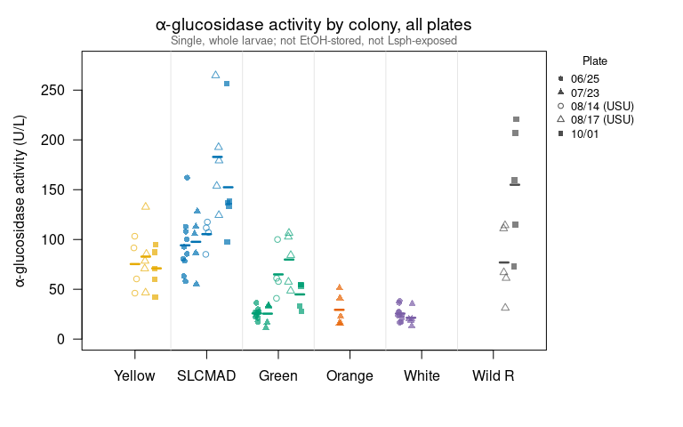
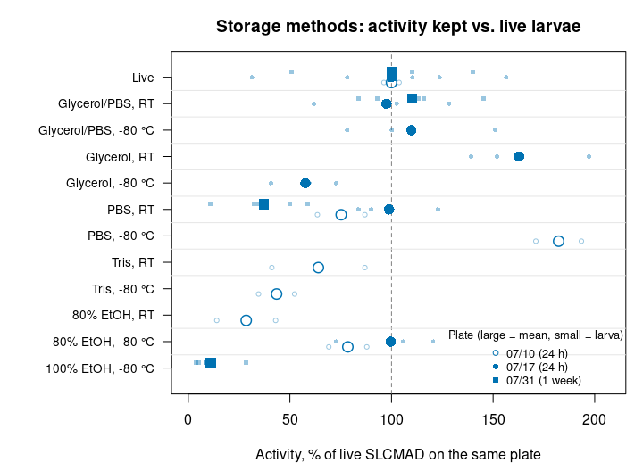
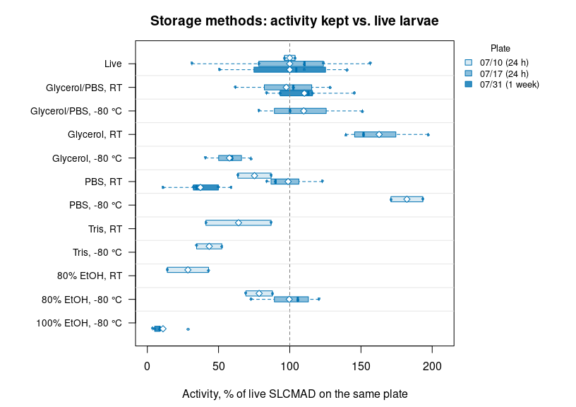
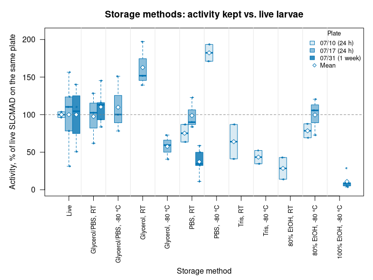

Alina’s alpha-glucosidase assays MASTER: highlights from 10 plates
(June - October 2026)
================
Norah Saarman
2026-10-22

- [Overview](#overview)
  - [The ten plates](#the-ten-plates)
- [Data](#data)
  - [Colors](#colors)
- [1. Colony comparison](#1-colony-comparison)
  - [All plates together](#all-plates-together)
  - [Relative to SLCMAD on the same
    plate](#relative-to-slcmad-on-the-same-plate)
  - [Activity vs. Lsph resistance](#activity-vs-lsph-resistance)
- [2. Storage methods](#2-storage-methods)
- [3. Method tests](#3-method-tests)
  - [Pooling (09/11 and 10/01)](#pooling-0911-and-1001)
  - [Lsph feeding (08/14)](#lsph-feeding-0814)
  - [Body parts (06/12)](#body-parts-0612)
  - [SLCMAD across plates](#slcmad-across-plates)
- [Highlights](#highlights)

RStudio Configuration: - **R version:** R 4.4.0 (Geospatial packages)  
- **Number of cores:** 1 (up to 32 available)  
- **Account:** saarman-np  
- **Partition:** saarman-np (now auto allows multiple simultaneous jobs)

# Overview

This summary pulls together the ten alpha-glucosidase plates Alina ran
between June and October 2026. It does no new calculations from the
plate-reader files: it reads the per-well activity tables that each
plate’s own Rmd writes to `../results/`, so **knit the ten plate Rmds
first**. Details, QC plots and plate-specific caveats are in each
plate’s own page (linked in the table below).

Sigma-Aldrich alpha-Glucosidase Activity Assay Kit (MAK123), 405 nm.
Activity (U/L) = (A405 final - A405 initial) / (A405 calibrator - A405
water) x 250, over 20 min. All values are single 4th-instar larvae
unless noted.

## The ten plates

``` r
plates <- data.frame(
  Date   = c("06/12", "06/25", "07/10", "07/17", "07/23",
             "07/31", "08/14", "08/17", "09/11", "10/01"),
  Reader = c(rep("Multiskan", 6), "USU (manual)", "USU (manual)", "Multiskan", "Multiskan"),
  Question = c("Body parts (larval abdomen, thorax, adult)",
               "Colonies: SLCMAD vs. Green, White",
               "Storage, 24 h (EtOH, Tris, PBS; RT vs. -80 °C)",
               "Storage, 24 h (glycerol, glycerol/PBS, EtOH, PBS); EtOH-stored colony and wild larvae",
               "Colonies: SLCMAD vs. Green, Orange, White",
               "Storage, 1 week (PBS, glycerol/PBS, EtOH)",
               "Lsph feeding (0-500 ppm, 1.5-2 h): Yellow, Green",
               "Colonies and wild: Yellow, SLCMAD, Green, Wild R",
               "Pooling (1-5 larvae per sample)",
               "Colonies and wild, single larvae and 5-larva pools"),
  Page = paste0("[", c("2026-06-12", "2026-06-25", "2026-07-10", "2026-07-17", "2026-07-23",
                       "2026-07-31", "2026-08-14", "2026-08-17", "2026-09-11", "2026-10-01"),
                "](alpha-glucosidase-",
                c("2026-06-12", "2026-06-25", "2026-07-10", "2026-07-17", "2026-07-23",
                  "2026-07-31", "2026-08-14", "2026-08-17", "2026-09-11", "2026-10-01"),
                "_Alina.md)")
)
kable(plates)
```

| Date  | Reader       | Question                                                                              | Page                                                |
|:------|:-------------|:--------------------------------------------------------------------------------------|:----------------------------------------------------|
| 06/12 | Multiskan    | Body parts (larval abdomen, thorax, adult)                                            | [2026-06-12](alpha-glucosidase-2026-06-12_Alina.md) |
| 06/25 | Multiskan    | Colonies: SLCMAD vs. Green, White                                                     | [2026-06-25](alpha-glucosidase-2026-06-25_Alina.md) |
| 07/10 | Multiskan    | Storage, 24 h (EtOH, Tris, PBS; RT vs. -80 °C)                                        | [2026-07-10](alpha-glucosidase-2026-07-10_Alina.md) |
| 07/17 | Multiskan    | Storage, 24 h (glycerol, glycerol/PBS, EtOH, PBS); EtOH-stored colony and wild larvae | [2026-07-17](alpha-glucosidase-2026-07-17_Alina.md) |
| 07/23 | Multiskan    | Colonies: SLCMAD vs. Green, Orange, White                                             | [2026-07-23](alpha-glucosidase-2026-07-23_Alina.md) |
| 07/31 | Multiskan    | Storage, 1 week (PBS, glycerol/PBS, EtOH)                                             | [2026-07-31](alpha-glucosidase-2026-07-31_Alina.md) |
| 08/14 | USU (manual) | Lsph feeding (0-500 ppm, 1.5-2 h): Yellow, Green                                      | [2026-08-14](alpha-glucosidase-2026-08-14_Alina.md) |
| 08/17 | USU (manual) | Colonies and wild: Yellow, SLCMAD, Green, Wild R                                      | [2026-08-17](alpha-glucosidase-2026-08-17_Alina.md) |
| 09/11 | Multiskan    | Pooling (1-5 larvae per sample)                                                       | [2026-09-11](alpha-glucosidase-2026-09-11_Alina.md) |
| 10/01 | Multiskan    | Colonies and wild, single larvae and 5-larva pools                                    | [2026-10-01](alpha-glucosidase-2026-10-01_Alina.md) |

# Data

``` r
read_res <- function(label) {
  read.csv(file.path(results_dir, paste0("agc_activity_", label, ".csv")),
           stringsAsFactors = FALSE)
}

d0612 <- read_res("2026-06-12")
d0625 <- read_res("2026-06-25")
d0710 <- read_res("2026-07-10")
d0717 <- read_res("2026-07-17")
d0723 <- read_res("2026-07-23")
d0731 <- read_res("2026-07-31")
d0814 <- read_res("2026-08-14")
d0817 <- read_res("2026-08-17")
d0911 <- read_res("09_11")
d1001 <- read_res("2026-10-01")

# Lsph probit results (24 h, best assay per colony) from LC50_LC90_drc_Alina_final.Rmd
lc <- read.csv(file.path(results_dir, "lsph_summary_table_24h.csv"),
               check.names = FALSE, stringsAsFactors = FALSE)
```

## Colors

Same palette as the Lsph probit figures. Wild resistant larvae aren’t
one of the colonies, so they are dark grey.

``` r
colony_order  <- c("Yellow", "SLCMAD", "Green", "Orange", "White", "Wild R")
colony_colors <- c(Yellow   = "#E6AB02",
                   SLCMAD   = "#0072B2",
                   Green    = "#009E73",
                   Orange   = "#E66100",
                   White    = "#7B5EA7",
                   "Wild R" = "grey30")
slcmad_col <- colony_colors[["SLCMAD"]]
```

# 1. Colony comparison

The plates that compare colonies with comparable larvae: single, whole
larvae, not stored in EtOH, not exposed to Lsph. That leaves five
plates:

- **06/25** and **07/23** (Multiskan)
- **08/14** (unexposed controls and SLCMAD only) and **08/17** (USU
  reader, read by hand)
- **10/01** (single larvae only; Wild R were stored, method not
  recorded)

Left out: 07/17 Orange, Green and wild larvae (a week in EtOH, which
destroys activity; see storage below), pooled samples, and Lsph-exposed
larvae.

``` r
colony_data <- rbind(
  data.frame(plate = "06/25", colony = d0625$colony, activity = d0625$activity_U_L),
  data.frame(plate = "07/23", colony = d0723$colony, activity = d0723$activity_U_L),
  with(d0814[d0814$colony == "SLCMAD" | d0814$dose %in% 0, ],
       data.frame(plate = "08/14", colony = colony, activity = activity_U_L)),
  data.frame(plate = "08/17", colony = d0817$colony, activity = d0817$activity_U_L),
  with(d1001[d1001$larvae == 1 & !d1001$exclude, ],
       data.frame(plate = "10/01", colony = sub(" \\(stored\\)", "", colony),
                  activity = activity_U_L))
)
colony_data$colony <- factor(colony_data$colony, levels = colony_order)
plate_order <- c("06/25", "07/23", "08/14", "08/17", "10/01")
colony_data$plate <- factor(colony_data$plate, levels = plate_order)

table(colony_data$colony, colony_data$plate)
```

    ##         
    ##          06/25 07/23 08/14 08/17 10/01
    ##   Yellow     0     0     4     5     5
    ##   SLCMAD    10     5     4     5     5
    ##   Green     10     5     4     5     5
    ##   Orange     0     5     0     0     0
    ##   White     10     5     0     0     0
    ##   Wild R     0     0     0     5     5

## All plates together

Each point is one larva, colored by colony and shaped by plate; bars are
plate means. Colonies are ordered from most susceptible to most
resistant, as in the Lsph probit panel, with wild resistant larvae last.
Open shapes are the two plates read by hand on the USU reader.

``` r
plate_pch    <- c("06/25" = 16, "07/23" = 17, "08/14" = 1, "08/17" = 2, "10/01" = 15)
plate_offset <- setNames(seq(-0.3, 0.3, length.out = length(plate_order)), plate_order)

colony_data$x <- as.numeric(colony_data$colony) + plate_offset[as.character(colony_data$plate)]
means <- aggregate(activity ~ colony + plate, data = colony_data, FUN = mean)
means$x <- as.numeric(means$colony) + plate_offset[as.character(means$plate)]

par(mar = c(4.5, 4.8, 3, 8))
plot(NA, xlim = c(0.5, length(colony_order) + 0.5),
     ylim = c(0, max(colony_data$activity) * 1.05),
     xaxt = "n", las = 1, xlab = "",
     ylab = expression(alpha*"-glucosidase activity (U/L)"),
     main = expression(alpha*"-glucosidase activity by colony, all plates"))
axis(1, at = seq_along(colony_order), labels = colony_order)
abline(v = seq(1.5, length(colony_order) - 0.5), col = "grey90")
set.seed(1)
points(jitter(colony_data$x, amount = 0.03), colony_data$activity,
       pch = plate_pch[as.character(colony_data$plate)], cex = 0.9,
       col = adjustcolor(colony_colors[as.character(colony_data$colony)], alpha.f = 0.7))
segments(means$x - 0.06, means$activity, means$x + 0.06, means$activity,
         lwd = 2.5, col = colony_colors[as.character(means$colony)])
legend("topright", inset = c(-0.2, 0), xpd = TRUE, bty = "n", cex = 0.8,
       pch = plate_pch, col = "grey30",
       legend = paste(plate_order, c("", "", "(USU)", "(USU)", "")),
       title = "Plate")
mtext("Single, whole larvae; not EtOH-stored, not Lsph-exposed",
      side = 3, line = 0.2, cex = 0.8, col = "grey40")
```

<!-- -->

## Relative to SLCMAD on the same plate

Plates differ in overall level (reader, day, calibrator), so each
colony’s mean is divided by the SLCMAD mean **on the same plate**. A
value of 0.3 means 30% of SLCMAD’s activity.

``` r
mean_tab <- tapply(colony_data$activity, list(colony_data$colony, colony_data$plate), mean)
ratio    <- sweep(mean_tab, 2, mean_tab["SLCMAD", ], "/")

kable(round(mean_tab, 0), caption = "Mean activity (U/L) by colony and plate")
```

|        | 06/25 | 07/23 | 08/14 | 08/17 | 10/01 |
|:-------|------:|------:|------:|------:|------:|
| Yellow |    NA |    NA |    75 |    83 |    71 |
| SLCMAD |    94 |    98 |   105 |   183 |   152 |
| Green  |    26 |    26 |    65 |    80 |    45 |
| Orange |    NA |    29 |    NA |    NA |    NA |
| White  |    26 |    21 |    NA |    NA |    NA |
| Wild R |    NA |    NA |    NA |    77 |   155 |

Mean activity (U/L) by colony and plate

``` r
kable(round(ratio, 2),    caption = "Mean activity relative to SLCMAD on the same plate")
```

|        | 06/25 | 07/23 | 08/14 | 08/17 | 10/01 |
|:-------|------:|------:|------:|------:|------:|
| Yellow |    NA |    NA |  0.71 |  0.45 |  0.47 |
| SLCMAD |  1.00 |  1.00 |  1.00 |  1.00 |  1.00 |
| Green  |  0.27 |  0.26 |  0.62 |  0.44 |  0.29 |
| Orange |    NA |  0.30 |    NA |    NA |    NA |
| White  |  0.27 |  0.22 |    NA |    NA |    NA |
| Wild R |    NA |    NA |    NA |  0.42 |  1.02 |

Mean activity relative to SLCMAD on the same plate

## Activity vs. Lsph resistance

LC50 at 24 h for the best bioassay of each colony (from
`LC50_LC90_drc_Alina_final`), next to the average of each colony’s
activity relative to SLCMAD across the plates above.

``` r
lc50 <- setNames(lc[["LC50 (ppm, 95% CI)"]], lc$Colony)
rel  <- rowMeans(ratio, na.rm = TRUE)
n_pl <- rowSums(!is.na(ratio))

resistance_summary <- data.frame(
  Colony                          = colony_order,
  `LC50 24 h (ppm)`               = ifelse(colony_order %in% names(lc50),
                                           lc50[colony_order], "not tested"),
  `Activity relative to SLCMAD`   = round(rel[colony_order], 2),
  `Plates`                        = n_pl[colony_order],
  check.names = FALSE, row.names = NULL
)
kable(resistance_summary)
```

| Colony | LC50 24 h (ppm)         | Activity relative to SLCMAD | Plates |
|:-------|:------------------------|----------------------------:|-------:|
| Yellow | 0.0119 (0.0014 - 0.101) |                        0.54 |      3 |
| SLCMAD | 0.0472 (0.00744 - 0.3)  |                        1.00 |      5 |
| Green  | 429 (279 - 660)         |                        0.38 |      5 |
| Orange | 50 - 500                |                        0.30 |      1 |
| White  | \> 500                  |                        0.25 |      2 |
| Wild R | not tested              |                        0.72 |      2 |

# 2. Storage methods

Three plates tested storage of SLCMAD larvae: 07/10 and 07/17 (about 24
h) and 07/31 (about 1 week). Each stored larva is expressed as a
percentage of the mean of the live SLCMAD larvae **on the same plate**.

``` r
std_temp <- function(x) ifelse(grepl("-80|Frozen", x), "-80 °C", "RT")
 
s0710 <- d0710[d0710$medium != "Live", ]
s0710$method <- paste0(s0710$medium, ", ", std_temp(s0710$temp))
live0710 <- mean(d0710$activity_U_L[d0710$medium == "Live"])
 
s0717 <- d0717[d0717$experiment == "storage", ]
s0717$method <- paste0(sub(",.*$", "", s0717$group), ", ", std_temp(s0717$group))
live0717 <- mean(d0717$activity_U_L[d0717$group == "Live"])
 
s0731 <- d0731[d0731$storage != "Live", ]
s0731$method <- paste0(sub("^EtOH", "100% EtOH", sub(",.*$", "", s0731$storage)),
                       ", ", std_temp(s0731$storage))
live0731 <- mean(d0731$activity_U_L[d0731$storage == "Live" & !d0731$exclude])
 
storage <- rbind(
  data.frame(plate = "07/10 (24 h)",   method = s0710$method,
             pct_of_live = 100 * s0710$activity_U_L / live0710),
  data.frame(plate = "07/17 (24 h)",   method = s0717$method,
             pct_of_live = 100 * s0717$activity_U_L / live0717),
  data.frame(plate = "07/31 (1 week)", method = s0731$method,
             pct_of_live = 100 * s0731$activity_U_L / live0731)
)

# Live larvae as a top row: each as % of its own plate's live mean
storage <- rbind(
  data.frame(plate = "07/10 (24 h)",   method = "Live",
             pct_of_live = 100 * d0710$activity_U_L[d0710$medium == "Live"] / live0710),
  data.frame(plate = "07/17 (24 h)",   method = "Live",
             pct_of_live = 100 * d0717$activity_U_L[d0717$group == "Live"] / live0717),
  data.frame(plate = "07/31 (1 week)", method = "Live",
             pct_of_live = 100 * d0731$activity_U_L[d0731$storage == "Live" &
                                                    !d0731$exclude] / live0731),
  storage
)

storage_summary <- aggregate(pct_of_live ~ method + plate, data = storage,
                             FUN = function(x) c(n = length(x), mean = mean(x)))
storage_summary <- do.call(data.frame, storage_summary)
names(storage_summary) <- c("method", "plate", "n", "mean_pct_of_live")
storage_summary <- storage_summary[order(storage_summary$method, storage_summary$plate), ]
kable(storage_summary, digits = 0, row.names = FALSE)
```

| method               | plate          |   n | mean_pct_of_live |
|:---------------------|:---------------|----:|-----------------:|
| 100% EtOH, -80 °C    | 07/31 (1 week) |   5 |               11 |
| 80% EtOH, -80 °C     | 07/10 (24 h)   |   2 |               79 |
| 80% EtOH, -80 °C     | 07/17 (24 h)   |   3 |              100 |
| 80% EtOH, RT         | 07/10 (24 h)   |   2 |               29 |
| Glycerol, -80 °C     | 07/17 (24 h)   |   3 |               58 |
| Glycerol, RT         | 07/17 (24 h)   |   3 |              163 |
| Glycerol/PBS, -80 °C | 07/17 (24 h)   |   3 |              110 |
| Glycerol/PBS, RT     | 07/17 (24 h)   |   3 |               98 |
| Glycerol/PBS, RT     | 07/31 (1 week) |   5 |              110 |
| Live                 | 07/10 (24 h)   |   2 |              100 |
| Live                 | 07/17 (24 h)   |   5 |              100 |
| Live                 | 07/31 (1 week) |   4 |              100 |
| PBS, -80 °C          | 07/10 (24 h)   |   2 |              182 |
| PBS, RT              | 07/10 (24 h)   |   2 |               75 |
| PBS, RT              | 07/17 (24 h)   |   3 |               99 |
| PBS, RT              | 07/31 (1 week) |   5 |               37 |
| Tris, -80 °C         | 07/10 (24 h)   |   2 |               43 |
| Tris, RT             | 07/10 (24 h)   |   2 |               64 |

``` r
method_order <- c("Live",
                  "Glycerol/PBS, RT", "Glycerol/PBS, -80 °C",
                  "Glycerol, RT", "Glycerol, -80 °C",
                  "PBS, RT", "PBS, -80 °C",
                  "Tris, RT", "Tris, -80 °C",
                  "80% EtOH, RT", "80% EtOH, -80 °C", "100% EtOH, -80 °C")
method_order <- intersect(method_order, unique(storage$method))
storage_plates <- c("07/10 (24 h)", "07/17 (24 h)", "07/31 (1 week)")
storage_pch    <- setNames(c(1, 16, 15), storage_plates)
storage_dy     <- setNames(c(-0.2, 0, 0.2), storage_plates)

y_pos <- setNames(rev(seq_along(method_order)), method_order)
sm <- storage_summary[storage_summary$method %in% method_order, ]

par(mar = c(4.5, 10, 3, 1))
plot(NA, xlim = c(0, max(storage$pct_of_live, 110) * 1.05),
     ylim = c(0.5, length(method_order) + 0.5),
     yaxt = "n", xlab = "Activity, % of live SLCMAD on the same plate", ylab = "",
     main = "Storage methods: activity kept vs. live larvae")
axis(2, at = y_pos, labels = names(y_pos), las = 1, cex.axis = 0.85)
abline(v = 100, lty = 2, col = "grey50")
abline(h = seq(1.5, length(method_order) - 0.5), col = "grey90")
points(storage$pct_of_live, y_pos[storage$method] + storage_dy[storage$plate],
       pch = storage_pch[storage$plate], cex = 0.7,
       col = adjustcolor(slcmad_col, alpha.f = 0.4))
points(sm$mean_pct_of_live, y_pos[sm$method] + storage_dy[sm$plate],
       pch = storage_pch[sm$plate], cex = 1.6, col = slcmad_col, lwd = 1.5)
legend("bottomright", bty = "n", cex = 0.8, pch = storage_pch, col = slcmad_col,
       legend = storage_plates, title = "Plate (large = mean, small = larva)")
```

<!-- -->

Box plot style:

``` r
method_order <- c("Live",
                  "Glycerol/PBS, RT", "Glycerol/PBS, -80 °C",
                  "Glycerol, RT", "Glycerol, -80 °C",
                  "PBS, RT", "PBS, -80 °C",
                  "Tris, RT", "Tris, -80 °C",
                  "80% EtOH, RT", "80% EtOH, -80 °C", "100% EtOH, -80 °C")
method_order   <- intersect(method_order, unique(storage$method))
storage_plates <- c("07/10 (24 h)", "07/17 (24 h)", "07/31 (1 week)")
plate_fill     <- setNames(sapply(c(0.15, 0.45, 0.8),
                                  function(a) adjustcolor(slcmad_col, alpha.f = a)),
                           storage_plates)
storage_dy     <- setNames(c(0.25, 0, -0.25), storage_plates)   # 07/10 on top in each row

# One box per method x plate, placed in that method's row
y_pos <- setNames(rev(seq_along(method_order)), method_order)
st <- storage[storage$method %in% method_order, ]
st$box <- factor(paste(st$method, st$plate, sep = " | "))
box_method <- sub(" \\| .*$", "", levels(st$box))
box_plate  <- sub("^.* \\| ", "", levels(st$box))

par(mar = c(4.5, 10, 3, 9))
boxplot(pct_of_live ~ box, data = st, horizontal = TRUE,
        at = y_pos[box_method] + storage_dy[box_plate], boxwex = 0.22,
        col = plate_fill[box_plate], border = slcmad_col, lwd = 1,
        outline = FALSE, axes = FALSE, ann = FALSE,
        xlim = c(0.5, length(method_order) + 0.5),
        ylim = c(0, max(st$pct_of_live) * 1.05))
axis(1)
axis(2, at = y_pos, labels = names(y_pos), las = 1, cex.axis = 0.85)
box()
abline(v = 100, lty = 2, col = "grey50")
abline(h = seq(1.5, length(method_order) - 0.5), col = "grey90")
set.seed(1)
points(st$pct_of_live,
       jitter(y_pos[st$method] + storage_dy[st$plate], amount = 0.04),
       pch = 16, cex = 0.6, col = adjustcolor(slcmad_col, alpha.f = 0.7))
box_means <- tapply(st$pct_of_live, st$box, mean)
   points(box_means, y_pos[box_method] + storage_dy[box_plate],
          pch = 23, bg = "white", col = slcmad_col, cex = 1)
title(main = "Storage methods: activity kept vs. live larvae",
      xlab = "Activity, % of live SLCMAD on the same plate")
legend("topright", inset = c(-0.28, 0), xpd = TRUE, bty = "n", cex = 0.8,
       fill = plate_fill, border = slcmad_col, legend = storage_plates,
       title = "Plate")
```

<!-- -->

Box plot style y-axis

``` r
method_order <- c("Live",
                  "Glycerol/PBS, RT", "Glycerol/PBS, -80 °C",
                  "Glycerol, RT", "Glycerol, -80 °C",
                  "PBS, RT", "PBS, -80 °C",
                  "Tris, RT", "Tris, -80 °C",
                  "80% EtOH, RT", "80% EtOH, -80 °C", "100% EtOH, -80 °C")
method_order   <- intersect(method_order, unique(storage$method))
storage_plates <- c("07/10 (24 h)", "07/17 (24 h)", "07/31 (1 week)")
plate_fill     <- setNames(sapply(c(0.15, 0.45, 0.8),
                                  function(a) adjustcolor(slcmad_col, alpha.f = a)),
                           storage_plates)
storage_dx     <- setNames(c(-0.3, 0, 0.3), storage_plates)   # 07/10 on the left in each method

# One box per method x plate, placed at that method's position
x_pos <- setNames(seq_along(method_order), method_order)
st <- storage[storage$method %in% method_order, ]
st$box <- factor(paste(st$method, st$plate, sep = " | "))
box_method <- sub(" \\| .*$", "", levels(st$box))
box_plate  <- sub("^.* \\| ", "", levels(st$box))

par(mar = c(9, 4.8, 3, 1))
boxplot(pct_of_live ~ box, data = st,
        at = x_pos[box_method] + storage_dx[box_plate], boxwex = 0.3,
        col = plate_fill[box_plate], border = slcmad_col, lwd = 1,
        outline = FALSE, axes = FALSE, ann = FALSE,
        xlim = c(0.5, length(method_order) + 0.5),
        ylim = c(0, max(st$pct_of_live) * 1.05))
# Labels turned 90 degrees so R doesn't drop any for overlapping
axis(1, at = x_pos, labels = names(x_pos), las = 2, cex.axis = 0.8)
axis(2, las = 1)
box()
abline(h = 100, lty = 2, col = "grey50")
abline(v = seq(1.5, length(method_order) - 0.5), col = "grey90")
set.seed(1)
points(jitter(x_pos[st$method] + storage_dx[st$plate], amount = 0.04),
       st$pct_of_live,
       pch = 16, cex = 0.6, col = adjustcolor(slcmad_col, alpha.f = 0.7))
box_means <- tapply(st$pct_of_live, st$box, mean)
points(x_pos[box_method] + storage_dx[box_plate], box_means,
       pch = 23, bg = "white", col = slcmad_col, cex = 1)
title(main = "Storage methods: activity kept vs. live larvae",
      ylab = "Activity, % of live SLCMAD on the same plate")
title(xlab = "Storage method", line = 7.5)
# Legend inside the empty top-right corner: plate fills plus the mean diamond
legend("topright", bty = "n", cex = 0.8,
       legend = c(storage_plates, "Mean"),
       fill   = c(plate_fill, NA),
       border = c(rep(slcmad_col, 3), NA),
       pch    = c(NA, NA, NA, 23),
       pt.bg  = c(NA, NA, NA, "white"),
       col    = slcmad_col,
       title  = "Plate")
```

<!-- -->

# 3. Method tests

## Pooling (09/11 and 10/01)

``` r
pool_0911 <- aggregate(activity_U_L ~ group, data = d0911, FUN = mean)
names(pool_0911) <- c("larvae per sample", "mean U/L (09/11)")
kable(pool_0911, digits = 0)
```

| larvae per sample | mean U/L (09/11) |
|:------------------|-----------------:|
| 1x                |              172 |
| 2x                |              237 |
| 3x                |              245 |
| 4x                |              229 |
| 5x                |              213 |

``` r
p1001 <- d1001[!d1001$exclude & d1001$colony %in% c("Yellow", "SLCMAD", "Green"), ]
pool_1001 <- tapply(p1001$activity_U_L, list(p1001$colony, p1001$larvae), mean)
colnames(pool_1001) <- c("single larva", "pool of 5")
kable(round(pool_1001[c("Yellow", "SLCMAD", "Green"), ], 0),
      caption = "Mean U/L, single larvae vs. 5-larva pools (10/01)")
```

|        | single larva | pool of 5 |
|:-------|-------------:|----------:|
| Yellow |           71 |        66 |
| SLCMAD |          152 |       197 |
| Green  |           45 |        88 |

Mean U/L, single larvae vs. 5-larva pools (10/01)

## Lsph feeding (08/14)

``` r
f0814 <- d0814[d0814$colony %in% c("Yellow", "Green"), ]
feeding <- tapply(f0814$activity_U_L, list(f0814$colony, f0814$dose), mean)
colnames(feeding) <- paste(colnames(feeding), "ppm")
kable(round(feeding[c("Yellow", "Green"), ], 0),
      caption = "Mean U/L after 1.5-2 h Lsph exposure (n = 4 per cell)")
```

|        | 0 ppm | 0.05 ppm | 5 ppm | 500 ppm |
|:-------|------:|---------:|------:|--------:|
| Yellow |    75 |       63 |    62 |      45 |
| Green  |    65 |       53 |    60 |      58 |

Mean U/L after 1.5-2 h Lsph exposure (n = 4 per cell)

## Body parts (06/12)

``` r
parts <- aggregate(activity_U_L ~ part, data = d0612, FUN = mean)
names(parts) <- c("SLCMAD sample", "mean U/L")
kable(parts, digits = 0)
```

| SLCMAD sample  | mean U/L |
|:---------------|---------:|
| Adult          |       44 |
| Larval abdomen |       28 |
| Larval thorax  |       61 |

## SLCMAD across plates

SLCMAD is on almost every plate, so it shows how much a single colony
varies from plate to plate.

``` r
slcmad <- rbind(
  data.frame(plate = "06/25", activity = d0625$activity_U_L[d0625$colony == "SLCMAD"]),
  data.frame(plate = "07/10", activity = d0710$activity_U_L[d0710$medium == "Live"]),
  data.frame(plate = "07/17", activity = d0717$activity_U_L[d0717$group == "Live"]),
  data.frame(plate = "07/23", activity = d0723$activity_U_L[d0723$colony == "SLCMAD"]),
  data.frame(plate = "07/31", activity = d0731$activity_U_L[d0731$storage == "Live" & !d0731$exclude]),
  data.frame(plate = "08/14", activity = d0814$activity_U_L[d0814$colony == "SLCMAD"]),
  data.frame(plate = "08/17", activity = d0817$activity_U_L[d0817$colony == "SLCMAD"]),
  data.frame(plate = "10/01", activity = d1001$activity_U_L[d1001$colony == "SLCMAD" &
                                                            d1001$larvae == 1])
)
slcmad_summary <- aggregate(activity ~ plate, data = slcmad,
                            FUN = function(x) c(n = length(x), mean = mean(x), sd = sd(x)))
slcmad_summary <- do.call(data.frame, slcmad_summary)
names(slcmad_summary) <- c("plate", "n", "mean_U_L", "sd_U_L")
kable(slcmad_summary, digits = 0)
```

| plate |   n | mean_U_L | sd_U_L |
|:------|----:|---------:|-------:|
| 06/25 |  10 |       94 |     30 |
| 07/10 |   2 |       71 |      4 |
| 07/17 |   5 |       82 |     39 |
| 07/23 |   5 |       98 |     28 |
| 07/31 |   4 |       88 |     33 |
| 08/14 |   4 |      105 |     14 |
| 08/17 |   5 |      183 |     53 |
| 10/01 |   5 |      152 |     60 |

# Highlights

*Summary for Alina and the lab, written 10/22/2026.*

**1. The resistant USU colonies have low alpha-glucosidase activity.**
On the two main colony plates (06/25 and 07/23), Green, Orange and White
read about a quarter to a third of SLCMAD on the same plate (Green 0.27
and 0.26, White 0.27 and 0.22, Orange 0.3). Green was 0.29 of SLCMAD on
10/01, but closer to SLCMAD on the two hand-read USU plates (0.62 on
08/14, 0.44 on 08/17). This fits their high Lsph LC50s and the
hypothesis that low alpha-glucosidase goes with resistance.

**2. But susceptibility alone doesn’t predict high activity.** Yellow,
the most susceptible colony in the probits (LC50 about 0.01 ppm), read
only 0.45-0.71 of SLCMAD on 08/14, 08/17 and 10/01, about the same as
Green on 08/14 and 08/17. SLCMAD is high on every plate. So the large
gap between SLCMAD and the resistant colonies may partly reflect SLCMAD
itself, not susceptibility in general. Wild resistant larvae were
inconsistent: 0.42 of SLCMAD on 08/17 (live) but 1.02 on 10/01 (stored,
method not recorded).

**3. Storage: 50% glycerol / 50% PBS at room temperature.** It kept
about all of the live activity after 24 h (98%) and after a week (110%).
PBS and frozen 80% EtOH kept most activity for a day (room-temperature
80% EtOH did not), but PBS and EtOH lost most activity over a week (PBS
37%, 100% EtOH at -80 °C 11%). EtOH-stored larvae (07/17) should not be
used for colony comparisons.

**4. Method tests.**

- *Pooling* (09/11, 10/01): single larvae read lower than pools on 09/11
  and for SLCMAD and Green on 10/01 (not Yellow), and pools didn’t
  reduce variation. Whether PBS was scaled with pool size on 10/01 still
  needs confirming.
- *Lsph feeding* (08/14): 1.5-2 h of exposure lowered activity somewhat,
  with no clear dose-response.
- *Body parts* (06/12): larval thorax read about twice larval abdomen.

**5. Caveats.** Most groups have 3-10 larvae, and 08/14 and 08/17 were
read by hand on the older USU reader (no kinetic QC, timing and
temperature not logged).

**Open questions for Alina.**

1.  PBS volumes for single vs. pooled samples on 09/11 and 10/01.
2.  Storage method for the 10/01 “Wild R (stored)” larvae.
3.  Live or stored larvae on 06/25 and 07/23 (the main colony
    comparisons).
4.  White: notes call it the “susceptible” USU colony, but it is the
    most resistant in the probits. Which label is current?
5.  The “Green \*” in well D3 on 10/01.

**Possible next step.** A plate with Yellow, SLCMAD, Green, Orange and
White together, live single larvae, 8-10 per colony, on the Multiskan,
would test the activity-resistance link directly with no between-plate
comparison.
